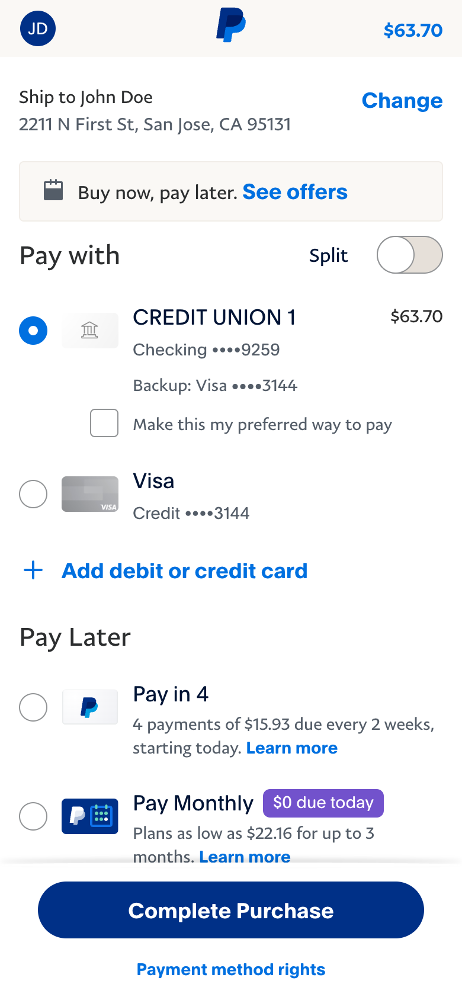
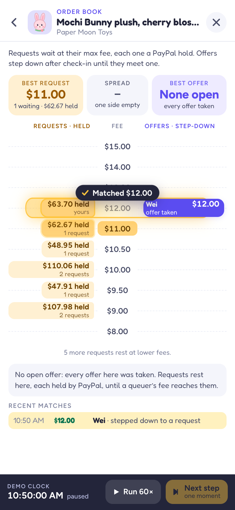
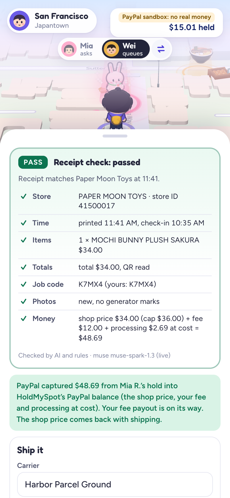
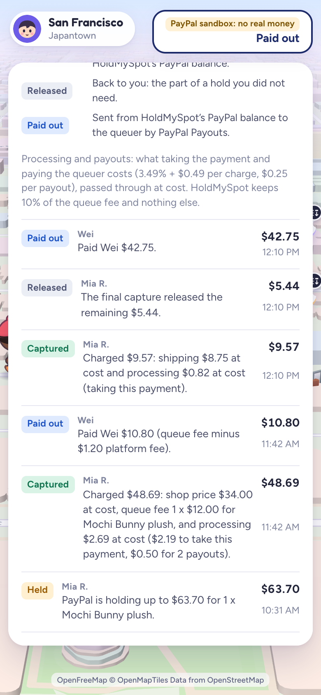
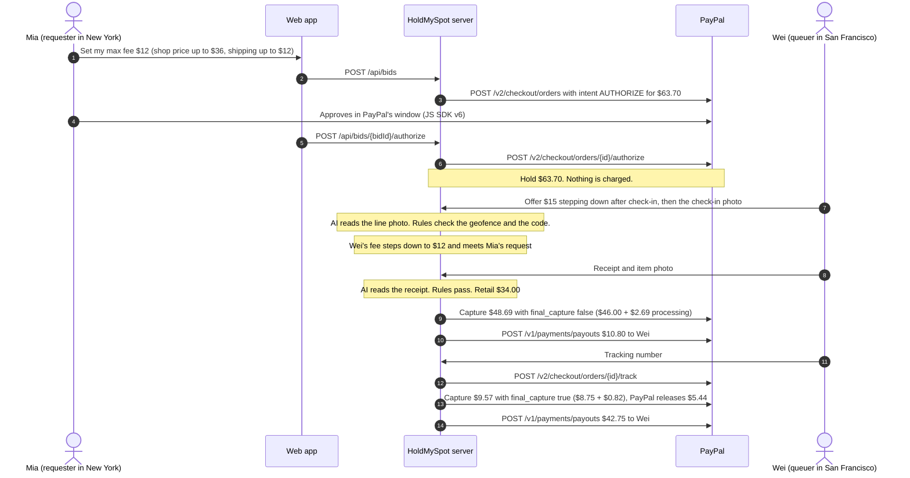
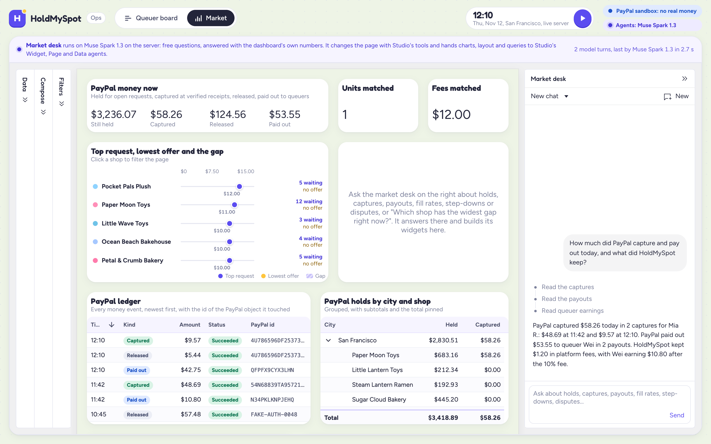
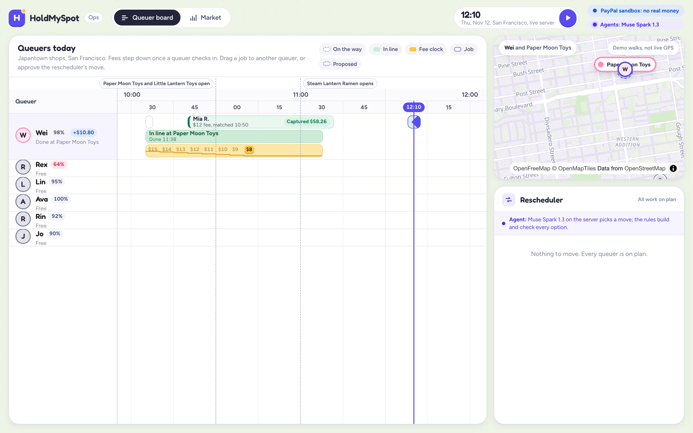
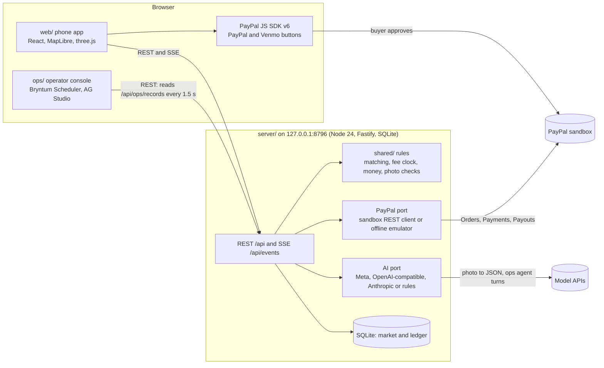

# HoldMySpot

**Pay someone near the shop to stand in line for you. PayPal holds the most it could cost; you are charged only what an AI-checked receipt proves.**

|  |  |  |  |
|:---:|:---:|:---:|:---:|
| **1. Hold.** Mia approves \$63.70 in PayPal's own window. Nothing is charged yet. | **2. Match.** Wei's fee steps down until it meets her \$12. | **3. Proof.** AI and rules pass his receipt; PayPal captures \$48.69. | **4. Settle.** Shipping is captured at cost, \$5.44 is released, Wei is paid by Payouts. |

**Shot on the real PayPal sandbox**, one errand through the web app on 2026-11-07 with a live AI model: authorization `88232929HR885933A`, captures `54N68839TA957213Y` and `4U786596DF2537313`, payout batches `88H3RUEBP9L4W` and `32VC3V9YGQ78C`. Read back from PayPal, every amount and every PayPal fee matched the server's ledger to the cent. [Every id](#proof-on-the-real-paypal-sandbox) | [Run it with no keys](#quick-start-with-zero-keys)

Some things are sold only in person, in long lines: a viral bakery's cake, a one-per-customer plush drop, a famous bowl of ramen. Paying a stranger to queue for you fails on trust: the requester fears paying for nothing, and the queuer fears spending his own cash at the counter and never being paid back. HoldMySpot is a live market for queue errands:

- **Request.** A requester anywhere in the US asks for an item at a shop and sets the most they will pay someone to queue for it. The request is a PayPal authorization hold for their whole limit, and it lights up the shop on a 3D map.
- **Offer.** Queuers nearby see the fee, the walk, the wait and what it pays per hour, and offer to go. Once a queuer checks in (geofence plus an AI-read line photo), his fee can step down on a clock to a floor he chose, so a queuer already in line still finds work: requests that offered less fill as the clock reaches them. Nobody can run a falling fee from home.
- **Proof.** He buys the item and uploads the receipt. AI reads it and rules check it. A fake receipt moves \$0.
- **Capture.** Only then does PayPal capture the shop price plus the matched fee, then the shipping at cost once tracking is on the order, each capture with its processing at cost. The rest of the hold is released.
- **Payout.** The captures land in HoldMySpot's PayPal balance, and PayPal Payouts pays the queuer from it.

**Why PayPal**

- **Strangers, real money.** The authorization proves the requester's money is there before the queuer spends his own at the counter, and it charges the requester nothing yet.
- **Charge only what is proven.** Partial captures charge the receipt, then the shipping, the last one with `final_capture`; PayPal releases the rest of the hold. A failed proof captures nothing.
- **Paying casual queuers.** Payouts pays a queuer by email, so a queuer needs a PayPal account, not merchant onboarding.

**For judges.** Built for the PayPal AI Hackathon (Devpost).

| Topic | Where |
|---|---|
| Setup | [Quick start with zero keys](#quick-start-with-zero-keys): Node 24, then `npm run setup` and `npm run demo`; no keys, no accounts. On your own PayPal sandbox app: [Real PayPal sandbox](#real-paypal-sandbox-with-your-own-app). |
| PayPal | [How HoldMySpot uses PayPal](#how-holdmyspot-uses-paypal): each PayPal API and SDK feature, what it does here, its sandbox proof and its code. |
| AI | [How HoldMySpot uses AI](#how-holdmyspot-uses-ai): each model and service, what it does, and what code decides instead. |
| Sponsors | [AG Studio](#ag-studio-ag-grid-the-market-dashboard): the market dashboard, with a custom agent on the Studio Agent Framework that hands work to Studio's own agents. [Bryntum Scheduler](#bryntum-scheduler-the-queuer-board): the queuer board, whose rescheduler moves jobs inside each requester's PayPal hold. |
| Other tools | [Other tools](#other-tools) |
| Proof | [Real PayPal sandbox ids](#proof-on-the-real-paypal-sandbox), [tests](#tests), [known limits](#known-limits) |
| Licence | [MIT](LICENSE) |

**Sponsor judges**, after `npm run demo` ([Quick start](#quick-start-with-zero-keys)). Both links open the ops console's in-browser replay of the demo day:

- **AG Studio:** http://127.0.0.1:5197/?backend=mock&at=12:05#/market, then **Widest gap** in the market desk panel on the right. Without a model the desk is its offline planner (the panel says so): it reads the market with our `read_market` tool and calls Studio's own `remove_widget`, `add_widget` and `configure_widget`; the panel lists each step and a spotlight widget appears. With a live model on the server (`npm run demo -- --ai live` and a key), open http://127.0.0.1:5197/#/market and ask anything: the desk hands charts to Studio's own Widget agent. Custom widgets, theming and layout tools: [AG Studio](#ag-studio-ag-grid-the-market-dashboard).
- **Bryntum Scheduler:** http://127.0.0.1:5197/?backend=mock&at=11:21, then read the two **Rescheduler** cards (hover an option to see it on the board) and click **Approve: Move to Ava at \$8.00** on Jo's, or instead drag Leo's job from Jo's row onto Ava's. Either way the move is checked with the shared matching rules and the job runs at Ava's \$8.00, inside Leo's PayPal hold. More: [Bryntum](#bryntum-scheduler-the-queuer-board).

**Also:** [30-second story](#the-30-second-story) | [Architecture](#architecture) | [For AI coding agents](#for-ai-coding-agents) | [Troubleshooting](#troubleshooting)

## The 30-second story

The demo day is a plush drop in San Francisco's Japantown on 2026-11-12 (market time). Every number below is checked by the tests and shown by `npm run demo`, and PayPal's sandbox charged the same to the cent ([Proof](#proof-on-the-real-paypal-sandbox)).

1. **10:30.** Paper Moon Toys sells the Mochi Bunny plush for \$34.00, one per customer, in person only. Twelve requests already glow over the shop; the top fee is \$11.
2. **10:31.** Mia lives in New York. She asks for one plush shipped to her: shop price up to \$36, queue fee up to \$12, shipping up to \$12, and up to \$3.70 for processing and payouts at cost. PayPal authorizes a **\$63.70 hold**. Nothing is charged.
3. **10:35.** Wei, a short walk away, offers to queue at \$15. His fee steps down \$1 every 5 minutes once he checks in, never below \$8.
4. **10:50.** Wei checks in: he is inside the shop's geofence, and the AI reads the one-time code in his line photo. His fee starts stepping down.
5. **11:05.** His fee reaches \$12 and meets Mia's request.
6. **11:16.** Rex, who took Priya's \$11 request, uploads a fake receipt. The AI reads it and the rules fail four checks (shop, printed time, totals, recycled photo). **\$0 moves**, and Priya's request goes back on the map, where Lin takes it at \$10.
7. **About 11:40.** Wei buys the plush and uploads the receipt and an item photo. PayPal captures **\$48.69** (the \$34.00 shop price, the \$12.00 fee and \$2.69 processing: PayPal's \$2.19 fee on this capture and \$0.25 for each of the two payouts), and Payouts sends Wei **\$10.80** (the fee minus HoldMySpot's 10%).
8. **14:00.** Wei ships the parcel. The tracking number goes onto Mia's PayPal order, a final capture of **\$9.57** (\$8.75 shipping and PayPal's \$0.82 fee on it, both at cost) releases the remaining **\$5.44**, and Payouts sends Wei **\$42.75** (the shop price and the shipping he paid).

Mia: held \$63.70, charged \$58.26 (\$34.00 shop price, \$12.00 fee, \$8.75 shipping, \$3.51 processing), \$5.44 released. Wei: received \$53.55 (\$42.75 back for the plush and the postage he paid, \$10.80 for his time). PayPal: \$3.51 (\$2.19 and \$0.82 on the two captures, \$0.25 on each payout), exactly the processing line. HoldMySpot: \$1.20, 10% of the queue fee. The fake receipt: \$0.

Mia pays the shop price printed on the receipt, never a markup; the fee pays Wei for his time. Every purchase is for one named requester, within the shop's per-person limit.

### The same errand, call by call

Sandbox mode; the zero-key demo sends the same requests to the emulator.



## Proof on the real PayPal sandbox

The hero errand ran twice on PayPal's sandbox on 2026-11-07: through the web app on two phones (the screenshots at the top) and through the server's HTTP API alone. After each run, its authorization, order, captures and payout batches were read back from PayPal: every amount, status and PayPal fee matched the server's ledger to the cent.

| | Web app run (the screenshots) | Server run `20261107-2047` |
|---|---|---|
| How it ran | Two phones in Playwright, played by `web/scripts/sandbox-walk.mjs`: a sandbox buyer approved Mia's hold in PayPal's own window, Wei's offer stepped down in the order book, Muse Spark read the photos live | `npm run gates -- lifecycle`: the server's HTTP API only, the buyer's approval in a headless browser, recorded AI answers |
| Order | `0LK56938DW451581H` | `6EG92708FG4945307` |
| Authorization for \$63.70, now `CAPTURED` | `88232929HR885933A` | `5XK23595W1944882C` |
| Receipt capture, \$48.69 (PayPal's fee \$2.19) | `54N68839TA957213Y` | `24U26127PB091713A` |
| Final shipping capture, \$9.57 (PayPal's fee \$0.82) | `4U786596DF2537313` | `01D83946MR897871E` |
| Released by the final capture | \$5.44 | \$5.44 |
| Tracking on the order, `SHIPPED` | `HPG-2611-57842795` | `HPG-2611-55706958` |
| Payout of Wei's fee, \$10.80 (PayPal's fee \$0.25), `SUCCESS` | batch `88H3RUEBP9L4W` | batch `5MVTE5WFTZD24` |
| Payout of the shop price and shipping, \$42.75 (PayPal's fee \$0.25), `SUCCESS` | batch `32VC3V9YGQ78C` | batch `GS8Q7QS46SBDS` |
| PayPal's fees, equal to Mia's processing line | \$3.51 | \$3.51 |
| Left with HoldMySpot: 10% of the \$12 fee | \$1.20 | \$1.20 |
| Kept in | [`proto-shots/v3/final/`](proto-shots/v3/final/): 16 phone screenshots, 3 ops console screenshots and 3 clips (D-121, D-122) | [docs/SANDBOX-GATES.md](docs/SANDBOX-GATES.md#full-job-through-the-server-sandbox), and PayPal's sanitized answers in [`server/test/paypal/fixtures/recorded/20261107-2047-lifecycle/`](server/test/paypal/fixtures/recorded/20261107-2047-lifecycle/), pinned by `server/test/paypal/sandbox-parity.test.ts` (D-120) |

- **Gates passed** ([docs/SANDBOX-GATES.md](docs/SANDBOX-GATES.md), written by `scripts/sandbox-gates.mjs`, ids and statuses only): partial and final captures (G1, G2), void after a partial capture (G3), payout by email (G6), a refund and a buyer-opened dispute settled in the seller's favour through `adjudicate` (G7), tracking on an authorized order's capture (G8), orders with `payment_source` and `PICKUP_FROM_PERSON` (G9) and the app's scopes (G11). **Waiting:** reauthorization is allowed only from day 4, so the dated holds wait for 2026-11-10 (G10). **Not on the gates page yet:** Venmo (G4), although the web app's sandbox check approved a Venmo-funded hold (authorization `7RB884471X718305E`, [docs/WEB-INTEGRATION.md](docs/WEB-INTEGRATION.md) section 5); Pay Later (G5) stays off.
- **Both captures read as final.** Once an authorization is closed, PayPal reports `final_capture: true` on every one of its captures; the server sent `false` on the \$48.69 one ([PAYPAL-MAPPING](docs/PAYPAL-MAPPING.md) section 2, step 5).
- **The first server run** (`20261107-1642`, before D-105) held \$60.00; PayPal's \$3.40 in fees on it is why the processing line exists.
- **What PayPal answered at the edges**, which the emulator copies (the full table is on the gates page):

| Call | PayPal's answer |
|---|---|
| Capture \$11.51 of a \$10.00 authorization (115.1%) | Refused: `MAX_CAPTURE_AMOUNT_EXCEEDED` |
| A final capture that brings the total to exactly 115% | Accepted |
| The same capture again with the same `PayPal-Request-Id` | The first capture again, not a second one |
| A new capture that reuses a captured invoice id | Refused: `DUPLICATE_TRANSACTION` |
| Reauthorize on day 1 | Refused: `REAUTHORIZATION_TOO_SOON` |
| Void after the final capture | Refused: `PREVIOUSLY_CAPTURED` |
| Refund \$12.01 of a \$12.00 capture | Refused: `REFUND_AMOUNT_EXCEEDED` |

## Quick start with zero keys

You need Node 24 or newer (the repo has an `.nvmrc`; `nvm install 24 && nvm use`), npm, and a browser with WebGL. Every package installs from the public npm registry, AG Studio and Bryntum included, so no account or login is needed. Checked on macOS with Node 24.15 and npm 11.12.

```sh
git clone https://github.com/eric2612115/HoldMySpot.git
cd HoldMySpot
npm run setup     # npm ci in shared/, server/, web/ and ops/ (under a minute)
npm run demo      # starts the server, the web app and the ops console; Ctrl-C stops all three
```

`npm run demo` also installs missing packages on its own. When everything answers it prints (trimmed):

```text
HoldMySpot is running (ready in 1.7 s)
  PayPal: simulated PayPal (fake mode): no network, no keys, same rules as the sandbox
  AI:     recorded answers of a real model for the demo photos (replay; no network), rules for any other photo

  Web app      http://127.0.0.1:5190/?demo=1   the market map (a phone layout)
  Ops console  http://127.0.0.1:5197/   queuer board; market dashboard at http://127.0.0.1:5197/#/market
  API          http://127.0.0.1:8796/api/health   (also /api/config, /api/books)
```

**What to click first**

1. **Ops console**, http://127.0.0.1:5197/ : press the round **Play** button next to the clock (top right). The story above runs at 60 times speed and stops at 14:01, about 90 seconds later (it jumps from 11:53 to 13:58, while the parcel waits to be shipped). Watch the queuer board while it runs: Wei's fee clock steps from \$15 down to \$12, Rex's job turns red ("Receipt failed, \$0 moved"), and Mia's job goes from Held to Captured. Then open **Market** (top left) for the AG Studio dashboard and ask the market desk in its panel (an agent on AG Studio's Agent Framework: its offline planner without a model key, a model on the server with `--ai live` and a key) "Holds and captures" or "Step-downs". By 14:01 every line has closed, so "Widest gap" finds no gap there; the replay in step 3 shows it building its widget.
2. **Web app**, http://127.0.0.1:5190/?demo=1 (a phone layout; it also works in a desktop window): tap **Mochi Bunny plush**, then **Set my max fee** and **Hold \$63.70 with PayPal**. A sheet labelled **Simulated PayPal** asks you to approve; the money chip (top right) then shows the hold. The **Mia asks / Wei queues** switch at the top shows the queuer's phone, and **Map** (bottom right) opens the overview with a list sorted by \$/hour.
3. **Replay**, http://127.0.0.1:5197/?backend=mock : the ops console's in-browser replay of the demo day. Its moment buttons (Clock opens, Two problems, Wei on the way, Lines moving, Parcels shipped) jump to 10:52, 11:21, 12:05, 12:40 and 14:10. At **Two problems** the rescheduler proposes two moves; at **Wei on the way**, "Widest gap" on the **Market** page builds the spotlight widget. The server's demo day has no late queuer, so those two problems show here; approvals and drags also work on the live server (`POST /api/ops/moves`).

Press Play first: anything you place in the web app joins the same market. To start over, press Ctrl-C and run `npm run demo` again; every start is a fresh market.

**What is simulated in this mode.** PayPal: the server's real sandbox REST client talks to an in-process emulator with PayPal's rules (ids look like `FAKE-AUTH-0065`); every screen says "Simulated PayPal". AI: the 21 demo photos replay a real model's recorded answers; other photos get a simulated reading. Live model calls so far were made with Meta's Muse Spark only ([Known limits](#known-limits)). Walks on the map are synthetic; no GPS is used. The server makes no network calls; the browser loads map tiles from OpenFreeMap.

**Useful switches**

| URL | What it does |
|---|---|
| `http://127.0.0.1:5190/?demo=1&phone=queuer` | Opens on the queuer's phone (Wei) |
| `http://127.0.0.1:5190/?demo=1&as=sam` | A San Francisco requester, for the local cake and ramen errands (Mia is in New York) |
| `http://127.0.0.1:5190/?demo=1&city=nyc` | The New York map |
| `http://127.0.0.1:5190/?demo=1&as=mia&book=plush-paper-moon` | Opens on the Mochi Bunny plush's order book ([below](#the-order-book-step-by-step)) |
| `http://127.0.0.1:5197/#/market` | The AG Studio market dashboard |
| `http://127.0.0.1:5197/?backend=mock` | The ops console on its in-browser replay of the demo day, with moment buttons, the rescheduler's proposals and drag-to-move |
| `http://127.0.0.1:5197/?backend=mock&at=11:21` | The replay at 11:21: two rescheduler proposals wait for approval |
| `http://127.0.0.1:5197/?backend=mock&at=12:05#/market` | The dashboard's replay at 12:05, where "Widest gap" builds the spotlight widget |

Ports taken? `npm run demo -- --port-offset 10` moves all three (8806, 5200, 5207). `npm run doctor` checks Node, packages, ports and keys (names only).

### The order book, step by step

Every shop item is a book. Tap the round badge on a map label, the **Order book** strip in a shop sheet or a queuer's task card, or open the link above. Requests rest on the left at their max fee, with what PayPal holds at each level; offers sit on the right at their fee now, each with its step-down path to its floor and a countdown to the next drop; the spread is in the middle and the latest matches below. In the zero-key demo the book's clock bar has **Run 60×** and **Next step**: after **Start the demo day** (or the ops console's Play), each Next step jumps the market clock to the next scripted moment or fee drop (Mia's request at 10:31, Wei's offer at 10:35, his check-in at 10:50), then from \$15 to \$14 to \$13 until his fee meets Mia's \$12 request at 11:05 and both leave the book with a "Matched" flash. `web/scripts/book-shots.mjs` takes the same walk for screenshots and a short video. Decisions D-110 to D-114.

## Real PayPal sandbox with your own app

Sandbox mode sends real calls to `api-m.sandbox.paypal.com` (no real money). The server refuses any other PayPal host, and keys never enter the repo.

1. **App.** Sign in at https://developer.paypal.com, open **Apps & Credentials**, switch to **Sandbox**, and open the Default Application or **Create App** (Merchant). Copy the **Client ID** and **Secret key 1**.
2. **Features.** On the same app page, under Features, tick **Accept payments** (authorize, capture and refunds) and **Payouts**; tick **Customer disputes** and shipment tracking if they are listed. Save. `npm run keys` reports which ones the app has.
3. **Accounts.** Under **Testing Tools > Sandbox Accounts**, pick one **Personal** account as the buyer (you sign in to PayPal's window with it; View/Edit shows its password) and a second Personal account to receive queuer payouts (create one if there is only one). The app's own Business account is the merchant; `npm run keys` finds its email and ID.
4. **Save the keys.** Run `npm run keys`. It asks for the client ID, the buyer email, the payout email and the secret (hidden input), checks them with one sandbox OAuth call, lists the app's features, and finds the merchant account from one \$1.00 sandbox order that is never approved. Everything goes to `.secrets/` (git-ignored, folder 700, files 600). Non-interactive: export `PAYPAL_CLIENT_ID`, `PAYPAL_CLIENT_SECRET`, `PAYPAL_BUYER_EMAIL` and `PAYPAL_PAYOUT_EMAIL`, then run `npm run keys -- --from-env`.
5. **Check.** `npm run doctor` ends with "PayPal sandbox mode is ready too: npm run dev:sandbox."
6. **Start.** `npm run dev:sandbox`. Every screen now says "PayPal sandbox: no real money". With an AI key saved too, photo checks call the model live.
7. **Approve a hold.** In the web app tap **Mochi Bunny plush**, then **Set my max fee** (or **Book now** when a queuer has offered). PayPal's own buttons appear: PayPal, and Venmo when PayPal reports it eligible. Click one; PayPal's window opens. Sign in as the sandbox buyer and approve. The app shows the hold, for example "\$63.70 held".
8. **Confirm on PayPal.** Sign in at https://www.sandbox.paypal.com with the app's business account (or the buyer) and open its activity: the authorization is there, not yet captured; captures and payouts appear there as errands finish. The server's ledger names the same PayPal ids: `curl -s -H 'X-HMS-User: mia' 'http://127.0.0.1:8796/api/ledger?mine=1'` lists each money line with its order, authorization and capture ids. **Cancel and release the hold** in the app voids the authorization.
9. **The whole money cycle on your sandbox, scripted.** `npm run gates -- lifecycle --out .run/gates.md --no-record` plays Mia and Wei over the server's HTTP API on its own port (8798; `--port` to change), approves the order in a headless browser as your sandbox buyer, then reads the authorization, the captures and the payouts back from PayPal and compares them with the server's ledger to the cent. It needs the buyer's sandbox login in `.secrets/sandbox-buyers.json` (`{"buyers":[{"label":"buyer","email":"...","password":"..."}]}`, git-ignored) and Playwright's Chromium (`npx playwright@1.56.1 install chromium`). `--out` and `--no-record` keep the committed evidence page and fixtures as they are. If PayPal shows a challenge (a CAPTCHA or a code), the script stops without answering it and names a screenshot of the page; holds you approve by hand (step 7) are not affected.
10. **The same errand through the web app, scripted.** `web/scripts/sandbox-walk.mjs` plays Mia's and Wei's phones in Playwright against a sandbox server with a live AI model, approves in PayPal's own window as a second sandbox personal account (`APPROVER`, never the payout receiver), checks the ledger and saves the screenshots and clips shown at the top of this page. It moves the market clock with the order book's Next step and never starts the scripted day. Its header lists what it needs: the server and web app commands, `HMS_SECRETS_DIR=.secrets` for keys saved by `npm run keys`, and ffmpeg for the clips.

Notes:
- The seeded crowd requests that fill the map stay on simulated PayPal in sandbox mode; every request you place is a real sandbox order. The Play button's scripted day is for the zero-key mode: in sandbox mode its first request waits for a PayPal approval that no screen offers, so place your own requests instead; the order book's **Next step** moves the market clock for them (D-123). To see captures and payouts on your own sandbox, use the scripted runs in steps 9 and 10.
- Pay Later stays off until it is proven with intent `AUTHORIZE` (gate G5). PayPal's own window may still list Pay Later options, which the app cannot hide.
- `npm run gates -- run --fake` runs the gate checks against the emulator with no keys (its page goes to a temporary file).

## How HoldMySpot uses PayPal

- One Orders v2 order with intent `AUTHORIZE` per request. The hold is the requester's own limit: quantity x (shop price cap + max fee) + shipping budget + the most processing the request can cost.
- Processing and payouts at cost: each capture adds what PayPal charges to take it (3.49% + \$0.49) plus \$0.25 for each payout it funds, grossed up to the cent, and the server reads PayPal's own fee back from every capture and payout. HoldMySpot keeps 10% of the queue fee and never loses money on a completed job ([docs/DECISIONS.md](docs/DECISIONS.md) D-105).
- Partial captures with `final_capture`: the receipt (shop price + fee), then the shipping at cost after tracking is added to the order. The final capture releases the rest. Captures never exceed the hold, although PayPal accepts up to 115%.
- Void when a request can capture nothing more (sold out, expired, cancelled, or done without a final capture). Reauthorize untouched holds from day 4 (on the sandbox, from 2026-11-10).
- PayPal Payouts to the queuer, only after a `COMPLETED` capture. Refunds from the ops side.
- PayPal's own JS SDK v6 buttons (PayPal, and Venmo when eligible) in sandbox mode.
- Every money call is idempotent (`PayPal-Request-Id` comes from the ledger), and every PayPal object carries an `HMS-` invoice id.
- Run against the real PayPal sandbox on 2026-11-07: the hero errand through the web app and through the server's API alone, each read back from PayPal and matched to the cent, plus PayPal's answers to edge cases ([Proof](#proof-on-the-real-paypal-sandbox)). The zero-key demo runs the same REST client against an offline emulator that copies those answers.

**Who holds the money.** HoldMySpot is the merchant on every order and pays queuers with Payouts, because a queuer is a person running one errand, not a seller. So the money does pass through HoldMySpot: PayPal holds the requester's money in the authorization, each capture lands in HoldMySpot's PayPal balance, and Payouts sends the queuer's share on: the fee minutes after the receipt capture, the shop price and shipping of a shipped item once tracking is added, a local errand's payout minutes after the handover. PayPal's multiparty or marketplace onboarding, which would pay queuers directly as PayPal sellers in the same payment, is the production path and is not built ([Known limits](#known-limits)).

**Every call**, with what the real sandbox proved on 2026-11-07 (gate ids from [docs/SANDBOX-GATES.md](docs/SANDBOX-GATES.md); "both runs" are the two errands under [Proof](#proof-on-the-real-paypal-sandbox)). The hero errand's calls in order are in [the sequence diagram above](#the-same-errand-call-by-call).

| PayPal feature | Call | What HoldMySpot does with it | Sandbox proof | Code |
|---|---|---|---|---|
| OAuth 2.0 | `POST /v1/oauth2/token` | Client credentials for every server call, cached until 60 s before they expire. `npm run keys` and `npm run doctor` use the same call to check the app's scopes. | G0, G11 | `server/src/paypal/http.ts`, `scripts/common.mjs` |
| JS SDK v6 | `createInstance`, `findEligibleMethods`, `createPayPalOneTimePaymentSession`, `createVenmoOneTimePaymentSession`, `<paypal-button>`, `<venmo-button>` | The requester approves the hold in PayPal's own window. The client ID comes from `GET /api/config`; the secret stays on the server. Fake mode shows a "Simulated PayPal" sheet instead. | The web app run: Mia's \$63.70 hold `88232929HR885933A`, approved in PayPal's own window (picture 1 at the top); earlier holds with Book now and Venmo ([WEB-INTEGRATION](docs/WEB-INTEGRATION.md) section 5) | `web/src/services/payments/paypalV6.ts`, `web/src/services/payments/approval.ts`, `web/src/ui/PayPalButton.tsx` |
| Orders v2, intent `AUTHORIZE` | `POST /v2/checkout/orders` | One order per request for its limit, with item lines, an `HMS-` invoice id, our id in `custom_id`, the soft descriptor `HOLDMYSPOT`, and `GET_FROM_FILE` shipping or `PICKUP_FROM_PERSON` for local errands. | G1 to G3, G9; both runs (orders `0LK56938DW451581H`, `6EG92708FG4945307`) | `server/src/app/bids.ts`, `server/src/paypal/wire.ts` |
| Authorize | `POST /v2/checkout/orders/{id}/authorize` | Creates the hold (valid 29 days, 3-day honor period). | Both runs: \$63.70 (`88232929HR885933A`, `5XK23595W1944882C`) | `server/src/app/money.ts` |
| Partial capture | `POST /v2/payments/authorizations/{id}/capture` with `final_capture` | Receipt capture (shop price at cost + matched fee + processing at cost), then the shipping capture (shipping + its own PayPal fee), final when it is the last one; a local errand gets one capture at the handover code. PayPal's fee comes back in `seller_receivable_breakdown.paypal_fee` and is stored on the ledger. Our code refuses any capture past 100% of the hold. | G1, G2; both runs: \$48.69 (PayPal's fee \$2.19), then \$9.57 final (fee \$0.82) | `server/src/app/money.ts`, `shared/src/money.ts` |
| Void | `POST /v2/payments/authorizations/{id}/void` | Releases a hold that can capture nothing more: a sold-out line, an expired or cancelled request, or one whose jobs are done without a final capture (also after partial captures). After a fake receipt the request first goes back on the map. | G3 (after a partial capture) | `server/src/app/money.ts` |
| Reauthorize | `POST /v2/payments/authorizations/{id}/reauthorize` | Renews an untouched hold of an open request from day 4; otherwise asks the requester to approve again. | Waiting: dated holds can be renewed from 2026-11-10 (G10); day 1 refused as expected | `server/src/app/money.ts`, `server/src/app/scheduler.ts` |
| Add tracking | `POST /v2/checkout/orders/{id}/track` | The queuer's tracking number goes onto the requester's order before the shipping capture. | G8; both runs | `server/src/app/jobs.ts` |
| Payouts | `POST /v1/payments/payouts`, `GET /v1/payments/payouts/{batch_id}` | Pays the queuer after a `COMPLETED` capture: the fee minus 10% after the receipt, the shop price and shipping after the final capture. One item per batch; `sender_batch_id` is the ledger key. | G6; both runs: \$10.80 and \$42.75, each `SUCCESS` with PayPal's \$0.25 fee | `server/src/app/money.ts`, `server/src/app/sync.ts` |
| Refunds | `POST /v2/payments/captures/{id}/refund` | Full or partial refund from the ops side (`POST /api/ops/jobs/:jobId/refund`). | G7 (refund `COMPLETED`) | `server/src/app/money.ts` |
| Status sync | `GET` captures and payout batches | A poller settles pending captures and payouts (default every 20 s). | Both runs (payout batches read back) | `server/src/app/sync.ts` |
| Webhooks | `POST /v1/notifications/verify-webhook-signature` | Client and signature check exist; the server's webhook route is not built yet (it needs a public URL), so status comes from polling. | Not connected | `server/src/paypal/webhook.ts` |
| Disputes | list, get, `provide-evidence`, `accept-claim`, `adjudicate` (sandbox) | Used by the gate script on the real sandbox; the server's dispute routes are not built yet. | G7: a buyer-opened dispute settled in the seller's favour through `adjudicate` (gate script only) | `server/src/paypal/client.ts`, `scripts/sandbox-gates.mjs` |

How the money stays safe:

- **Never above the user's limit.** PayPal accepts captures up to 115% of an authorization; HoldMySpot's code stops at 100% (`OVER_LIMIT`), and the request form says so. The hold already includes the most processing the request can cost, so passing processing through never needs more than the hold.
- **PayPal's fees are paid at cost, never out of the queuer's pay.** The requester's "Processing and payouts" line is PayPal's fee on each capture plus \$0.25 per payout, to the cent; the server records PayPal's own fee from each capture and payout and the ops console shows any difference. It is not called "PayPal processing" because PayPal's user agreement forbids a fee for accepting PayPal as a payment method; this cost is the same whichever button pays.
- **The ledger is the outbox.** Each money call first writes a `pending` ledger line with a deterministic key, sends that key as `PayPal-Request-Id`, then marks the line `succeeded` or `failed`. After a crash the server resends pending lines with the same keys, so nothing is charged twice.
- **The emulator copies the sandbox.** Fake mode is the sandbox REST client answered by `server/src/paypal/emulator.ts`, which follows the answers recorded from the real sandbox on 2026-11-07: 115% capture limit, `final_capture` closing the authorization, void after a partial capture, reauthorization only from day 4, payout batches `PENDING` first, PayPal's fees, idempotent replays. The recorded answers are test fixtures (`server/test/paypal/fixtures/recorded/`).
- **Unspent money never leaves the requester.** It stays in the PayPal authorization until a final capture or a void releases it. Captured money waits in HoldMySpot's PayPal balance only until its payout: the fee goes to the queuer right after the receipt capture; the shop price and the shipping wait for the final capture after tracking, because a claimed payout cannot be pulled back. If no tracking arrives within 5 days of the verified receipt, the job fails and the server refunds the receipt capture.

More: [docs/PAYPAL-MAPPING.md](docs/PAYPAL-MAPPING.md) (every call, order and payout bodies, errors) and [docs/DOMAIN.md](docs/DOMAIN.md) section 7 (money rules with the worked example).

## How HoldMySpot uses AI

Models read and explain; code decides money. A model never sets an amount, a provider error never passes a proof (it goes to ops review), and every AI result is stamped on screen with provider, model and mode.

| Job | When | What the model does | What decides | Code |
|---|---|---|---|---|
| Line photo check | Check-in | Reads whether a line is visible, how many people are ahead, the one-time code on paper, the storefront text | Geofence (80 m), code matches, photo not recycled (hard); line visible (soft) | `server/src/ai/proof.ts`, `shared/src/proofs.ts` |
| Receipt and item photo check | After buying | Reads the shop name, store ID, receipt number, printed time, lines and total, the job code on a sticky note next to the item, and the units visible | 7 hard checks (code, shop, receipt QR against the print, time window, totals, recycled photo, quantity) and 3 soft ones (item lines, shop price cap, image-generator metadata). Hard failure: \$0 moves. Soft failure: ops review. The capture amount comes from code. | `server/src/ai/proof.ts`, `server/src/ai/qr.ts`, `server/src/ai/phash.ts`, `shared/src/proofs.ts` |
| Fee and wait estimate | Request and offer forms, map | Counts people in the latest line photo and writes the one-line reason | The formula (wait minutes x 24 cents, rounded) | `server/src/ai/estimates.ts`, `shared/src/estimates.ts` |
| Shipping estimate | Request form (shipped items) | Writes the explanation | A rate table and the item's weight | `server/src/ai/estimates.ts`, `shared/src/estimates.ts` |
| Bidding agent (API only) | A request created with an agent goal | Proposes raise, keep, reduce or cancel | The server enforces a ceiling inside the hold: a raise that PayPal does not hold is refused (`OVER_LIMIT`, `server/test/agent.test.ts`), and the agent never touches PayPal. No screen uses it yet; without a key it follows a formula. | `server/src/ai/agent.ts`, `server/src/app/agent.ts` |

The two agents on the ops console think on the same AI port when the server runs a live model (`POST /api/ops/agents/turn`; never recorded or replayed): the market desk, a custom agent that works with AG Studio's built-in agents ([AG Studio](#ag-studio-ag-grid-the-market-dashboard)), and the queuer board's rescheduler, which picks among the moves the rules allow ([Bryntum](#bryntum-scheduler-the-queuer-board)). Without one they run offline, a planner with fixed topics and the rules' pick, and the console says so.

**Models and services.** One provider answers every AI job above (`HMS_AI_PROVIDER`; `auto` picks Anthropic, then Meta, then OpenAI, by which key is present):

| Model or service | What it does here | Key | Status |
|---|---|---|---|
| Meta **Muse Spark** (`muse`): `muse-spark-1.3` at `https://api.meta.ai/v1/chat/completions` | The jobs above: reads line photos and receipts into JSON for the rules, writes the estimates' reasons, and thinks for both ops agents when the server runs it live. The zero-key demo replays its recorded answers. | `MODEL_API_KEY` | Live on 2026-11-07 on all 21 demo photos: 21/21 verdicts, 161/164 fields, 10/10 bad proofs caught, 0/7 genuine ones failed, median 8.1 s per photo; that run is the demo's recorded answers. Also live in the web app's sandbox run: the line photo, the receipt (picture 3 at the top) and the market desk. |
| **Any OpenAI-compatible** Chat Completions endpoint (`openai`, `HMS_AI_BASE_URL`): `gpt-6.1-sol` (`HMS_AI_MODEL`) at api.openai.com by default | The same jobs | `OPENAI_API_KEY` | The code path ran live against Meta's endpoint (one photo, 4/4 fields). Not yet called with an OpenAI key. |
| Anthropic **Claude** (`anthropic`): `claude-opus-5-5` (`HMS_ANTHROPIC_MODEL`) through the official TypeScript SDK | The same jobs | `ANTHROPIC_API_KEY` | Unit-tested; not yet called live. |
| **Rules only** (`fake`): `rules-v1` | No model: a simulated reading for a photo without a recorded answer, so the rules still decide | none | Used by the tests and when no key is present. |
| **AG Studio's built-in agents**: Widget, Page and Data | Add and configure dashboard widgets, lay out the page and query the dashboard's data when the market desk delegates to them; they think on the server's model through our adapter | The server's model key (no AG key needed) | Live with Muse Spark on 11-07: the Widget agent configured a bar chart; a hand-off to the Data agent timed out ([AG Studio](#ag-studio-ag-grid-the-market-dashboard)). |

**Without a key** (`npm run demo`): the 21 rendered demo photos in `server/fixtures/proofs/` (5 line photos, 16 receipt sets, each with a `truth.json`) replay Muse Spark's recorded answers from `server/fixtures/ai/`, stamped `muse / muse-spark-1.3 / replay`, and the rules decide exactly as in a live run. Other photos (the script's placeholders, your own uploads) get a simulated reading stamped `fake / rules-v1`. Estimates use the formulas. Nothing touches the network.

**With a key**: `npm run keys` (AI section) or `OPENAI_API_KEY=... npm run keys -- --from-env`, then `npm run demo -- --ai live` (sandbox mode uses a saved key on its own). Photos you upload on the queuer's phone and the estimate explanations then go to the model. The scripted day's staged photos keep their recorded readings, so the demo's numbers never change; to send the 21 demo photos to your model, run `npm run ai:eval -- --live` (21 model calls; it prints the accuracy table below). `npm run doctor -- --live-ai` makes one tiny call to check the key.

`npm run ai:eval` with no key replays the recorded answers offline in about a minute: one line per photo, each ending with the stamp of the answer it replayed (`muse/muse-spark-1.3/replay`), then a summary:

```text
Cases: 21 (16 purchase proofs, 5 line photos)
Answers: 21 replayed from recorded muse/muse-spark-1.3 answers. No model was called in this run.
Verdict accuracy:         21/21 = 100.0%
Exact failed-check sets:  21/21 = 100.0%
Money (retail, capture):  8/8 = 100.0%
Fields read correctly:    161/164 = 98.2%
Bad proofs caught:        10/10; genuine proofs wrongly failed: 0/7
```

The "Answers" line counts where each answer came from, by its stamp: replayed recordings (no model call), live answers (`--live` or `--record`), or the rules-only reader for a photo without a recording. The money line checks the full capture, processing at cost included. The 21 cases are 10 bad proofs (expected `failed`), 7 genuine ones (`passed`) and 4 that belong in ops review (`needs_review`: a line photo with no line visible, a price over the requester's cap, an extra line on the receipt, and image-generator metadata). All 21 photos are synthetic, rendered by `server/scripts/render-receipts.ts`; accuracy on real receipts is not measured.

More: [docs/AI-SERVICES.md](docs/AI-SERVICES.md).

## Sponsor technology: AG Studio and Bryntum

Both live in the ops console (`ops/`), http://127.0.0.1:5197/ after `npm run demo`. Neither needs a key, and both install from the public npm registry. Each runs on the live server and on the console's in-browser replay (`?backend=mock`).

### AG Studio (AG Grid): the market dashboard



*The sandbox server at 12:10, after the web app run. Asked "How much did PayPal capture and pay out today, and what did HoldMySpot keep?", the market desk (Muse Spark, two model turns) read the captures, the payouts and the queuer earnings with `read_market` and answered from them: \$58.26 captured in two captures, \$53.55 paid out to Wei, \$1.20 kept. The PayPal ledger grid lists the sandbox ids; the seeded crowd's requests stay on simulated PayPal (`FAKE-` ids).*

**Where:** ops console > **Market** (`#/market`), on the live server and on the zero-key replay, for example at 12:05: http://127.0.0.1:5197/?backend=mock&at=12:05#/market.

| What AG Studio offers | How the dashboard uses it | Code |
|---|---|---|
| **Custom widgets** | Three widget types registered with Studio, each with field roles that Studio's panels and AI tools can map: the gap board (top request, lowest offer and the gap per shop), the depth ladder, and the gap spotlight the agent builds. Studio's Compose panel lists them under "HoldMySpot". | `ops/src/market/widgets/` |
| **Theming** | `studioTheme.withParams` with the app's palette, rounded widgets, Fredoka titles and a pale green canvas, and Studio's grid params for the grids (lilac header, soft rows, a pinned total row). Field names replace Studio's "(sum)" labels (`localeText`). | `ops/src/market/theme.ts`, `ops/src/market/MarketView.tsx` |
| **AG Grid inside Studio** | The first screen holds the **PayPal ledger** (Studio's grid widget: time, kind and status pills, amount, PayPal id) and the **holds by city and shop** (the pivot table widget: grouped rows, subtotals, a pinned total); a payouts grid with a pinned total sits below. The pills and PayPal ids are React cell renderers passed through the grid widgets' `createCellRenderer` option. | `ops/src/market/studioState.ts`, `ops/src/market/widgets/cells.tsx` |
| **Layout tools** | Studio runs in edit mode with its Data, Compose and Filters panels: an operator can add, move, resize, duplicate and delete widgets and drag fields onto them, and Studio keeps the layout while the market data refreshes. Every dataset joins a shops table, so a click on a shop filters the page. | `ops/src/market/MarketView.tsx`, `ops/src/market/studioState.ts` |
| **Studio Agent Framework** | Our own harness (`createAiHarness`, Studio's `ai` prop) whose primary agent is the market desk, a custom agent that **delegates to three of Studio's built-in agents** (Widget, Page, Data) with `delegate_to`. All four run as `directLlmRunner`s on our `AgLlmAdapter`, whose LLM is the HoldMySpot server's AI port (`POST /api/ops/agents/turn`; the key stays on the server). The desk reads the market with our `read_market` tool and acts with Studio's `add_widget`, `remove_widget`, `position_widget` and `view_page`, plus two tools of ours that run Studio's own (`add_gap_spotlight`, `filter_shop`); Studio runs every call and lists each step and delegation in its AI panel. | `ops/src/market/agent/` |

- **Ask it anything about the market.** With a live model on the server (for example `npm run demo -- --ai live` with Meta's key, `HMS_AI_KEY_FILES=<file>#MODEL_API_KEY`), the desk takes free questions about holds, captures, payouts, fill rates, step-downs and disputes, and answers with numbers from `read_market` only (the snapshot the console draws: code decides the figures). Checked live on 11-07 with Muse Spark 1.3: "How much is PayPal holding right now, and did any capture fail?" took two turns (17 s) and answered with the held, captured and released totals and Rex's rejected receipt; "Chart the money PayPal captured, by shop" added a bar chart, handed it to Studio's Widget agent, which configured it (category `shops.shop`, sum of `holds.capturedUsd`) and checked it, and named the largest capture with its PayPal id (ten turns, 95 s; a hand-off to the Data agent in the same run timed out, and the desk answered from `read_market`).
- **Without a model** the desk is an **offline planner**, and the AI panel title, the strip above Studio and the top bar say so: it maps a question by keywords to the same topics ("Widest gap", "Holds and captures", "Fill rates", "Step-downs", "Disputes"), builds the gap spotlight or the depth ladder through the same Studio tools, and filters the page for "only <shop>". On the replay (`?backend=mock`) the desk stays offline unless the URL adds `?agents=model`, so the scripted checks never call a model.
- **Data:** the eight datasets the server's API serves (fills, bids, asks, jobs, holds, ledger, payouts, books) at `GET /api/ops/datasets/:name`, built once in `shared/src/opsviews.ts`, plus the shops table. The page holds a PayPal money tile, two value tiles, the gap board, the PayPal ledger and holds pivot, three AG charts (matches over time, queuer earnings, holds versus captures), the depth ladder and the payouts grid. Code: `ops/src/market/studioData.ts`, `ops/src/market/studioState.ts`.
- **Keys:** none needed. AG's trial mode unlocks every feature, the AI panel included; AG Studio then prints "License Key Not Found" in the browser console, and on hosts other than `localhost` and `127.0.0.1` it shows a "For Trial Use Only" watermark for about five seconds. An **AG Studio Pro with AI** trial key from AG Grid removes both: `npm run keys` (AG section), or `AG_STUDIO_LICENSE_KEY=... npm run keys -- --from-env`, or `VITE_AG_STUDIO_LICENSE_KEY` in `ops/.env.local`. It is read when the ops dev server or build starts and never printed. An AG Grid and AG Charts Enterprise key is optional, since every grid and chart here is drawn inside AG Studio. With the ops dev server running, `npm run licence:check` in `ops/` reports what AG makes of the keys, and that AG Studio drew the grids and the three charts and the agent answered ([Tests](#tests)). Details: [ops/README.md](ops/README.md#licences).

### Bryntum Scheduler: the queuer board



*The sandbox server at 12:10, after the web app run: Wei's row holds his walk, his time in line, his fee clock from \$15 and Mia's job (matched at \$12 at 10:50, captured \$58.26); the map follows him to Paper Moon Toys; the rescheduler runs on Muse Spark and has nothing to move. Its two proposals are on the replay at 11:21 (`?backend=mock&at=11:21`).*

- **Where:** ops console > **Queuer board** (the default page), on the live server and on the replay, http://127.0.0.1:5197/?backend=mock&at=11:21. Approvals and drags reach the server through `POST /api/ops/moves`, which checks every move again with its own rules (D-102).
- **Two problems at 11:21.** Jo is 2.7 km from Little Lantern Toys and will miss his check-in window at 11:25, so the rescheduler proposes moving Leo's plush to Ava, already in line, at \$8.00, under Leo's \$10.00 max fee. Noor's hold, funded with Venmo, is past its honor period and needs a new approval (the server does not reauthorize Venmo-funded holds until the sandbox shows it works), while Rin waits in line for Noor's two cakes; the rescheduler proposes giving the cakes to Sam and Leo, whose holds can still capture, at \$8.50 each. Each card lists every option the rules allow (for Jo: move to Ava, give Jo 9 more minutes, release Jo now); hovering one draws its dry run on the board, and **Approve** applies the selected one at once. Without approval, Jo's claim lapses at 11:25 and the rules give the plush to Ava then; Rin buys Noor's cakes at noon and the capture fails.
- **Payment-aware moves.** A proposal or a drag is checked with the shared matching rules: the same item at the same shop, room left in a compatible offer, and that queuer's current fee at or under the request's max fee. The job then runs at that fee, so the requester's PayPal hold still covers it and never has to grow. A refused drop says why.
- **The rescheduler is an agent that drives the schedule** (D-101). Rules find a queuer who cannot reach the shop before the window closes, or whose ETA passed without a check-in, and jobs on a hold that can no longer capture; they build every move they allow (**reassign**, **shift the window**, **release**, **free the units** of an unpayable hold) and dry-run each for the ghost bars. A model on the server's AI port then picks one option per problem and writes the reason the card shows ("Agent pick"); it can only choose among the rules' options, never set an amount. Checked live on 11-07: Muse Spark 1.3 picked "move to Ava at \$8.00" for Jo ("Jo is 2.7 km away and has not moved, so Ava buys soon") and "give them to Sam and Leo" for Noor in one turn (4.9 s). Without a model the rules' pick shows ("Rules pick", and "Rules only" on the panel).
- **What the board draws:** one row per San Francisco queuer. Bars show the walk to the shop (arrival window), the time in line, the fee clock drawn as a staircase with the price at each step, and one job per requester with its money state (Held, Captured, or failed with the reason). A market-clock line runs across; shop openings have their own lane. The MapLibre map beside it follows the selected queuer and shop, with the walk and the geofence.
- **Bryntum features used:** the React wrapper (`BryntumScheduler`), a minute-and-hour view preset with 15-minute ticks, stacked events in our own lane order, an `eventRenderer` for every bar (the fee-clock staircase included), a column renderer per queuer (reliability, earnings, status), event tooltips that list each fee step, drag with a `validatorFn` that runs the shared rules and an asynchronous drop finalize, `scrollToDate` to keep the market clock in view, and row and bar clicks synced to the map.
- **Code:** `ops/src/board/QueuerBoard.tsx` (the `BryntumScheduler` React component), `ops/src/board/boardModel.ts`, `ops/src/board/MapPanel.tsx`, `ops/src/board/ReschedulerPanel.tsx`.
- **Package and key:** `@bryntum/scheduler-community` and `@bryntum/scheduler-react-community` 8.0.0, MIT licensed, from the public npm registry, so a judge's clone needs no Bryntum account or trial key and shows no trial badge. The market-clock line and the shop-opening labels are an overlay placed with the scheduler's `getCoordinateFromDate`.

## Other tools

| Tool | What it does here |
|---|---|
| Node.js 24 and TypeScript 5.9 | The server runs its TypeScript directly (`node src/main.ts`); `npm test` type-checks all four packages. |
| Fastify 5, Zod 4 and `node:sqlite` | The server's REST and server-sent-events API, request validation, and the market and ledger in one SQLite file. |
| React 19 and Vite 8 (with Zustand and React Router in the web app) | The phone web app and the ops console. |
| MapLibre GL JS with OpenFreeMap tiles | The maps in the web app and beside the Bryntum board. |
| three.js | The 3D scene over the map: KayKit City Builder and Restaurant Bits props (CC0), characters and items drawn in code. |
| jsQR, jpeg-js and qrcode | Reading a receipt's QR code against its print, decoding JPEG photos, and drawing the QR codes on the synthetic demo receipts. |
| Playwright with Chromium | Approving sandbox orders as the test buyer in the gate script, rendering the 21 demo photos, and the screenshots, clips and sponsor checks. |
| ffmpeg | Joins the sandbox walk's frames into its three clips. |
| node:test and Vitest | The test suites: node:test for shared, server and ops; Vitest for the web app. |
| Fontsource: Figtree and Fredoka | The fonts. |

## Tests

```sh
npm test              # shared, server, web and ops: type checks and tests, about 40 s, ends with "All green: 6 steps"
npm test -- --build   # also the web and ops production builds
```

The suites run without keys or network (the runner removes `HMS_*`, `PAYPAL_*` and AI key variables). They cover the worked money example; the matcher and the fee clock; the hero day end to end over HTTP with the real PayPal client on the emulator (held \$63.70, captures \$48.69 and \$9.57, \$5.44 released, payouts \$10.80 and \$42.75, PayPal's fees equal to the processing line, Rex \$0); HoldMySpot's margin on every job type (`server/test/processing.test.ts`); sandbox mode refusing to start without its settings (`server/test/config.test.ts`); the same day on the recorded model answers; the photo rules on every demo photo; every route; the recorded sandbox answers mapped by the client (`server/test/paypal/recorded.test.ts`); the emulator pinned to them (`server/test/paypal/sandbox-parity.test.ts`); the ops agents' model turns (a stand-in model) and moves applied on the server (`server/test/opsAgents.test.ts`); and, in `ops/`, the rescheduler's options and dry runs at 11:21, what happens without approval or with a shifted window, the desk's facts, and the widest gap at 12:05 (Steam Lantern Ramen, \$2.00).

**Sponsor screens in a headless browser.** With `npm run demo` running and Playwright's Chromium installed (`npx playwright@1.56.1 install chromium`), from `ops/`:

```sh
OUT_DIR=../.run/ops-shots npm run shots   # exit 0, three "saved" lines: the Bryntum board with its job bars and the map
                                          # (11:21), the AG Studio dashboard after the agent's spotlight (12:05), and the
                                          # board after both approvals; the PNGs go to .run/ops-shots (git-ignored)
npm run licence:check                     # exit 0: "Drawn by AG Studio: 3 grid(s), 3 chart(s); market desk agent answered"
```

Both open the console's replay, so the server's state does not matter. Without an AG key the second ends "Verdict: not fully licensed. Every feature still works (AG trial mode)". With other ports, add `BASE_URL=http://127.0.0.1:<ops port>`.

## Architecture



Every command runs in one SQLite transaction and appends its events to an outbox; after the commit they reach the web app over server-sent events, and the ops console reads every record every 1.5 seconds. The market clock belongs to the server (the demo runs it at 60 times speed). In code the market is a walking order book: bids (requests) and asks (offers) matched by price-time priority, with the fee clock on the asks. The apps share one typed contract, `shared/src/contract.ts`.

| Path | What is there |
|---|---|
| `shared/src/` | The contract (REST and SSE types) and the pure rules: `money.ts` (limits, captures, payouts, renewals), `matching.ts` (price-time priority), `stepdown.ts` (the fee clock), `proofs.ts` (photo checks), `seed.ts` (fictional shops, items and people), `opsviews.ts` (dashboard datasets). TypeScript source, no build step. |
| `server/src/app/` | Commands and queries: bids, asks, jobs, money (the ledger outbox), the scheduler, the PayPal poller and the ops agents' moves (`opsAgents.ts`). |
| `server/src/paypal/` | The REST client (`client.ts`), the sandbox adapter (`sandbox.ts`) and the emulator (`emulator.ts`). |
| `server/src/ai/` | Providers (Meta, OpenAI-compatible, Anthropic, rules), the photo pipeline, estimates, the bidding agent, the ops agents' model turns (`opsTurn.ts`). |
| `server/src/demo/` | The demo director and its scripts (the hero day, a local errand, a renewal). |
| `server/fixtures/` | `proofs/`: the 21 rendered demo photos with their truth; `ai/`: the recorded model answers. |
| `server/test/` | node:test suites; `paypal/fixtures/recorded/`: sanitized answers from the real sandbox. |
| `web/src/` | The phone app: map and 3D scene (`map/`, `three/`), the requester's sheets, the queuer's phone (`ui/queuer/`), PayPal (`services/payments/`). |
| `ops/src/` | The ops console: `board/` (Bryntum), `market/` (AG Studio), `data/` (live server or in-browser replay). |
| `scripts/` | The root commands: `setup.mjs`, `dev.mjs` (the launcher), `doctor.mjs`, `setup-keys.mjs`, `test-all.mjs`, `sandbox-gates.mjs`. |
| `docs/` | [ARCHITECTURE](docs/ARCHITECTURE.md), [DOMAIN](docs/DOMAIN.md), [PAYPAL-MAPPING](docs/PAYPAL-MAPPING.md), [AI-SERVICES](docs/AI-SERVICES.md), [API](docs/API.md), [SANDBOX-GATES](docs/SANDBOX-GATES.md), [WEB-INTEGRATION](docs/WEB-INTEGRATION.md), [DECISIONS](docs/DECISIONS.md). |

Root commands: `setup`, `demo` (alias `start`), `dev:sandbox`, `keys`, `doctor`, `test`, `gates`, `ai:eval`. Each takes `-- --help`.

## For AI coding agents

Everything runs without keys or prompts. Follow these in order from the repo root; [AGENTS.md](AGENTS.md) has the same steps and the rules for changing the code.

```sh
node --version                       # v24 or newer
npm run setup                        # exit 0, ends "Installed in N s."
npm run -s doctor -- --json          # pure JSON; exit 0 and "ok": true when the zero-key demo can start
npm test                             # exit 0, ends "All green: 6 steps in N s."
npm run ai:eval                      # exit 0, about a minute; its table reports verdict accuracy 21/21 (100.0%)
npm run demo -- --smoke              # starts all three, checks each, stops; exit 0, "Smoke check passed"
```

Run `doctor` before the demo starts: it reports ports in use, including the demo's own. To drive the demo over the API, start it in the background and wait for the server:

```sh
mkdir -p .run && npm run demo > .run/demo.out 2>&1 &
until curl -sf http://127.0.0.1:8796/api/health; do sleep 1; done
# {"ok":true,"mode":"fake","contractVersion":"1.0.0","uptimeMs":...}

curl -s -X POST http://127.0.0.1:8796/api/demo/start -H 'content-type: application/json' -d '{"scriptId":"hero","speed":600}'
until curl -s http://127.0.0.1:8796/api/demo/state | grep -q '"finished"'; do sleep 1; done   # about 10 s at 600x

for who in mia wei; do curl -s -H "X-HMS-User: $who" 'http://127.0.0.1:8796/api/ledger?mine=1' \
  | node -e "let s='';process.stdin.on('data',d=>s+=d).on('end',()=>console.log(JSON.parse(s).entries.map(e=>e.kind+' '+e.amount.cents+' '+e.status).join(', ')))"; done
# released 544 succeeded, captured 957 succeeded, captured 4869 succeeded, held 6370 succeeded
# paid_out 4275 succeeded, paid_out 1080 succeeded
# (captures include processing and payouts at cost: PayPal's fees, $3.51 in all, docs/DECISIONS.md D-105)

# Sponsor screens (needs Playwright's Chromium: npx playwright@1.56.1 install chromium)
(cd ops && OUT_DIR=../.run/ops-shots npm run shots && npm run licence:check)
# three "saved .../.run/ops-shots/ops-0N-....png" lines, then
# Drawn by AG Studio: 3 grid(s), 3 chart(s); market desk agent answered

npm run demo -- --stop               # stops only what the launcher started
```

- **Ports:** server 8796, web 5190, ops 5197. `--port-offset N` adds N to all three; `--server-port`, `--web-port` and `--ops-port` set one each (pass the same flags to `--stop` and to `doctor`, use the server port in the URLs, and set `BASE_URL=http://127.0.0.1:<ops port>` for the two sponsor checks). An instance on another server port keeps its own SQLite file.
- **More checks:** `GET /api/config` (mode and reason, AI provider, clock), `GET /api/demo/state`, `GET /api/ops/records` (every record). `POST /api/demo/reset` with `{"scriptId":"hero"}` goes back to 10:30. [docs/API.md](docs/API.md) lists every endpoint.
- **Logs and process ids:** `.run/logs/` and `.run/dev-<port>.json`. `npm run demo -- --dry-run` prints what would start, without starting it.
- **Keys:** `npm run keys -- --from-env` reads the variables in `npm run keys -- --help`; values are never printed. Never commit `.secrets/`.
- **What is not built or not proven yet:** [Known limits](#known-limits).

## Known limits

- **PayPal's fees are passed through at a fixed schedule.** The processing line uses the rate the sandbox charged on 2026-11-07 (3.49% + \$0.49 per capture, \$0.25 per payout); the server compares it with PayPal's reported fee, but a difference (another rate, an international buyer) is only shown to ops and settled by hand. A refund after a capture loses the capture fee PayPal keeps, and a queuer who never ships keeps the fee payout. Both sandbox runs of the hero errand ([Proof](#proof-on-the-real-paypal-sandbox)) were charged exactly this schedule: \$2.19 and \$0.82 on the captures, \$0.25 per payout.
- **Production PayPal steps are not built:** PayPal's approval as a marketplace, multiparty or marketplace onboarding so queuers are paid directly as PayPal sellers instead of through HoldMySpot's balance, Payouts approval for live use, Venmo payouts (they need US phone numbers) and webhooks on a public URL ([docs/PAYPAL-MAPPING.md](docs/PAYPAL-MAPPING.md) section 11).
- **Sandbox proof still open:** reauthorization of the dated holds from 2026-11-10 (G10); Venmo is not recorded as gate G4 yet; Pay Later stays off (G5). Webhooks are not connected (status comes from polling), and disputes run only in the gate script (G7); the server's dispute routes are not built.
- **Sandbox mode by hand:** the Play button's scripted day needs the zero-key mode (in sandbox mode it waits for a PayPal approval that no screen offers); captures and payouts on your own sandbox come from `npm run gates -- lifecycle` or `web/scripts/sandbox-walk.mjs` (steps 9 and 10 of the sandbox section).
- **Live AI:** only Meta's Muse Spark has been called live (all 21 demo photos, the ops agents, and the web app's sandbox run). The OpenAI provider's default model `gpt-6.1-sol` has not been called with an OpenAI key, and the Anthropic provider has not been called live; `auto` picks Anthropic first when its key is present (`HMS_AI_PROVIDER` picks another).
- **Agents:** the ops console's agents need a live model on the server to think (offline they are a planner with fixed topics and the rules' pick); with Muse Spark a chart through Studio's Widget agent takes about ten turns, and a delegate can fail on a large schema (the desk then says the widget is not configured). The bidding agent has no screen yet (API only; without a key it follows a formula).
- **Ops on the live server:** approvals and drags work there (`POST /api/ops/moves`), but the server's demo day has no late queuer, so the rescheduler's two problems show on the replay. The console draws queuer positions from the synthetic walk model and does not read the server's `queuer.moved` events yet, so on the server a late queuer is found by his ETA passing without a check-in.
- **Test data:** all 21 demo photos are synthetic, and so are the walks on the map.
- **Platforms:** checked on macOS (Node 24.15, npm 11.12); there is no CI yet.

## Troubleshooting

| Problem | Fix |
|---|---|
| "Node X is too old" | Install Node 24 or newer: `nvm install 24 && nvm use` (the repo has `.nvmrc`). The server runs TypeScript directly and uses `node:sqlite`. |
| "a port is taken" | Another program holds 8796, 5190 or 5197. Use `npm run demo -- --port-offset 10`. If an earlier launcher is still running, `npm run demo -- --stop` stops what it started. |
| `npm ci` fails | Check the network and the Node version (`npm run doctor`), then run `npm run setup` again. |
| `npm run dev:sandbox` refuses to start | It names the missing settings. Run `npm run keys` (the payout receiver is `PAYPAL_PAYOUT_EMAIL` there), then `npm run doctor`. |
| `--ai live` refuses to start | No AI key was found. Add one with `npm run keys` (AI section), or leave out `--ai live`. |
| PayPal's window does not open | Allow pop-ups for `127.0.0.1`, then click the button again. |
| The map stays blank | The browser needs WebGL and internet access for the OpenFreeMap tiles. |
| "License Key Not Found" in the browser console, or a short watermark | AG Studio's trial mode; everything still works. Add an AG Studio key (see Sponsor technology) to remove it. |
| The board looks empty after the Play run | The board follows the clock, which stops at 14:01. Scroll the board sideways back to 10:30 to see the whole day, open **Market**, or open the replay (`?backend=mock`), whose moment buttons jump to set times. |
| "Widest gap" finds no gap | After the Play run every line has closed. Ask "Top earner" or "Held versus captured", or open the replay at 12:05 (`?backend=mock&at=12:05#/market`). |
| Start over | Ctrl-C, then `npm run demo` again (a fresh market each start), or `POST /api/demo/reset` with `{"scriptId":"hero"}`. |

## Licence and attribution

HoldMySpot is released under the [MIT Licence](LICENSE).

- **3D props:** KayKit City Builder Bits and Restaurant Bits by Kay Lousberg (www.kaylousberg.com), CC0, in `web/public/models/` with their licence files. The characters and item models are drawn in code.
- **Map:** tiles and the "liberty" style from OpenFreeMap, data from OpenStreetMap contributors through OpenMapTiles; the attribution is shown on every map. Rendered with MapLibre GL JS (BSD-3-Clause).
- **Fonts:** Figtree and Fredoka (SIL Open Font License 1.1), bundled through Fontsource.
- **Sponsor libraries:** AG Studio, AG Grid Enterprise and AG Charts Enterprise (commercial; they run in AG's trial mode without a key, or with your own trial key); Bryntum Scheduler Community (MIT).
- **Libraries:** React, three.js, Vite, Vitest, Zustand, React Router, Fastify, Zod, qrcode (MIT); TypeScript, jsQR, the Anthropic TypeScript SDK and Playwright (Apache-2.0); jpeg-js (BSD-3-Clause). PayPal's JS SDK is loaded from PayPal at run time.
- **Fictional content:** every shop, item, person, store ID and receipt in the demo is made up. The demo photos are rendered by `server/scripts/render-receipts.ts`.
