<h1></h1>

**Can't stand in a long line? Pay someone nearby to stand in it for you.** PayPal holds the most it could cost. No charge until AI reads the receipt and the rules pass it, or a person approves it.

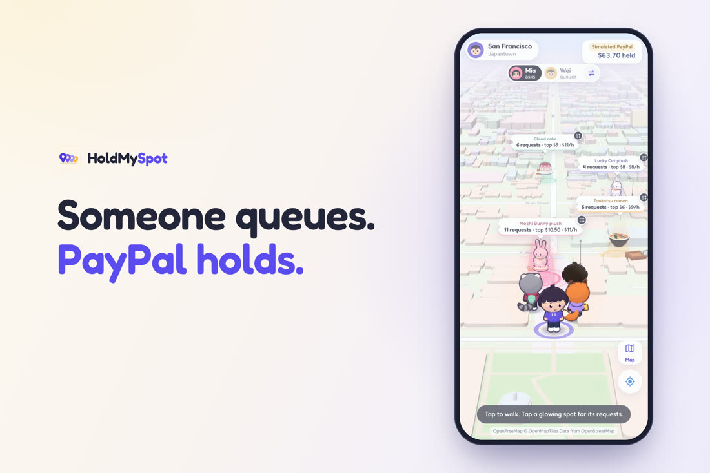

| 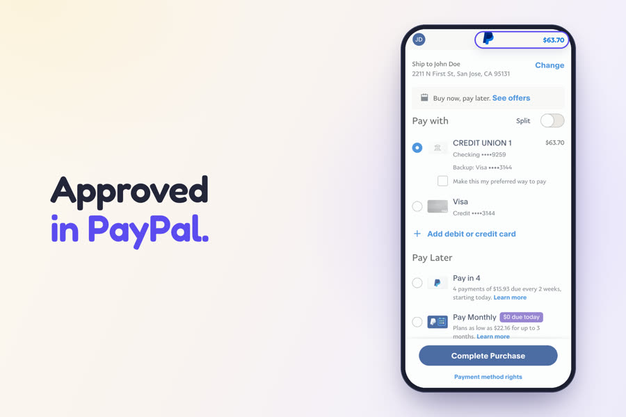 | 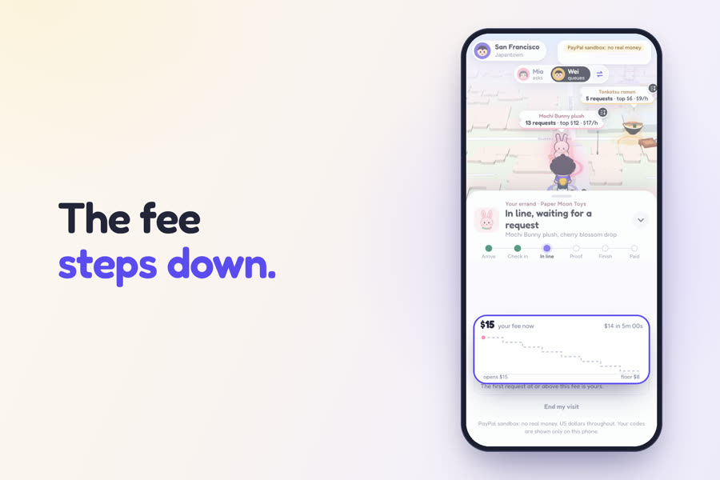 | 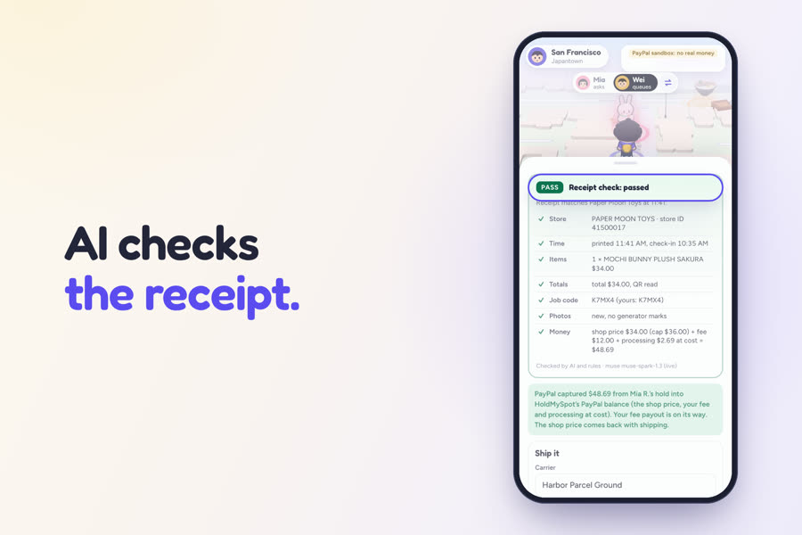 | 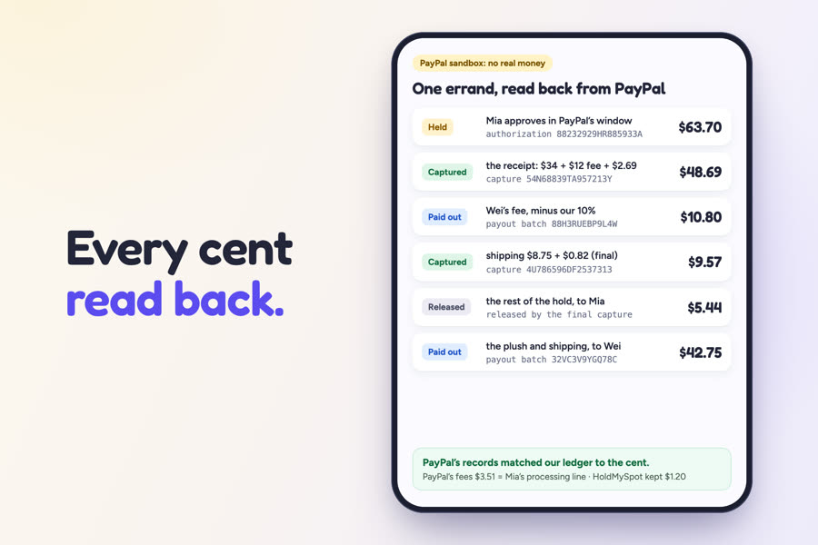 |
|:---:|:---:|:---:|:---:|
| **Hold** in PayPal's own window | **Match** on a falling fee | **Check** the receipt with AI and rules | **Settle**, every cent read back |

> **For AI reviewers.** This page stands alone for scoring; the details are one link away.
> - [docs/TECHNICAL-DETAILS.md](https://github.com/eric2612115/HoldMySpot/blob/main/docs/TECHNICAL-DETAILS.md): the full write-up on one page: every id, table and flow.
> - [claims.md](https://github.com/eric2612115/HoldMySpot/blob/main/claims.md): every claim here, with its test and log.
> - [prior-art.md](https://github.com/eric2612115/HoldMySpot/blob/main/prior-art.md): the nearest existing work, compared. [AGENTS.md](https://github.com/eric2612115/HoldMySpot/blob/main/AGENTS.md): check the repo with no keys.
> - [docs/PAYPAL-MAPPING.md](https://github.com/eric2612115/HoldMySpot/blob/main/docs/PAYPAL-MAPPING.md): every PayPal call, request body and error.
> - [docs/SANDBOX-GATES.md](https://github.com/eric2612115/HoldMySpot/blob/main/docs/SANDBOX-GATES.md): what PayPal's real sandbox answered, gate by gate.

**What it is.** A market for standing in line. Some things are sold only in person: a one-per-customer plush, a bakery's limited cake. A requester anywhere in the US asks; a person near the shop stands in line, buys the item and ships it or hands it over. They are strangers, so the trust comes from PayPal, AI and code.

**How PayPal is used.** Each request is an Orders v2 `AUTHORIZE` hold for the requester's whole limit, approved in PayPal's own window (PayPal or Venmo, JS SDK v6). Partial captures take the receipt's price and then the shipping (declared by the queuer, capped by the budget); the final capture releases the rest; Payouts pays the queuer. Tracking, void, refund, reauthorize and disputes are built on the same ledger.

**How AI is used.** Meta's Muse Spark reads the line photo and the receipt into JSON. Code checks what it read and computes every amount. The model also estimates, proposes fee moves, drafts dispute notes and thinks for two ops agents. It moves no money.

**Sponsors.** [AG Studio](#ag-studio-the-market-dashboard) is the market dashboard, with our agent delegating to Studio's own agents. [Bryntum Scheduler](#bryntum-scheduler-the-queuer-board) is the queuer board, where every drag is checked against the money rules. [Render](docs/HOSTING.md) hosts the judge site as one web service from `render.yaml`.

**Try it** at https://holdmyspot-k4a4.onrender.com: two phones side by side, the ops console at [/ops/](https://holdmyspot-k4a4.onrender.com/ops/), a private market for every visitor, no sign-up. Straight to a scene: [Bryntum at 11:21](https://holdmyspot-k4a4.onrender.com/ops/?backend=mock&at=11:21), [AG Studio](https://holdmyspot-k4a4.onrender.com/ops/?backend=mock&at=12:05&agents=model#/market) (type "Add a bar chart of captured dollars by shop."), [Needs a person](https://holdmyspot-k4a4.onrender.com/ops/?backend=mock&at=11:21#/people). **Run it** with Node 24, no keys, no accounts: `npm run setup && npm run demo` ([details](#run-it)).

<!-- numbers:front-proof:start -->
| Proof | Result | Log |
|---|---|---|
| Hero errand on the real PayPal sandbox, through the web app and through the API | Held \$63.70, captured \$48.69 + \$9.57, released \$5.44, paid out \$10.80 + \$42.75; PayPal's fees \$3.51, exactly the processing line; both runs read back from PayPal match the ledger to the cent (the API run: 10 of 10 read-back checks; the web app run: 9 of 9 walk checks and PayPal's read-back) | [gates](docs/SANDBOX-GATES.md#full-job-through-the-server-sandbox), [web run](docs/evidence/web-run-20261107.txt) |
| Local pickup on the real PayPal sandbox | Held \$50.50, one capture of \$48.43 at the handover code, released \$2.07, paid out \$44.80; 11 of 11 read-back checks match | [gates](docs/SANDBOX-GATES.md#local-errand-through-the-server-sandbox) |
| Gates passed on the real PayPal sandbox | G0, G1, G2, G3, G4, G6, G7, G8, G9, G10 and G11 | [gates](docs/SANDBOX-GATES.md) |
| AI reads, rules decide (21 demo photos) | 21/21 verdicts, 21/21 exact failed-check sets, 8/8 money, 161/164 fields, 10/10 bad proofs caught, 0/7 genuine proofs failed | [ai-eval.json](docs/evidence/ai-eval.json) |
| `npm run attack`, no keys | 22 attempts: 18 refused with \$0.00 moved; rows 7 and 22 sent to a person, \$0.00 until they decide; row 1 moved exactly the genuine receipt's amount; row 12 paid shipping as declared, capped by the budget | [attack.json](docs/evidence/attack.json) |
| `npm test`, no keys | 771 tests, 0 failed; 19 property tests, 31,680 generated cases | [tests.json](docs/evidence/tests.json) |
<!-- numbers:front-proof:end -->

These numbers are generated from the logs, and `npm test` fails if this page disagrees with them. On 2026-11-09 the same errand ran three more times on PayPal's sandbox on the stamped-photo build, through the web app, `npm run errand` and the hosted site's sandbox path, each read back from PayPal ([ids](docs/TECHNICAL-DETAILS.md#proof-on-the-real-paypal-sandbox)).

## 1. Technological implementation

### PayPal: one line per API

| PayPal API | What we do with it | Sandbox proof |
|---|---|---|
| JS SDK v6 buttons | The requester approves the hold in PayPal's own window, with PayPal or Venmo. | \$63.70 hold `88232929HR885933A`; \$56.00 Venmo-button hold `7RB884471X718305E` |
| Orders v2, `AUTHORIZE` | One order per request for the whole limit; `PICKUP_FROM_PERSON` on a local errand. | Orders `0LK56938DW451581H`, `6EG92708FG4945307`, `15B12811F4599863Y`; G1 to G3, G9 |
| Authorize | Holds the money for up to 29 days. Nothing is charged. | Holds `88232929HR885933A`, `5XK23595W1944882C`, `2KG09036B9936292Y` |
| Partial capture, `final_capture` | The receipt, then the shipping; the final capture releases the rest. Our code stops at 100% of the hold, though PayPal allows 115%. | \$48.69 and \$9.57: `54N68839TA957213Y`, `4U786596DF2537313`; Venmo-funded \$10.00: `41C59314FX8286919` (G4) |
| Void | Releases a hold that can capture nothing more. | G3, after a partial capture |
| Reauthorize | Renews an untouched hold once, from day 4, after PayPal's 3-day honor period. | G10: two holds renewed on day 4 ([ids](docs/SANDBOX-GATES.md)); day 1 answered `REAUTHORIZATION_TOO_SOON` |
| Add tracking | The queuer's tracking number goes on the order before the shipping capture. | G8; both hero runs, `SHIPPED` |
| Payouts | Pays the queuer after a `COMPLETED` capture: the fee minus 10%, then the shop price and shipping. | \$10.80 and \$42.75, `SUCCESS`; G6 |
| Refunds | The ops console refunds all or part, never more than is refundable, once per key. | G7; a refund through the route read back `PARTIALLY_REFUNDED` |
| Disputes | The status sync brings PayPal's disputes on our invoices to the console's Needs a person desk, which drafts the seller's note for a person to send. | G7: a buyer's dispute settled in the seller's favour on the real sandbox ([gates page](docs/SANDBOX-GATES.md)) |
| OAuth 2.0, status reads | Client credentials on the server only; a poller settles pending captures and payouts. | G0, G11; both runs' batches read back |

Every money call carries a `PayPal-Request-Id` from the ledger, so a resend never charges twice. The zero-key demo runs the same REST client against an emulator that copies PayPal's recorded answers ([every call](docs/PAYPAL-MAPPING.md)).

### AI: one line per job

| AI job | What the model does | What code decides |
|---|---|---|
| Line photo | Reads the line, the people ahead and the one-time code | Geofence, code match, recycled photo |
| Receipt and item photo | Reads shop, time, lines, total and code | 7 hard checks (a failure moves \$0) and 4 soft ones (a person decides); code computes the capture |
| Fee and wait estimate | Counts people, writes the reason | A formula sets the number |
| Shipping estimate | Writes the explanation | A rate table sets the number |
| Bidding agent (optional toggle) | Proposes raise, keep, reduce or cancel | The server refuses a fee PayPal does not hold |
| Dispute note | Words facts that code supplies | A person reviews and sends; a number the facts lack sends it to the template |
| Market desk and rescheduler (ops agents) | Answer questions, pick among allowed moves | Figures come from code; the rules build every move; neither agent calls PayPal |

A provider error sends a proof to review, never to a pass. Every AI result is stamped on screen with provider, model and mode. Meta's Muse Spark runs live; OpenAI-compatible and Anthropic adapters share the same port ([AI services](docs/AI-SERVICES.md)).

| 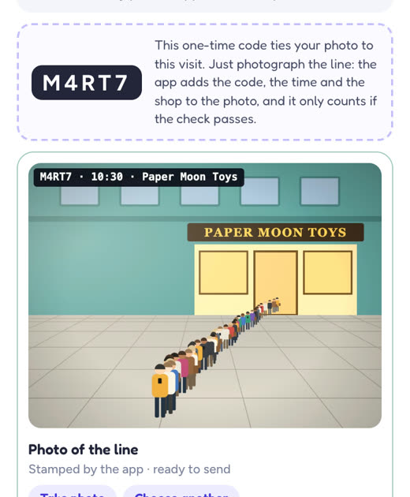 | 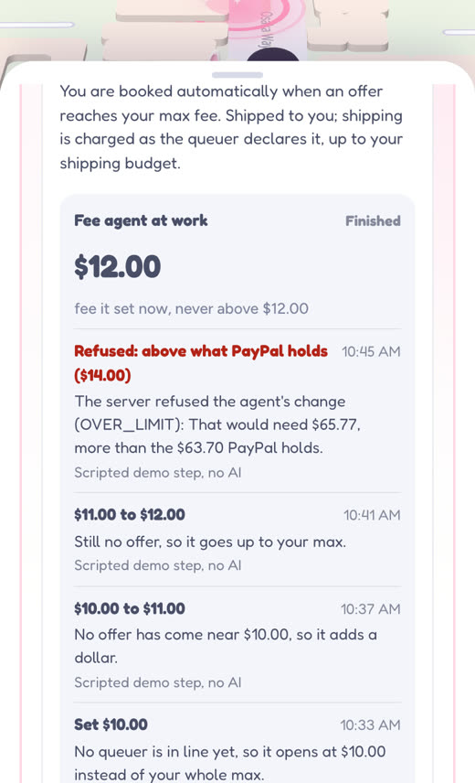 |
|:---:|:---:|
| The app stamps the visit's code on the photo; nobody writes or holds anything. | The bidding agent's log says who decided each step, and the server refuses a fee above the hold. |

### Bryntum Scheduler: the queuer board

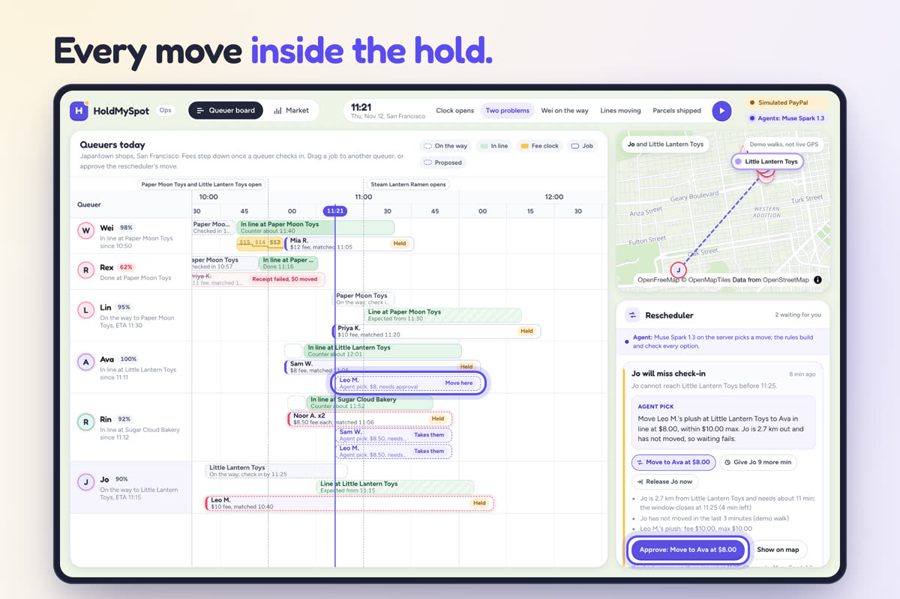

The board is `@bryntum/scheduler-react-community` 8.0.0: one row per queuer, with an `eventRenderer` drawing each walk, line, fee staircase and job with its money state.
Drag uses a `validatorFn` that runs the shared matching rules, so a move can never outgrow the requester's PayPal hold.
Our rescheduler agent proposes moves, shows them on the board and waits for a person to approve. MIT, from npm, no key.

### AG Studio: the market dashboard

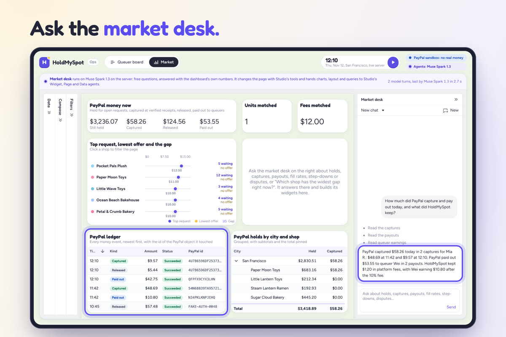

AG Studio 3.1 with AG Grid and AG Charts inside: three custom widgets, a themed canvas, the PayPal ledger grid and the holds pivot.
On the Studio Agent Framework (`createAiHarness`), our market desk reads the market through `read_market` and delegates to Studio's Widget, Page and Data agents.
It runs on the server's model, or as an offline planner that says so; both draw with Studio's own tools. No key needed.

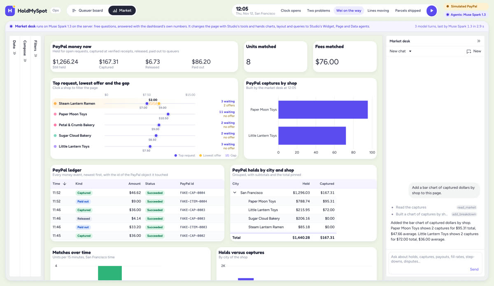

Live with Muse Spark on 2026-11-08: asked for a chart of captures by shop, the desk built it from exact fields.

## 2. Design

A complete product with two sides: a phone app for both people and an operator console with three pages.

| 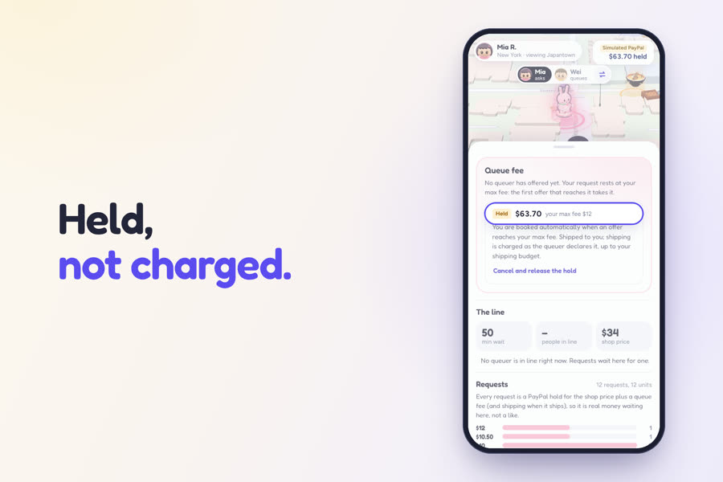 | 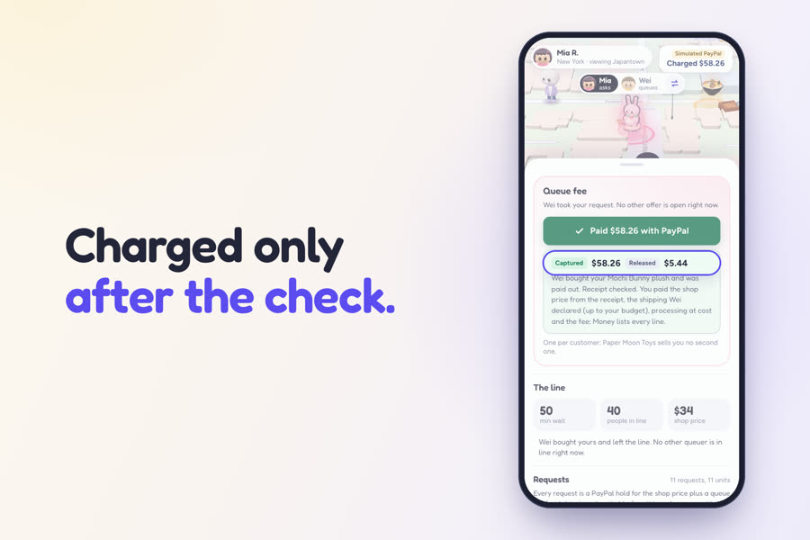 | 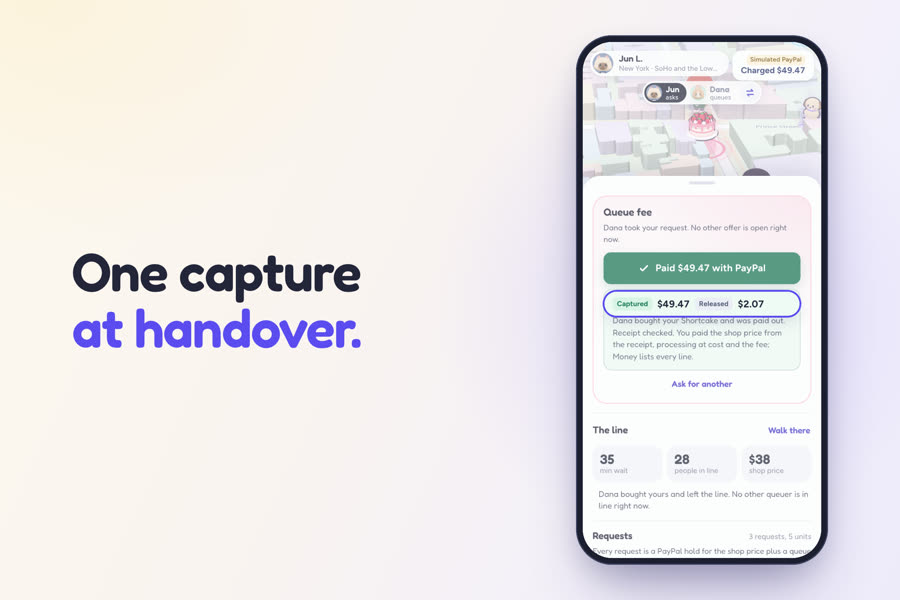 |
|:---:|:---:|:---:|
| Held, not charged. | Charged only after the check. | Local pickup: one capture at the handover code. |

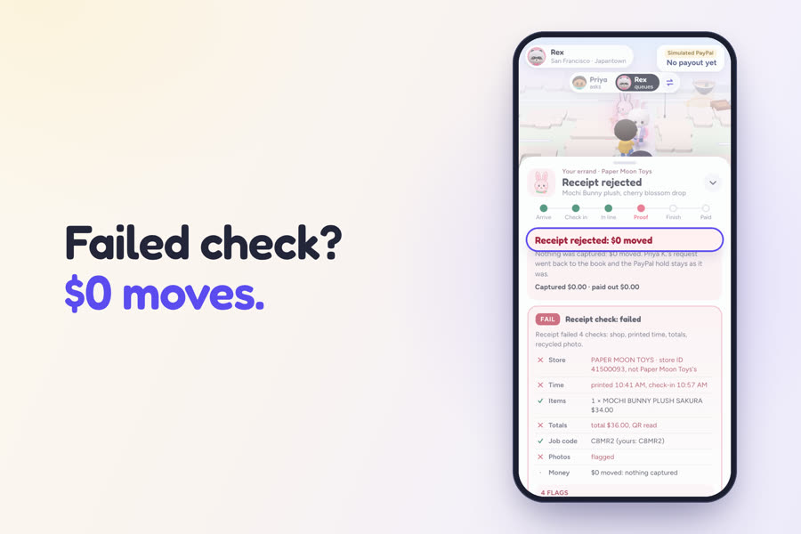

Receipts that fail the checks move \$0, and the request goes back on the map.

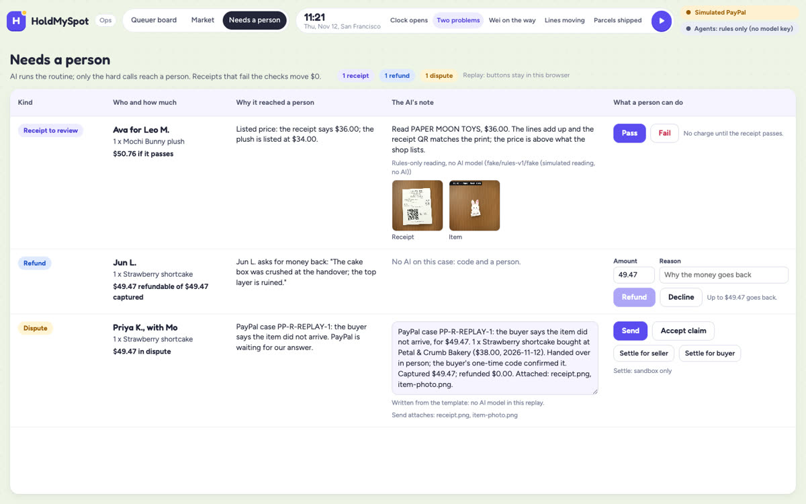

AI runs the routine; only the hard calls reach a person, one row per case ([how it works](docs/NEEDS-A-PERSON.md)).

Every screen says whether it talks to the PayPal sandbox or to simulated PayPal.

## 3. Potential impact

**The problem.** Someone who cannot be there can pay a stranger to queue, and that fails on trust both ways: the requester fears paying for nothing, and the queuer fears spending his own money at the counter and never being paid back.

**The audience.** Requesters anywhere in the US who want one item from an in-person-only sale, and queuers near the shop with an hour to spare, paid by PayPal Payouts with no merchant onboarding.

**The demand is real.** A New York line-sitting company charges \$25 to \$37.50 an hour ([Fortune, 2025](https://www.fortune.com/2025/05/18/gen-x-entrepreneur-line-sitting-business-nyc-diddy-trial-sample-sale)), and TaskRabbit lists [waiting in line](https://www.taskrabbit.com/services/shopping-delivery/waiting-in-line) as a service.

**It is fair by construction.** The requester pays the receipt's price with no markup. One item for one named requester, within the shop's own limits. Only the queuer's time has a price, and HoldMySpot keeps 10% of that fee. Tickets and medical or government queues are out by policy.

**For PayPal it is a reusable pattern** built on Orders v2 `AUTHORIZE`, partial captures and Payouts: hold the most a job could cost, capture what a check passes, pay the worker. It fits any one-item errand whose final price is unknown upfront.

**Production path:** PayPal multiparty onboarding, so queuers are paid as PayPal sellers in the same payment, and webhooks on a public URL beside the status poller.

## 4. Innovation and idea

- **An order book on a person's time.** The item is not traded; the queue fee is. Requests rest at their max fee, and offers walk down to meet them.
- **A fee that falls only after a check-in at the shop.** It steps down once the phone reports a position inside the shop's geofence and an AI-read line photo shows the visit's one-time code.
- **The receipt sets the price.** AI reads it, code checks it, PayPal captures exactly that, up to the cap.
- **The model reads; it never decides.** On the 10 bad demo proofs, rules + AI stop 10 of 10, the model's own report alone 3 of 10, and code alone 4 of 10 ([ablation](docs/ABLATION.md)).

[prior-art.md](prior-art.md) sets this beside the nearest services and hackathon entries, with where this repo tests each difference.

## 5. Presentation: the day in six steps

Every step below runs in `npm run demo`, and PayPal's sandbox charged the same to the cent.

1. **10:31.** Mia in New York asks for a \$34.00 plush, one per customer, shop price up to \$36, fee up to \$12, shipping up to \$12. PayPal authorizes a **\$63.70 hold**. Nothing is charged.
2. **10:50.** Wei, a short walk away, checks in at the shop. His fee starts stepping down from \$15.
3. **11:05.** His fee reaches \$12 and meets Mia's request.
4. **11:16.** Rex, another queuer, sends a receipt for Priya, another requester. It fails four checks: **\$0 moves**, and Priya's request goes back on the map.
5. **About 11:40.** Wei buys the plush and uploads the receipt. AI reads it, the rules pass it, PayPal captures **\$48.69**, and Payouts sends Wei **\$10.80**.
6. **14:00.** Wei ships it. Tracking goes on the order, a final capture of **\$9.57** (shipping declared by the queuer, capped by the budget) releases **\$5.44**, and Payouts sends Wei **\$42.75**.

<!-- numbers:front-money:start -->
Mia: held \$63.70, charged \$58.26, \$5.44 released. Wei: received \$53.55 (\$42.75 back for the plush and the postage he declared, \$10.80 for his time). PayPal's fees: \$3.51, exactly the processing line. HoldMySpot: \$1.20, 10% of the queue fee.
<!-- numbers:front-money:end -->

## Run it

### Zero keys: frontend, backend and sponsors

Needs Node 24 or newer (`.nvmrc`), npm and a browser with WebGL. Everything installs from the public npm registry, AG Studio and Bryntum included.

```sh
git clone https://github.com/eric2612115/HoldMySpot.git
cd HoldMySpot
npm run setup     # installs shared/, server/, web/ and ops/
npm run demo      # starts the server, the web app and the ops console; Ctrl-C stops all three
```

Ports 8796, 5190 and 5197 busy? `npm run demo -- --port-offset 2900` adds 2900 to each; `npm run hosted` takes the same flag.

It runs with zero keys on simulated PayPal and recorded model answers; add sandbox keys to run against PayPal's real sandbox ([below](#your-own-keys-real-paypal-sandbox-and-live-ai)). No accounts and no sign-in: the phone's **Mia asks / Wei queues** switch picks who you are.

| Open | Then |
|---|---|
| Web app: http://127.0.0.1:5190/?demo=1 | Tap **Mochi Bunny plush**, **Set my max fee**, **Hold \$63.70 with PayPal** (a sheet labelled Simulated PayPal). |
| Ops console: http://127.0.0.1:5197/ | Press **Play** by the clock: the whole day runs in about two minutes. Then the web app's money chip reads charged \$58.26, \$5.44 released. |
| Bryntum: http://127.0.0.1:5197/?backend=mock&at=11:21 | Read the **Rescheduler** cards, then **Approve**, or drag a job between queuers. |
| AG Studio: http://127.0.0.1:5197/?backend=mock&at=12:05#/market | Press **Widest gap** in the market desk. |
| Needs a person: http://127.0.0.1:5197/?backend=mock&at=11:21#/people | One receipt, one refund and one dispute. |
| API: http://127.0.0.1:8796/api/health | Also `/api/config` and `/api/books`; [every endpoint](docs/API.md). |
| Live site, **More scenes** | **Shortcake errand in New York**: one capture at the handover code. **Sold out at Paper Moon Toys**: two queuers report it, every hold on the plush is released, \$0 charged. |
| Live site, Wei's phone | **Mochi Bunny plush**, **Take this task**, **Use the sample line photo**, **Check in with this photo**: the AI check passes. |
| Live site, Mia's phone | **Let AI adjust my fee** runs the bidding agent on the site's live model, under the ops agents' caps; rows read "Decided by AI · muse muse-spark-1.3 (live)". |
| Live site, **Use the real PayPal sandbox** | After **Let Wei run the errand**, the ops console's **Market** page shows that run's PayPal ids in the AG Studio ledger. |

Checks, with no keys and no network:

```sh
npm test                      # every package, ends "All green"
npm run ai:eval               # replays the recorded model answers, in seconds
npm run attack                # tries to cheat the money, one table
npm run demo -- --smoke       # starts all three, checks each, stops
npm run numbers -- --check    # this page against the logs
```

With the demo running, `(cd ops && OUT_DIR=../.run/ops-shots npm run shots && npm run licence:check)` drives both sponsor screens; it needs `npx playwright@1.56.1 install chromium`.

### One command, one port, your own private market

`npm run hosted` serves the phones side by side, the ops console and the API on `http://127.0.0.1:8796/`; every visitor gets a private in-memory market, cleared when idle, with no sign-up; Ctrl-C stops it. The same site runs at https://holdmyspot-k4a4.onrender.com ([docs/HOSTING.md](docs/HOSTING.md)). An AI reviewer with no cookies takes a token instead:

```sh
BASE=https://holdmyspot-k4a4.onrender.com   # or http://127.0.0.1:8796 after npm run hosted
TOKEN=$(curl -s -X POST "$BASE/api/demo/session" | node -pe 'JSON.parse(require("fs").readFileSync(0)).token')
curl -s -X POST "$BASE/api/demo/start" -H "X-HMS-Market: $TOKEN" -H 'content-type: application/json' -d '{"scriptId":"hero","speed":600}'
until curl -s "$BASE/api/demo/state" -H "X-HMS-Market: $TOKEN" | grep -q '"finished"'; do sleep 1; done   # about 10 s
curl -s "$BASE/api/ledger?mine=1" -H "X-HMS-Market: $TOKEN" -H 'X-HMS-User: mia'
# held 6370, captured 4869 and 957, released 544 (cents)
```

### Your own keys: real PayPal sandbox and live AI

Create a sandbox app at https://developer.paypal.com with **Accept payments** and **Payouts** ticked, and two Personal sandbox accounts (a buyer and a payout receiver). Keys stay in the git-ignored `.secrets/`.

```sh
npm run keys          # asks for the client id, secret, buyer and payout emails; optional AI and AG keys
# or: PAYPAL_CLIENT_ID=... PAYPAL_CLIENT_SECRET=... PAYPAL_BUYER_EMAIL=... PAYPAL_PAYOUT_EMAIL=... npm run keys -- --from-env
# AI: MODEL_API_KEY (Meta Muse), OPENAI_API_KEY or ANTHROPIC_API_KEY in the same way
npm run doctor        # names only; ends "PayPal sandbox mode is ready too"
npm run dev:sandbox   # real sandbox calls; live AI when a key is saved
npm run errand        # after you approve a hold: plays the queuer over the API
npm run paypal:check -- --bid <request id>     # GET calls only: PayPal against the ledger
npm run gates -- lifecycle --by-hand --out .run/gates.md --no-record     # the whole errand, scripted
npm run demo -- --ai live                      # zero-key PayPal with a live model
```

The captures and payouts of your own run also appear in your own sandbox business account's activity on sandbox.paypal.com.

## Other tools

Node.js 24 and TypeScript 5.9; Fastify 5, Zod 4 and `node:sqlite`; React 19 and Vite 8; MapLibre GL JS with OpenFreeMap tiles; three.js; jsQR, jpeg-js and qrcode; Playwright; node:test and Vitest ([full table](docs/TECHNICAL-DETAILS.md#other-tools)).

## If you want to know X, read Y

| If you want to know | Read |
|---|---|
| What the AI does and which layer stops what | [docs/AI-SERVICES.md](docs/AI-SERVICES.md), [docs/ABLATION.md](docs/ABLATION.md) |
| The money rules and the worked example | [docs/DOMAIN.md](docs/DOMAIN.md) |
| The hard calls for a person | [docs/NEEDS-A-PERSON.md](docs/NEEDS-A-PERSON.md) |
| Why it was built this way | [docs/DECISIONS.md](docs/DECISIONS.md) |
| How the sponsors are wired in | [ops/README.md](ops/README.md) |
| The API and the system | [docs/API.md](docs/API.md), [docs/ARCHITECTURE.md](docs/ARCHITECTURE.md) |

## Licence

[MIT](LICENSE). 3D props are CC0 by Kay Lousberg; the map is OpenFreeMap and OpenStreetMap; Bryntum Scheduler Community is MIT; AG Studio, AG Grid and AG Charts Enterprise are commercial and run in AG's trial mode without a key ([full attribution](docs/TECHNICAL-DETAILS.md#licence-and-attribution)). Every shop, item, person and receipt in the demo is fictional.
