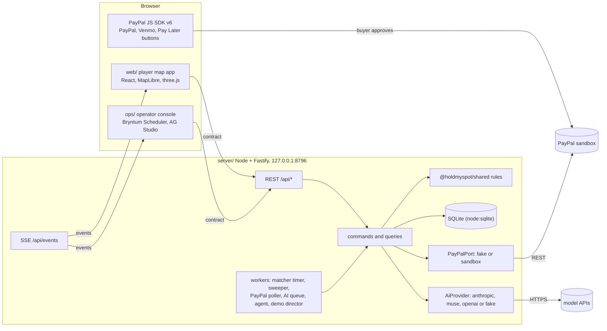

# HoldMySpot architecture

Status: proposed, 2026-11-07, for the PayPal AI Hackathon entry (deadline 2026-11-13 04:00 Taipei). Decisions behind this page are in [DECISIONS.md](DECISIONS.md).

HoldMySpot is a walking order book on the queue fee: requesters anywhere in the US post bids backed by PayPal holds; queuers near the shop post asks and check in; an AI-read, rule-checked receipt triggers partial captures and Payouts. Rules: [DOMAIN.md](DOMAIN.md). PayPal calls: [PAYPAL-MAPPING.md](PAYPAL-MAPPING.md). AI: [AI-SERVICES.md](AI-SERVICES.md). Endpoints and events: [API.md](API.md). Owner steps: [SANDBOX-GATES.md](SANDBOX-GATES.md).

## 1. Fixed versus open

**Fixed now** (change only through a new decision): the contract in `shared/src/contract.ts`; the market and money rules and state machines in `shared/src`; the PayPal call sequence; the AI service boundaries; the seed catalog; env vars, ports and runtime modes; the repo layout and stack; the demo script format.

**Open** (later work changes only these): screen layouts and visual design, map art and 3D characters, motion, copy tone (within the required disclosures in DOMAIN.md section 9), the ops dashboard layout, camera choreography for the film.

## 2. System



## 3. Repo layout

```
HoldMySpot/
  docs/                        this documentation
  shared/                      @holdmyspot/shared: contract + pure rules, TypeScript source, no build
    src/contract.ts            REST + SSE contract, records, errors, endpoint table, default rules
    src/money.ts               limits, captures, payouts, renewal (tested with the worked example)
    src/stepdown.ts            fee clock (the web app imports it for the offer card)
    src/matching.ts            price-time priority matcher, depth
    src/machines.ts            state machines
    src/geo.ts                 travel range, geofence
    src/seed.ts                cities, fictional shops and items, personas, demo constants
    src/estimates.ts           fee, clock, retail cap, shipping and duty formulas, bid disclosures
    src/proofs.ts              line-photo and receipt rules (hard and soft checks), shop-local time helpers
    src/opsviews.ts            the ops dashboard datasets (server endpoint and console, D-49)
    src/ports.ts               server-only PayPal and AI ports
  server/                      @holdmyspot/server: Node 22.18+ runs the .ts files directly, Fastify 5, node:sqlite, zod
    src/main.ts                boot: config, mode, key report (names only), listen
    src/server.ts              composition root: ports, kernel, demo director, HTTP, workers
    src/config.ts              env + sandbox.env, mode resolution
    src/clock.ts               market clock (speed, pause, jump forward)
    src/db/                    database.ts (node:sqlite, JSON document tables with indexed columns), store.ts
    src/app/                   app.ts (kernel: exec queue, tx + event outbox, pinned time), market.ts (book,
                               matching, snapshots), bids.ts, asks.ts (asks, claims, check-in, lapses), jobs.ts
                               (purchase, proof, shipment, handover, sold out), money.ts (ledger outbox, captures,
                               voids, renewals, payouts, refunds, bid settlement), scheduler.ts (due-time loop,
                               sweeper), sync.ts (PayPal status poll), agent.ts (bidding agent loop), seed.ts,
                               files.ts, ops.ts (board, datasets), views.ts (redaction, event audiences),
                               opsAgents.ts (the ops agents' turn route and their moves: POST /api/ops/agents/turn,
                               POST /api/ops/moves, D-100 to D-102)
    src/ports/                 payments.ts (PaymentsPort = PayPalPort), ai.ts (AiPort), load.ts (loads paypal/, ai/),
                               runscope.ts (sandbox run id on PayPal keys and invoice ids, D-50)
    src/fakes/                 paypal.ts (fake mode's PayPal: the sandbox REST client on the in-process emulator,
                               saved in SQLite, D-47), ai.ts + scenarios.ts (rules-only AI for simulated scenarios)
    src/paypal/                REST client, sandbox adapter, emulator (fake), webhook helpers, status mappers
    src/ai/                    providers (anthropic, muse, openai-compatible, fake, replay), proof pipeline, estimates, agent, phash, qr,
                               opsTurn.ts (one live model turn for the ops console's agents, D-103)
    src/realtime/bus.ts        event outbox (delivered to SSE after commit)
    src/http/                  server.ts (a route for every ENDPOINTS key, idempotency, SSE), routes.ts, schemas.ts
    src/demo/                  director.ts, fixtures.ts (rendered photos and pinned codes, D-48),
                               scripts/hero.ts, scripts/others.ts (local-errand, renewal)
    test/                      node:test suites (engine, money, hero, http, agent, ports, e2e; paypal/ and ai/ for the services)
    fixtures/                  ai/ (replay fixtures: Muse Spark's recorded readings of the demo photos), proofs/ (rendered
                               receipt and line photos with truth sidecars)
    scripts/                   render-receipts.ts, ai-eval.ts
    data/                      git-ignored: holdmyspot.sqlite, uploads/
  scripts/                     setup-sandbox-secrets.mjs (writes sandbox.env), sandbox-gates.mjs (day-1 gates;
                               results in docs/SANDBOX-GATES.md)
  web/                         player map app (prototype in progress: React 19, Vite, MapLibre, three.js)
  ops/                         operator console: React + Vite; Bryntum Scheduler queuer board with a synced
                               MapLibre map, AG Studio market dashboard; reads GET /api/ops/records when the server
                               answers, else replays the hero day in the browser (scripts/shots-live.mjs films a run)
  assets-src/                  third-party asset packs (cloned repos git-ignored)
```

Package wiring: `server`, `web` and `ops` depend on `"@holdmyspot/shared": "file:../shared"`. A root npm workspace comes later, once the web prototype settles (creating it now would change how `npm install` behaves inside `web/` while another agent works there). Shared files use only erasable TypeScript and `.ts` import paths, so Node runs them directly and Vite bundles them; they compile under both the shared tsconfig and the web app's settings.

## 4. Runtime modes

| | `HMS_MODE=fake` (default) | `HMS_MODE=sandbox` |
|---|---|---|
| PayPal | The sandbox REST client answered by an in-process emulator with PayPal's rules (115% overage, honor period, final capture, void after partial, reauthorize day 4 to 29, payout batches PENDING first), deterministic ids, state saved in SQLite (D-47) | Real sandbox REST at `api-m.sandbox.paypal.com` (the adapter refuses any other base URL); keys and invoice ids carry the market run id (D-50) |
| Buyer approval | "Simulated PayPal" sheet, then `POST /api/fake/paypal/orders/:orderId/approve` | PayPal JS SDK v6 buttons; the buyer logs in on PayPal's page |
| Network | None from the server (the browser still loads map tiles) | PayPal; model APIs when a key is present |
| AI | `replay` of the committed Muse Spark readings (`server/fixtures/ai`, stamped `muse`/`replay`), else rules-only `fake` (no network unless `HMS_AI_MODE=live` is set on purpose) | Provider from `auto` (section 10), mode `live` |
| PayPal time | Honor period and validity on the market clock (a renewal can be demoed) | Real time |
| Banner | "Simulated PayPal" | "PayPal sandbox: no real money" |

If `HMS_MODE=sandbox` but `~/.config/paypal-hackathon/sandbox.env` is missing or incomplete, the server refuses to start: it prints one line naming the missing variables (never a value) and exits with code 2, and it also refuses when the sandbox adapter cannot be built (D-108). Only the explicit opt-in `HMS_SANDBOX_FALLBACK=fake` (tests, and the settings probe behind `npm run doctor` and the launcher) runs the simulated PayPal instead, with the reason in `GET /api/config` `modeReason`. The server never talks to PayPal's live environment.

## 5. Server internals

- **Layers.** Routes (Fastify, zod schemas mirroring the contract) call commands and queries; those apply the shared rules, write SQLite through repositories, and use ports for PayPal, AI, files, the clock and the event bus.
- **Transactions and events.** Each command runs in one SQLite transaction and appends its events to the `events` table in the same transaction (outbox). After commit the bus pushes them to SSE clients. Every status change goes through `assertTransition`.
- **Money calls** use the ledger as their outbox: insert the ledger entry as `pending` with its idempotency key, call PayPal with that key as `PayPal-Request-Id`, then mark it `succeeded` or `failed` and update hold, job and payout. A refusal is settled in its own transaction before the error goes back to the caller (the next attempt gets a new key, `<key>:2`); an outage stays `pending` and is resent with the same key. On boot the server retries `pending` entries with the same keys. A new payout batch is read back once at creation (D-51).
- **Workers** (in process):
  - matcher timer: runs `matchBook` at each book's `nextClockStepAt` and after clock speed changes;
  - sweeper (`HMS_SWEEP_SECONDS`, 15): lapses claims past their window, expires bids past their deadline, applies `renewalVerdict` to holds, fails shipped jobs without tracking after `shipWithinDays`, voids holds that can capture nothing more;
  - PayPal poller (both modes, `HMS_PAYPAL_POLL_SECONDS`): pending captures and payout batches (authorizations and disputes later);
  - AI queue: proof checks with concurrency 2, 60-second timeout, one retry, then `needs_review`;
  - bidding agent scheduler (AI-SERVICES.md 4.5);
  - demo director (section 8).
- **Errors.** `ContractError` maps to `ApiErrorBody` (status table in API.md). PayPal failures keep PayPal's `debug_id`.
- **Idempotency.** POSTs marked idempotent in `ENDPOINTS` accept `Idempotency-Key`; the first response is stored for 24 hours per (key, route, persona).
- **Logging.** Fastify's pino logger with redaction of `authorization`, `paypal-*` headers, tokens and any `*_KEY` or `*_SECRET` values; upload bodies are never logged.

## 6. Data (SQLite, `server/data/holdmyspot.sqlite`)

Money columns are INTEGER cents; nested values are JSON text columns; times are INTEGER epoch ms (market time, except PayPal real-time fields on holds).

| Table | Holds |
|---|---|
| `meta` | schema version, boot id, clock state, demo state |
| `cities`, `shops`, `items`, `users` | loaded from `shared/src/seed.ts` at reset |
| `bids`, `holds`, `asks`, `claims`, `matches`, `jobs`, `proofs` | the records in the contract |
| `ledger` | append-only; UNIQUE `idempotency_key` |
| `payouts`, `disputes`, `agent_actions` | |
| `files` | id, purpose, owner, content type, bytes, sha256, dhash, width, height, path under `server/data/uploads/` |
| `events` | `seq` INTEGER PRIMARY KEY, type, market time, audience, JSON data (SSE replay; pruned to the newest 10,000) |
| `idempotency` | key, route, persona, response JSON, created time |
| `paypal_sync` | PayPal object id, kind, our reference, last status, last polled |
| `webhook_events` | PayPal event id, type, verified, processed time |
| `ai_calls` | task, provider, model, mode, fixture key, latency, ok (no prompts, no images) |

`POST /api/demo/reset` drops and reseeds everything.

## 7. Realtime (SSE)

One stream per client: `GET /api/events?as=<userId>&since=<seq>` (EventSource cannot send headers, so the persona rides in the query; ops uses `as=ops`). Each message is `id: <seq>`, `event: <type>`, `data: <EventEnvelope JSON>`. The server sends `retry: 2000`, a `hello` event first, and a comment ping every 15 seconds. On reconnect the browser sends `Last-Event-ID`; the server replays newer events the persona may see, or sends `resync` when they are no longer kept (clients then refetch snapshots). Audience rules are in API.md. Clients treat events as hints plus data: each payload is the full current record, so applying the latest one is enough.

## 8. Clock and demo mode

- **Market clock.** The server owns market time. `ClockState { speed, paused, marketNow, realNow }` comes with `GET /api/config`, `GET /api/clock`, `hello` and `clock.updated`; clients compute now as `marketNow + (Date.now() - realNow) * speed`. Speed 1 to 600; jumps go forward only, so ids and timestamps stay monotonic. Money amounts never depend on speed.
- **Demo mode** (`HMS_DEMO=1`): `/api/demo/*` routes and the director. Scripts are code in `server/src/demo/scripts/`: an ordered list of steps at market times, each acting through the same commands as a persona would (never writing rows directly). Step types: `bid.create`, `bid.approve` (fake approval), `wait_for` (an event, for example a bid authorized by a real sandbox approval), `ask.create`, `bid.claim`, `move` (synthetic avatar path, `queuer.moved`), `claim.checkIn` (fixture photo), `job.bought`, `job.proof` (fixture photos), `job.shipment`, `job.handover`, `clock.jump`, `cue`.
- **Determinism.** Seed `20261112`, market start `2026-11-12T10:30:00-08:00` (San Francisco), speed 60, sequential ids, fake PayPal ids, AI in `replay`. The same script gives the same screens every run, also for a second take in the same server process (the scheduler forgets a market's finished work at a reset). `npm run demo` starts every boot from a fresh market at the script's start (`HMS_DEMO_RESET=1`). When a script finishes, the market clock pauses on the closing numbers; `POST /api/demo/resume` leaves a finished script there, and `POST /api/demo/clock {"paused": false}` runs the market on (D-65).
- **Photos.** The hero uploads the rendered photos in `server/fixtures/proofs` for Wei's and Rex's check-ins and for Mia's, Priya's and Rex's receipts, with the codes they show pinned on the records (D-48). In `replay` the AI services answer with Muse Spark's recorded reading of each photo (`server/fixtures/ai`, made by `npm run ai:eval -- --record`), offline; the rules decide as in a live run (D-66). Other uploads are placeholders with a simulated scenario.
- **Scripts.** `hero` (below), `renewal` (a hold created three market days earlier is reauthorized on day 4), `local-errand` (New York shortcake: claim, check-in, USD receipt, handover code, hold $51.54, one capture of $49.47 with $2.47 processing at cost, payout of $46.10, HoldMySpot keeps $0.90), `ambient` (crowd bids and walking avatars for B-roll).
- **Filming.** Takes use fake mode or replay so nothing slow or flaky runs live in a take. A sandbox run of the same script (with `wait_for` steps where the owner approves in PayPal's window) is recorded separately to show real sandbox ids. The real reauthorization is filmed on 11-11 or 11-12 from holds created on 11-08.

Hero script (market time, San Francisco, 2026-11-12; amounts from DOMAIN.md section 7):

| Time | Step |
|---|---|
| 10:30 | Reset. Seeded crowd requests light up the San Francisco books (Paper Moon Toys in Japantown: a dozen requests for the one-per-customer Mochi Bunny plush, the top at $11). |
| 10:31 | Mia (New York, 1:31 pm there) quotes and posts one plush shipped to her: retail cap $36, max fee $12, shipping budget $12, processing and payouts up to $3.70 at cost. Hold $63.70. |
| 10:33 | Rex takes Priya's request at its $11 max fee; ETA 10:55. |
| 10:35 | Wei offers to queue: one spot, fee $15, clock $1 every 5 minutes to $8, ETA 10:50. His avatar walks over. |
| 10:50 | Wei checks in (line photo read by the AI services); his clock starts at $15. |
| 10:55, 11:00 | The clock steps to $14 and $13; no resting request reaches them. |
| 10:57 | Rex checks in. |
| 11:05 | The clock reaches $12 and meets Mia's request: Wei's one spot fills. |
| 11:16, 11:18 | Rex says he bought the plush; his receipt fails four checks (shop, printed time, totals, recycled photo): "$0 moved", and Priya's request goes back to the book. |
| 11:20 | Lin offers to queue at $10: Priya's $11 request fills at once at $10. |
| 11:38 to 11:52 | Wei buys and uploads Mia's receipt: capture $48.69 (shop price $34.00, the $12.00 fee and $2.69 processing at cost: PayPal's $2.19 fee on this capture and $0.25 for each of the job's two payouts), payout $10.80. Lin does the same for Priya: capture $46.62, payout $9.00. |
| jump to 13:58 | |
| 14:00 | Wei ships Mia's parcel to New York: tracking added, final capture $9.57 (shipping $8.75 and PayPal's $0.82 fee on this capture, at cost), $5.44 released, payout $42.75 (the shop price and shipping he paid). PayPal's fees on the errand ($3.51) equal the processing line; HoldMySpot keeps $1.20. |
| 14:01 | Closing cue: "Held $63.70. Charged $58.26. Fake receipt: $0." |

With the jump, the run takes about 3 minutes at speed 60.

## 9. Seed data (`shared/src/seed.ts`)

- **Cities:** San Francisco (the default map, Japantown) and New York. Every requester and queuer is in the US; amounts are US dollars.
- **San Francisco, Japantown (the first screen):** Paper Moon Toys, Buchanan St (Mochi Bunny plush, cherry blossom drop, $34, one per customer, sold in person only, ships in the US: the hero item); Little Lantern Toys, Bush St (Lucky Cat plush, $26, limit 6); Steam Lantern Ramen, Sutter St (black garlic tonkotsu ramen to take out, $19, local errand); Sugar Cloud Bakery, Buchanan St (strawberry cloud cake, 40 a day, $38, local errand).
- **San Francisco, farther out:** Butter Bell Bakery (Basque cheesecake), Crumb & Clover Bakery (tres leches), Ocean Beach Bakehouse (morning buns), Pocket Pals Plush (Sleepy Otter plush), Little Wave Toys (Sea Otter plush), Geneva Toy Corner (Cloud Pup plush), Kettle Moon Ramen, Sunset Ramen House and Dogpatch Noodle Co. Some are outside the 30-minute travel range or close before a queuer could arrive, so the overview greys them.
- **New York (`?city=nyc`):** Petal & Crumb Bakery (strawberry shortcake, $38, local errand), Little Orbit Toys (Space Pup plush, $32, one per customer, ships), Bowery Noodle Club (tonkotsu ramen, $21), Houston Street Bakeshop (chocolate babka, $22).
- **Item kinds:** `cake` and `ramen` are perishable local errands; `plush` drops are sold in person, one per customer (Little Lantern allows 6), and may ship to another US city at cost.
- **Personas:** requesters Mia, Jun and Priya (New York), Sam, Noor and Leo (San Francisco); San Francisco queuers Wei (hero; the owner's character), Lin, Rin, Ava, Jo and Rex (low reliability, the fake receipt); New York queuers Dana, Theo and Mo. Queuer home positions are private and only feed the travel-range rule and synthetic walks.
- **Crowd bids:** generated by the server from `DEMO_SEED` with `CROWD_NAMES`.
- Item ids equal the web map's point ids. Store receipts carry a fictional `RCPT1` QR (store ID, receipt number, date, total, currency, lines); the store IDs are made up and belong to no real company.

## 10. Environment variables

**Server** (all optional; defaults shown):

| Variable | Default | Meaning |
|---|---|---|
| `HMS_MODE` | `fake` | `fake` or `sandbox`; `sandbox` with missing settings refuses to start (D-108) |
| `HMS_SANDBOX_FALLBACK` | empty | `fake`: the explicit opt-in to run simulated PayPal when `HMS_MODE=sandbox` cannot start (tests and the settings probe) |
| `HMS_HOST` / `HMS_PORT` | `127.0.0.1` / `8796` | 8795 was taken by another local server |
| `HMS_DB_PATH` | `server/data/holdmyspot.sqlite` | `:memory:` in tests |
| `HMS_UPLOAD_DIR` | `server/data/uploads` | |
| `HMS_SECRETS_DIR` | `~/.config/paypal-hackathon` | reads `sandbox.env` and `ai.env` |
| `HMS_AI_KEY_FILES` | empty | extra dotenv files, comma separated; only `ANTHROPIC_API_KEY`, `MODEL_API_KEY` and `OPENAI_API_KEY` are read from them, and `path#MODEL_API_KEY` narrows a file to that one name. `server/.env.local` (git-ignored, `HMS_*` names only) can set it |
| `HMS_AI_PROVIDER` | `auto` | `auto` (Anthropic, else Muse, else OpenAI-compatible with its own key, else rules only), `anthropic`, `muse`, `openai`, `fake` |
| `HMS_AI_MODE` | `replay` (fake mode), `live` (sandbox mode) | `live`, `record`, `replay`, `fake` |
| `HMS_AI_FIXTURES_DIR` | `server/fixtures/ai` | replay answers; the test suites point it at an empty folder except `test/replay.test.ts` |
| `HMS_ANTHROPIC_MODEL` | `claude-opus-5-5` | |
| `HMS_MUSE_MODEL` / `HMS_MUSE_URL` | `muse-spark-1.3` / `https://api.meta.ai/v1/chat/completions` | |
| `HMS_AI_BASE_URL` / `HMS_AI_MODEL` | `https://api.openai.com/v1` / `gpt-6.1-sol` | the `openai` provider: any OpenAI-compatible Chat Completions endpoint (`/chat/completions` is added to a base URL), key `OPENAI_API_KEY`; `MODEL_API_KEY` is used only when the base URL is Meta's own host. Not yet called with a real OpenAI key |
| `HMS_AI_AGENT_TIMEOUT_MS` | `30000` | one bidding-agent run |
| `HMS_AI_TIMEOUT_MS` | `60000` | |
| `HMS_DEMO` | `0` | `1` enables demo routes and the director |
| `HMS_DEMO_SCRIPT` | `hero` | |
| `HMS_DEMO_RESET` | `0` | `1` (set by `npm run demo`): every boot in demo mode starts from a fresh market at the script's start |
| `HMS_SEED` | `20261112` | |
| `HMS_MARKET_START` | real now | for example `2026-11-12T10:30:00-08:00` |
| `HMS_CLOCK_SPEED` | `1` | 1 to 600 |
| `HMS_PLATFORM_FEE_BPS` | `1000` | |
| `HMS_FX_TWD_PER_USD` | `32.30` | pinned rate for a receipt in TWD; dormant, every seeded shop prices in USD |
| `HMS_SWEEP_SECONDS` | `15` | |
| `HMS_PAYPAL_SYNC` | `poll` | `poll` or `webhook` (webhook also keeps a slow poll) |
| `HMS_PAYPAL_POLL_SECONDS` | `20` | |
| `HMS_PAYPAL_TIMEOUT_MS` | `10000` | |
| `HMS_PAYPAL_FUNDING` | `paypal,venmo` | buttons allowed; add `paylater` after probe G5 |
| `HMS_FAKE_FAIL` | empty | fake-mode failure injection, `<op>:<effect>[:<count>\|*]` (server/src/paypal/emulator.ts): for example `capture:unavailable:3` (an outage longer than the client's two retries), `payout:unclaimed`, `authorize:decline` |
| `HMS_AI_PROOF_FIXTURES_DIR` | `server/fixtures/proofs` | rendered demo photos and their truth sidecars (AI services and demo director) |
| `HMS_WEB_ORIGINS` | `http://127.0.0.1:5190,http://localhost:5190,http://127.0.0.1:5197,http://localhost:5197` | CORS in development |
| `HMS_SERVE_STATIC` | `0` | `1` serves `web/dist` at `/` and `ops/dist` at `/ops` (one origin for judges) |
| `HMS_ADMIN_KEY` | empty | required when `HMS_HOST` is not a loopback address |
| `HMS_LOG_LEVEL` | `info` | |

**`~/.config/paypal-hackathon/sandbox.env`** (written by `scripts/setup-sandbox-secrets.mjs`, mode 600): `PAYPAL_ENV` (must be `sandbox`), `PAYPAL_CLIENT_ID`, `PAYPAL_CLIENT_SECRET`, `PAYPAL_MERCHANT_EMAIL`, `PAYPAL_MERCHANT_ID`, `PAYPAL_BUYER_EMAIL`, `PAYPAL_TW_PAYOUT_EMAIL`; optional `PAYPAL_WEBHOOK_ID` (only with a public URL).

**`~/.config/paypal-hackathon/ai.env`**: optional `ANTHROPIC_API_KEY`, optional `MODEL_API_KEY`, optional `OPENAI_API_KEY`.

**web/**: `VITE_HMS_API` (default empty: same origin through the Vite proxy to `http://127.0.0.1:8796`); a switch between the in-browser mock and the server (the web agent names it; `VITE_BACKEND=mock|server` is suggested). The PayPal client ID comes from `GET /api/config`, never from a web env file.

**ops/**: `VITE_HMS_API`, `VITE_HMS_ADMIN_KEY` (only for a non-loopback server). The AG licence is read by `ops/vite.config.ts` at dev-server or build time: `VITE_AG_LICENSE_KEY` in the git-ignored `ops/.env.local`, else a key file (`HMS_AG_LICENSE_FILE`, default `~/.config/paypal-hackathon/aggrid-license.txt`, mode 600). It is never printed or committed. Bryntum installs as `@bryntum/scheduler-community` and `@bryntum/scheduler-react-community` 8.0.0 (MIT) from the public npm registry.

## 11. Ports and processes

| Process | Port | Command |
|---|---|---|
| server | 8796 | `npm run dev` in `server/` |
| web dev / preview | 5190 / 5191 | existing `web/vite.config.ts` |
| ops dev / preview | 5197 / 5198 | `npm run dev` in `ops/` |

Stop only the servers you started, by PID or with `npm run demo -- --stop` and the same port flags.

## 12. Security and privacy

- Secrets come only from the two files in `HMS_SECRETS_DIR` and the process env; logs show names and presence, never values. `GET /api/config` exposes only the public client ID.
- No real sign-in in v1: requests act as a seeded persona through `X-HMS-User`. The server binds to 127.0.0.1; on any other host it refuses to start without `HMS_ADMIN_KEY`, and admin routes require `X-HMS-Admin-Key`.
- Uploads: JPEG, PNG or WebP, at most 8 MB, served only to the job's participants and ops.
- Personal data: all personas are fictional; sandbox receiver emails are shown to ops only; no live positions leave the server (demo walks are synthetic).
- CORS allow-list in development; same origin when `HMS_SERVE_STATIC=1`.

## 13. Testing

- `shared/`: `npm run check` (TypeScript plus 73 tests, including the worked money example, the matcher, the proof rules and the estimate formulas).
- `server/`: `npm run check` (TypeScript plus node:test). Tests run in fake mode on an in-memory database with the market clock moved by hand: engine (price-time priority, partial fills, fee-clock steps at exact times, claims, compatibility, re-offers, lapses, sold out, deadlines), money (never above the user's limit even though PayPal allows 115%, job caps, final capture flag, voids after failures and partial captures, outages kept pending and retried with the same key, renewals on day 4, Venmo renewal-required, refunds, payout sync), the hero script end to end (held $63.70, captures $48.69 and $9.57 with processing at cost, released $5.44, payouts $10.80 and $42.75, PayPal's fees equal to the processing line, Rex's job $0), processing and payouts at cost on every job type (`test/processing.test.ts`), sandbox mode refusing to start without its settings (`test/config.test.ts`), every contract route over HTTP, SSE audiences and replay, and the bidding-agent loop. Every suite runs on the real PayPal client (emulator) since D-47. The suites read photos with the rules only (an empty replay folder); `test/replay.test.ts` plays the hero on the recorded Muse Spark answers and checks the same money and the `muse`/`replay` stamps.
- End to end (`server/test/e2e.test.ts`): over HTTP only, with the real PayPal client and the real AI services (no key, no network): two US holds (PayPal and Venmo), Wei's fee clock filling both, Rex's missed check-in (claim lapsed, the plush back in the book), receipts read from the rendered photos, partial captures, payouts, tracking, final captures and releases, a sell-out that voids a hold, the scripted hero with both services, and the ops read model. `server/test/ports.test.ts` covers the wiring: PayPal state across a restart and a reset, two renewals from the original authorization, a decline and a second approval, sandbox run ids, and the AI loader.
- Run the demo: `npm run demo` in `server/` (fake mode, the AI services in replay, a fresh market at 2026-11-12 10:30 San Francisco, speed 60), then `POST /api/demo/start {"scriptId":"hero","speed":60}`. With `npm run dev` in `ops/`, `npm run shots:live` there films the run into `proto-shots/v2/live/`; `npm run shots` in `web/` and in `ops/` take the final set into `proto-shots/v2/final/`; `node scripts/sandbox-walk.mjs` in `web/` takes one hero errand on the real PayPal sandbox into `proto-shots/v3/final/` (D-121). Git tracks only these two screenshot folders (D-68).
- Sandbox: `node scripts/sandbox-gates.mjs run` runs the day-1 gates (PAYPAL-MAPPING.md section 7; results in docs/SANDBOX-GATES.md) and needs the owner for approvals.
- `web/`: the switch from its mock to the contract is in [WEB-INTEGRATION.md](WEB-INTEGRATION.md).

## 14. Web prototype alignment

| Prototype (`web/src`) | Contract and shared code |
|---|---|
| `domain/types.ts` `TaskPoint` | `Shop` + `Item` + `BookSnapshot`; `TaskPoint.id` equals `Item.id` |
| `TaskPoint.retailCents`, `tags`, `hue` | `Item.retailCents`, `Item.tags`, `Shop.accent` |
| `TaskPoint.placement` (metres from the player) | `Shop.lngLat` |
| `TaskPoint.queue` (`QueueInfo`) | `BookSnapshot.queue`, same field names |
| `TaskPoint.bids` (all-in cents per bid) | `BookSnapshot.bids` (fee per unit, depth levels); single bids stay private |
| `TaskPoint.offers` (`FeeOffer`) | best `AskQuote` (`feeCents` + `clock`), priced with `askFeeAt` / `askSchedule` |
| in-hand resale of a bought item | removed from the web app too (decision D-07) |
| `TaskPoint.closesAt` (rolling rounds) | each bid's `deadlineAt` and the shop's hours |
| the fee clock (step-down) | `shared/src/stepdown.ts`, imported by the web app |
| `domain/money.ts` | `shared/src/money.ts` (same `usd`, `money`, `formatUsd`, `toPayPalValue`) |
| `domain/book.ts` matching and depth | `shared/src/matching.ts` (`matchBook`, `sortBids`, `bidDepth`) |
| `services/payments` `PaymentsService` | the market API: `placeHold` becomes `POST /api/bids` + SDK approval + `POST /api/bids/:id/authorize`; capture, release and payout happen on the server; `activity()` becomes `GET /api/ledger` + `ledger.appended` |
| `Hold`, `Payout`, `Activity`, `PaymentError` codes | `Hold`, `Payout`, `LedgerEntry` (supersets), `ApiErrorCode` (keeps the four codes) |
| `services/clock.ts` `MarketClock` | `ClockState` (same formula, owned by the server) |
| `config/cities.ts` `CityId` | `sf` (default) and `nyc` from the seed; `taipei` is a hidden web-only street view with in-browser data; bearing and pitch stay in the web app |
| `state/market.ts` order kinds `now` / `max` | one bid type: a max fee at or above the best ask fills at once (`now`), below it rests (`max`) |
| `domain/earning.ts` travel and $/hour | the shared travel rule is the floor; the app's own estimate (walk up to 20 minutes, else transit) sets the minutes, the $/hour, the filters, the ring, greying and an offer's ETA (D-63) |

The web app talks to the server when it answers (fake PayPal mode on 8796) and falls back to its in-browser market otherwise (WEB-INTEGRATION.md). Its money panel lists both personas' lines: the requester's holds, captures and releases and the queuer's payouts.

## 15. Build order

1. Server skeleton: config and mode resolution, SQLite schema, seed load, books, SSE, fake PayPal (P0).
2. Bid, ask, claim, check-in, job, proof (fake AI), settlement and payouts, with the hero ledger test (P0). Add `server/data/` to `.gitignore`.
3. Sandbox adapter and the probe script; owner runs the secrets script and the approvals.
4. AI providers, proof pipeline, receipt fixtures, replay.
5. Web: API client, PayPal v6 buttons, bid form with disclosures, queuer check-in and proof screens, ledger.
6. Ops: Bryntum board with map, AG Studio datasets, proof review, money panel, demo panel.
7. Demo director and scripts; film runs.
8. P1 and P2 extras (agent, refunds, disputes, estimates endpoints).
