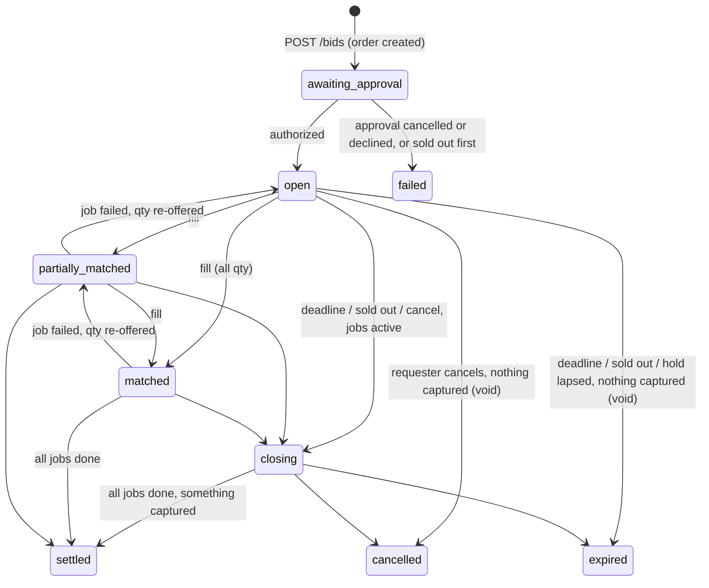
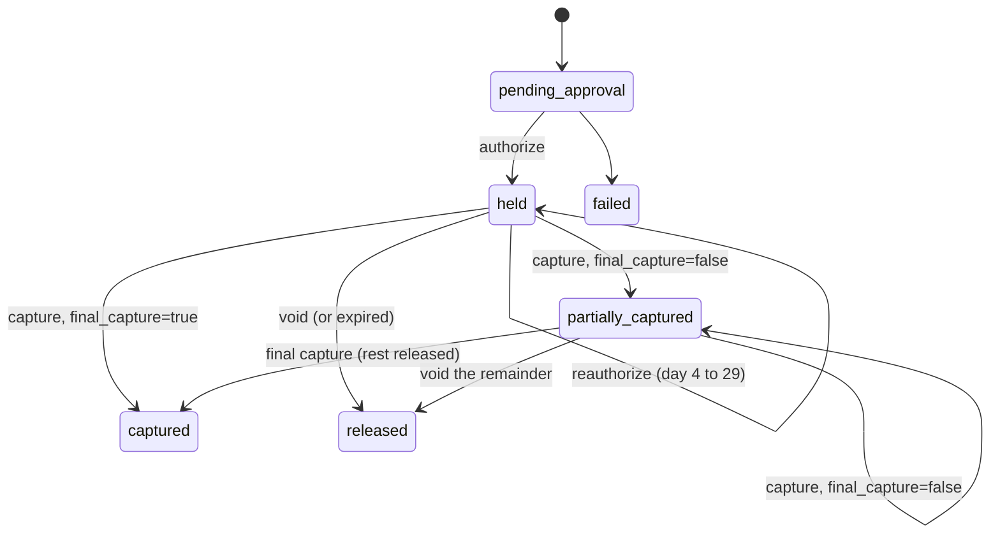
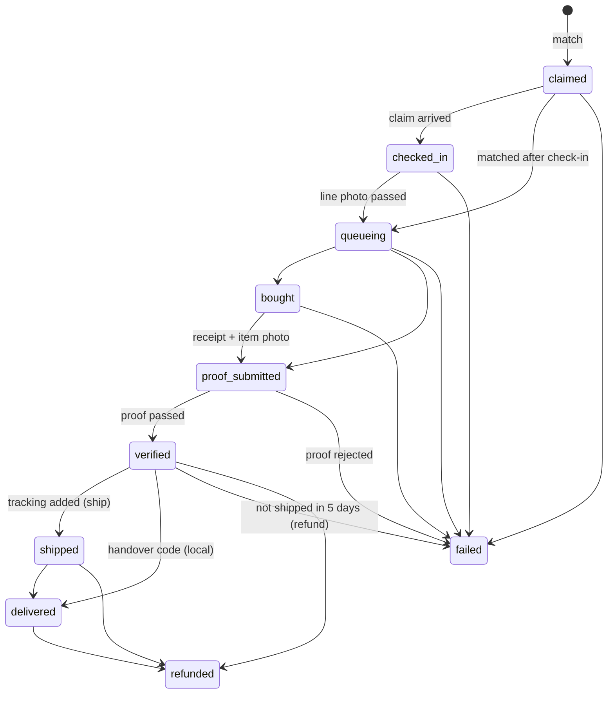

# HoldMySpot domain model, state machines and money rules

Status: proposed, 2026-11-07. Types live in `shared/src/contract.ts`; the rules below are code in `shared/src/{money,matching,stepdown,machines,geo}.ts` and are covered by `shared/src/*.test.ts`. If this page and the code disagree, the code wins and this page gets fixed.

## 1. The idea in one paragraph

HoldMySpot is a walking order book on the **queue fee**. A requester anywhere in the US posts a **bid**: "I want shop X's item, quantity N, I will pay the shop price up to a cap plus a queue fee up to F, by a deadline". The bid is backed by a PayPal **hold** (Orders v2, intent AUTHORIZE) for the most it could ever cost. A queuer near the shop posts an **ask**: "I will be at shop X at time T, I can buy N, for fee G per unit", optionally with a **fee clock** that steps the fee down after check-in. Bids and asks match by price-time priority, with partial fills. The queuer checks in at the shop, buys for each requester at the counter, and uploads the receipt. AI reads the receipt and deterministic rules check it; only then is money captured: the shop price at cost plus the matched fee, and later the actual shipping, each capture with its processing at cost (what PayPal charges to take that payment and to pay the queuer). Captures land in HoldMySpot's PayPal balance, and the queuer is paid from it by PayPal Payouts. A sold-out line, a no-show or a fake receipt captures nothing and the hold is released.

The market is on the service (standing in line), never on the goods: retail, shipping and processing pass through at cost, and HoldMySpot keeps 10% of the queue fee and nothing else (D-105).

## 2. Glossary

| Term | Meaning | Type |
|---|---|---|
| Requester | US person who wants an item and pays (US sandbox buyer). | `User` with role `requester` |
| Queuer | Person who stands in line near the shop and is paid by Payouts. | `User` with role `queuer` |
| Book | All bids and asks for one shop item. One glowing point on the map. | `BookSnapshot` |
| Bid | Requester's resting order: item, qty, retail cap, max fee, shipping budget, destination, deadline. | `BidTask` |
| Hold | The PayPal authorization behind one bid. Its amount is the requester's own limit. | `Hold` |
| Ask | Queuer's offer: shop, item, ETA, capacity, fee, optional fee clock. Location-bound. | `AskTask` |
| Fee clock | Step-down schedule on an ask's fee: open, step, interval, floor. Starts at check-in. | `FeeClock` |
| Claim | The queuer's visit commitment for one ask: arrival window, check-in. | `Claim` |
| Match | Immutable fill record between one bid and one ask. | `Match` |
| Job | Fulfilment of one match for one named requester: one purchase, one receipt. | `Job` |
| Proof | A photo check: the line photo at check-in, or the receipt plus item photo after buying. | `Proof` |
| Ledger entry | One money event: held, renewed, captured, released, paid out, refunded. | `LedgerEntry` |
| Payout | A PayPal Payouts item to the queuer. | `Payout` |

Code uses bid, ask and book. Screens and the pitch should prefer plain words such as "request", "offer", "line" and "held by PayPal" (see section 9).

## 3. Records

Field lists are in `shared/src/contract.ts`. The points that matter:

- **BidTask**: `qty` is at most the item's per-person limit. `retailCapCents` and `maxFeeCents` are per unit, `shippingBudgetCents` is per bid (0 for local errands). `limitCents = qty * (retailCap + maxFee) + shippingBudget + processing reserve` is the hold amount and the requester's own limit (`bidLimitCents`, section 7). `destination` is `{ mode: 'local', cityId }` or `{ mode: 'ship', country: 'US', region, city, postalCode }`. `pricedAt` is the time priority and resets when the max fee changes. `paypalOrderId` and `paypalAuthorizationId` are on the bid and on its hold.
- **AskTask**: `capacity` is at most the item's per-person limit (the queuer is one person in the line). `feeCents` is the fixed fee, or the opening fee when `clock` is set. `origin: 'claim'` means the queuer took one bid directly (`targetBidId`) at that bid's max fee.
- **Claim**: one per ask, created with it. `windowEndsAt = etaAt + arrivalGraceMinutes`. `checkInCode` is a one-time code the queuer shows in the line photo.
- **Match and Job**: one job per match. A job has its own `proofCode` (shown next to the item in the purchase photo), its `caps` (the most it may capture for retail, fee and shipping), and in local mode a `handoverCode` the requester shows at the handover.
- **Hold**: superset of the web prototype's `Hold`. Tracks `authorizationId` (current) and `originalAuthorizationId`, honor period and expiry, `renewals`, `renewalRequired`.
- **LedgerEntry**: superset of the web prototype's `Activity`. Append-only, unique `idempotencyKey`, `status` pending/succeeded/failed.

## 4. Matching (`shared/src/matching.ts`)

One book = one shop item. The server runs `matchBook(bids, asks, { shopCityId, now })` after every change to the book (new or amended bid, new ask, check-in, a job failure returning quantity) and at every fee-clock step (`nextClockStepAt`). The pass is pure and deterministic.

1. **Priority.** Bids: highest `maxFeeCents`, then earliest `pricedAt`, then id. Asks: lowest current fee, then earliest `pricedAt`, then id.
2. **Walk.** Bids in priority order; each bid takes the best compatible asks while the ask's current fee is at or below the bid's max.
3. **Execution price is always the ask's current fee.** A new bid that crosses a resting ask pays the ask's fee. A resting bid fills when the ask's clock first steps to or below its max, at that step's price. A direct claim is an ask priced at the bid's max fee, so the queuer gets exactly what the bid offered.
4. **Partial fills.** Each fill takes `min(bid remaining, ask remaining)`. One queuer can fill several requesters; one requester can be filled by several queuers.
5. **Compatibility** (`compatible`):
   - the ask offers the bid's mode (`local` or `ship`);
   - local errands only match requesters in the shop's own city (San Francisco or New York); a parcel ships to any US address;
   - the ask's ETA is no later than the bid's deadline, and the deadline has not passed;
   - an en-route ask's arrival window is still open;
   - no self-match;
   - a claim-ask only fills the bid it targets.
6. **Matchable.** A bid is matchable only while its hold is `held` or `partially_captured`, `renewalRequired` is false and the bid is not closing. An ask is matchable while `open`.
7. **Re-offer.** When a job fails before purchase (no-show, rejected proof, queuer withdrew), its quantity goes back to the bid's `remainingQty` (if the deadline has not passed and the item is not sold out) and matching runs again with trigger `requeue`.
8. **Sold out.** A checked-in queuer can report the item sold out (with an optional photo). The book turns `sold_out`; jobs not yet bought fail with `sold_out`; open bids stop matching and close (holds voided where nothing was captured). A sold-out book takes no new request or offer (`SOLD_OUT`): the quote and the bid are refused, and an approval that lands after the sell-out is not authorized, so nothing is held (D-116).

### Fee clock (`shared/src/stepdown.ts`)

`fee(t) = max(floor, open - step * floor((t - startsAt) / interval))`; the web app imports the same functions. The clock's `startsAt` is null until the claim checks in, so nobody can run a falling fee from home; before check-in the ask sells at its opening fee. Example: open $15, step $1 every 5 minutes, floor $8; checked in at 10:50, the fee is $14 at 10:55, $13 at 11:00, $12 at 11:05 and $8 from 11:25. The clock lives on the queuer's fee only: a bought item is never put up for sale again (D-07).

## 5. Location rules (`shared/src/geo.ts`)

- Bids come from anywhere. Asks are location-bound.
- Posting an ask or claiming a bid needs a position within `maxTravelMinutes` (30) of the shop at `travelMetersPerMinute` (250, mixed walking and transit), and the ETA cannot be earlier than that travel time allows.
- The web app shows an honest travel estimate that is never faster than this rule: a walk up to 20 minutes, else transit (10 minutes to a stop and waiting, then 300 m a minute along the route). That estimate sets the minutes on every dot and row, the $/hour, the travel filters, greying (more than 30 minutes is too far) and the ETA of an offer the queuer posts (the trip plus a minute), so the arrival window always covers the trip on screen (D-63).
- The claim's arrival window ends `arrivalGraceMinutes` (10) after the ETA.
- **Check-in** = geofence (inside the shop's radius, default 80 m, GPS accuracy 50 m or better) moves the claim to `arrived`, then the line photo showing the one-time `checkInCode` is checked by AI and moves it to `checked_in`. The fee clock starts at `checked_in`.
- If the claim is not `checked_in` when the window ends, it **lapses**: jobs not yet bought fail with `no_show`, their quantity is re-offered, the ask lapses, and the queuer's reliability drops. Queuers below `reliabilityFloor` (60) cannot post asks.
- Live positions are never public. The public map shows asks at the shop (claim status and ETA). Demo avatars that walk the streets are synthetic (`queuer.moved` events from the demo director, `synthetic: true`).

## 6. State machines (`shared/src/machines.ts`)

`assertTransition(machine, from, to)` guards every status change on the server; apps use `canTransition` to decide which buttons to show.

### Bid

| From | To | Trigger | Side effects |
|---|---|---|---|
| awaiting_approval | open | `POST /bids/:id/authorize` succeeds | Hold `held`; ledger `held`; matching runs |
| awaiting_approval | failed | approval cancelled or declined, no approval within 3 hours (our own timeout), or the item sold out before the authorization (close reason `sold_out`, D-116) | Hold `failed`; nothing held |
| open / partially_matched / matched | each other | fills, job failures | `remainingQty` changes (`bidStatusForQty`) |
| any live | closing | deadline passed, sold out, cancel or renewal failure while jobs are active | Bid stops matching |
| live or closing | settled | every job `delivered`, `failed` or `refunded` and something was captured | If the last capture was not final: void the remainder (ledger `released`) |
| live or closing | cancelled / expired | nothing was captured and no job is active | Void; ledger `released` |

### Hold

### Ask and claim

| Ask | To | Trigger |
|---|---|---|
| open | filled | capacity reaches 0 |
| filled | open | a job fails for a requester-side reason and capacity returns |
| open / filled | withdrawn | queuer withdraws (jobs already matched stay) |
| open / filled / withdrawn | lapsed | the claim lapsed |
| open / filled / withdrawn | closed | claim done, shop closed or sold out |

| Claim | To | Trigger |
|---|---|---|
| awaiting_arrival | arrived | check-in inside the geofence |
| awaiting_arrival / arrived | checked_in | line photo proof passed (fee clock starts) |
| awaiting_arrival / arrived | lapsed | window ended before `checked_in` |
| awaiting_arrival / arrived | cancelled | withdrawn before any match |
| checked_in | done | queuer ends the visit, or every job is past purchase |

### Job

| Transition | Money side effect |
|---|---|
| proof_submitted -> verified (ship) | Capture #1: receipt retail (capped) + matched fee + processing (its PayPal fee and both payouts' fees), `final_capture=false`. Payout: fee minus platform fee. |
| verified -> shipped | Add tracking to capture #1, then capture #2: shipping and prepaid duty at cost (capped) + its own PayPal fee, final if it is the last possible capture. Payout: retail + shipping. |
| verified -> delivered (local) | One capture: receipt retail (capped) + fee + processing (its PayPal fee and the payout's fee), final if last. Payout: retail + fee minus platform fee. |
| any -> failed before purchase | None; quantity re-offered. If the bid can no longer use the hold, void. |
| proof_submitted -> failed (rejected) | None ("$0 moved"); quantity re-offered. |
| verified -> failed (not shipped) | Refund capture #1 in full. |
| -> refunded | Refund (full or partial is a ledger entry; full moves the job to `refunded`). |

`failure.reason` is one of `no_show`, `sold_out`, `proof_rejected`, `requester_cancelled` (only while `claimed`), `queuer_withdrew`, `hold_unavailable`, `not_shipped`, `payment_failed`, `shop_closed`.

### Proof and payout

Proof: `verifying -> passed | failed | needs_review`, `needs_review -> passed | failed` (decided in the ops console). Payout: `pending -> succeeded | unclaimed | failed`, `unclaimed -> succeeded | returned | cancelled`.

## 7. Money rules (`shared/src/money.ts`)

All amounts are integer US cents. Every seeded shop prices in US dollars; the engine still converts a receipt in TWD at the job's locked rate (`fx`, default 32.30 TWD per USD, set at match time), rounding half up, but no seeded shop uses it.

1. **One hold per bid** for `limitCents = qty * (retailCap + maxFee) + shippingBudget + processingReserve` (`bidLimitCents`). This is the requester's own limit. The reserve is the most processing the bid can be charged: every way the matcher can split its units into jobs, each capture at its cap (`processingReserveCents`); in practice one job per unit.
2. **Never capture above the user's own limit.** PayPal accepts captures up to 115% of an authorization by default; our code refuses any capture that would take the total past 100% of the hold (`assertCaptureWithinLimit`, error `OVER_LIMIT`), and the bid screen says so.
3. **Per-job caps** (`jobCaps`): retail `job.qty * retailCap`, fee `job.qty * matchedFee`, shipping `floor(shippingBudget * job.qty / bid.qty)`, and `processingCents`, the processing of the job's captures at those caps. Retail is charged at cost from the receipt up to its cap; shipping and prepaid duty at cost up to theirs; each capture may add only its own processing (`captureCapCents`). The queuer's app shows the retail cap at the counter.
4. **Capture schedule.** Ship mode: capture #1 at the verified receipt, capture #2 after tracking. Local mode: one capture at the handover. A capture is sent with `final_capture=true` only when it is the last possible one for the hold (`isFinalCapture`); otherwise the remainder is released later by a void.
5. **Void on failure.** When a bid can no longer capture anything more (all jobs finished, nothing left to match), the server voids the authorization if the last capture was not final. A bid that ends with no captures is voided in full.
6. **Hold renewal** (`renewalVerdict`). An untouched hold (no captures) of a bid that is still open is reauthorized for the same amount once the 3-day honor period is over (day 4) and at least one day before the 29-day validity ends. Reauthorization gives a new authorization id and a new honor period; validity still counts from the original. If reauthorization fails, is too late, or is not supported for the funding source (Venmo is unproven), the hold is marked `renewalRequired`, the bid stops matching and the requester is asked to approve a new hold. Holds with captures are never reauthorized; their later captures still work until day 29.
7. **Platform fee**: 10% of the matched queue fee (`platformFeeBps` 1000), rounded down in the queuer's favour, deducted from the queuer's fee payout. Never charged on retail, shipping or processing. Shown on both the bid form and the ask form.
8. **Payouts only after a COMPLETED capture.** Ship mode: the fee (minus platform fee) after capture #1, retail plus shipping after capture #2. Local mode: everything after the handover capture. Claimed payouts cannot be pulled back, which is why the item money waits for tracking.
9. **Refunds** go back to the requester from the captures in HoldMySpot's PayPal balance, processing included. A payout already claimed by the queuer is not reversed, and PayPal keeps its capture fee on a refund; the platform absorbs both.
10. **Idempotency.** Every money call has a deterministic key stored on its ledger entry (unique) and sent as `PayPal-Request-Id` (payouts: `sender_batch_id`). Keys: `order:<bidId>`, `auth:<bidId>`, `cap:<jobId>:receipt`, `track:<jobId>`, `cap:<jobId>:shipping`, `cap:<jobId>:handover`, `void:<holdId>:<n>`, `reauth:<holdId>:<n>`, `payout:<jobId>:fee`, `payout:<jobId>:reimb`, `payout:<jobId>:all`, `refund:<jobId>:<n>`.
11. **Processing and payouts at cost (D-105).** PayPal charges HoldMySpot 3.49% (half a cent up) + $0.49 per capture and $0.25 per Payouts item (`PAYPAL_PRICING`, as the sandbox charged on 11-07). Each capture is grossed up to the smallest amount whose net after PayPal's fee pays its base plus the payout fees it carries (`grossUpCapture`), so the requester's processing line equals PayPal's fees to the cent. The receipt or handover capture carries every payout of its job (ship: 2, local: 1); the shipping capture carries only its own fee. The server stores PayPal's own fee from each capture (`seller_receivable_breakdown.paypal_fee`) and payout item (`payout_item_fee`) on the ledger and the job; `jobSettlement` reports charged, paid out, PayPal's fees, HoldMySpot's share and any variance from the schedule. HoldMySpot's share of a completed job is exactly its platform fee; a job that captures nothing costs everyone $0.
12. **Where the money sits.** Unspent money stays in the requester's PayPal authorization until a final capture or a void releases it. A capture lands in HoldMySpot's PayPal balance; Payouts sends the queue fee minutes later, the shop price and shipping of a shipped item after the tracking number and the final capture, and a local errand's single payout minutes after the handover. Paying queuers directly as PayPal sellers (multiparty or marketplace onboarding) is the production path and is not built.

### Worked example (checked by `money.test.ts`)

Mia in New York asks for the Mochi Bunny plush from Paper Moon Toys in San Francisco's Japantown (one per customer, sold in person only, shop price $34.00), shipped to her. She sets a retail cap of $36.00, a max fee of $12.00 and a shipping budget of $12.00.

| Step | Amount | Rule |
|---|---|---|
| Hold (PayPal authorizes) | $63.70 = 1 x ($36 + $12) + $12 + $3.70 processing reserve | limit; the reserve is capture #1 at its cap ($48.00 + $2.76) plus capture #2 at its cap ($12.00 + $0.94) |
| Wei checks in 10:50, clock $15 -> $1 / 5 min | fills Mia's request at 11:05 at $12.00 | ask price, first step at or below her max |
| Receipt $34.00 (tax included) | retail $34.00 (cap $36.00) | at cost |
| Capture #1 (`final_capture=false`) | $48.69 = $34.00 + $12.00 + $2.69 processing | $2.69 = PayPal's $2.19 fee on $48.69 (3.49% is $1.70, plus $0.49) + 2 x $0.25 payouts |
| Payout #1 to Wei | $10.80 = $12.00 - $1.20 platform fee | fee payout |
| Tracking added; shipping to New York $8.75, no duty | shipping $8.75 (cap $12.00) | at cost |
| Capture #2 (`final_capture=true`) | $9.57 = $8.75 + $0.82 processing; $5.44 released | $0.82 = PayPal's fee on $9.57 ($0.33 + $0.49); the final capture releases the rest |
| Payout #2 to Wei | $42.75 = $34.00 + $8.75 | reimbursement |
| Totals | Mia charged $58.26 of $63.70 held = $34.00 + $12.00 + $8.75 + $3.51 processing; Wei paid $53.55; PayPal's fees $3.51 ($2.19 + $0.82 + 2 x $0.25); HoldMySpot keeps $1.20 | |

Rex's job in the same script ends with a fake receipt: the QR's store ID does not match Paper Moon Toys, the printed time is before his check-in, the lines do not add up and the item photo matches an older upload. The proof fails, nothing is captured ("$0 moved"), and Priya's request goes back to the book, where Lin's $10 offer takes it (capture $46.62 = $34.00 + $10.00 + $2.62 processing, payout $9.00).

HoldMySpot's margin by job type (`server/test/processing.test.ts`): a shipped or local job that completes leaves exactly 10% of its queue fee ($1.20 for Mia, $0.90 for the New York errand); a void, a sold-out line, a no-show or a rejected receipt captures nothing, so PayPal charges nothing and everyone's money is $0. The one loss is outside the fee model: a queuer who never ships keeps the fee payout, the receipt capture is refunded in full and PayPal keeps its capture fee.

## 8. Other rules

- **Catalog only.** Bids name a seeded shop item (`shared/src/seed.ts`); there is no free-form item in v1.
- **Store limits.** Bid qty and ask capacity are capped by the item's per-person limit; one job = one purchase for one named requester.
- **Deadlines.** At most `maxBidDays` (10) ahead. Shipped jobs must get tracking within `shipWithinDays` (5) of verification.
- **Excluded.** Event tickets; medical, government and free public queues; resale of perishable food (cakes and ramen are local errands only); in-hand resale of bought items (removed, see D-07); random assignment of any kind. Items are a limited cake or pastry, a one-per-customer plush drop and a famous ramen line. 18+ only.

## 9. Words on screen

Required disclosures (exact numbers filled in):

- Bid form: "PayPal holds up to $63.70. You pay the receipt price, the matched fee, the actual shipping and processing at cost, never more than this. The rest is released."
- Bid form and ask form: "HoldMySpot keeps 10% of the queue fee. Shop price, shipping and processing are passed through at cost."
- Bid form: "Processing and payouts: up to $3.70, what taking your payment and paying the queuer costs (3.49% + $0.49 per charge, $0.25 per payout). HoldMySpot makes nothing on it." The cost is the same whichever button pays (D-105).
- Every screen in sandbox or fake mode: a mode banner ("PayPal sandbox: no real money" or "Simulated PayPal").
- AI results: "Checked by AI and rules" plus the provider stamp; a photo no model and no recording read says "Simulated reading, no AI" with the reading it got (D-128); estimates are labelled as estimates.

Avoid on screen and in the pitch (from the 11-07 policy check): NFT, mint, token, floor price, flip, trading, liquidity, spread; loot box, gacha, chase, jackpot, break; scalp, resell for profit, skip the line, bots, hype; escrow, wallet, credits, cash out; "PayPal protects every trade"; any real brand. Internal names (bid, ask, book) stay in code; screen copy is presentation and can say "requests" and "offers".
