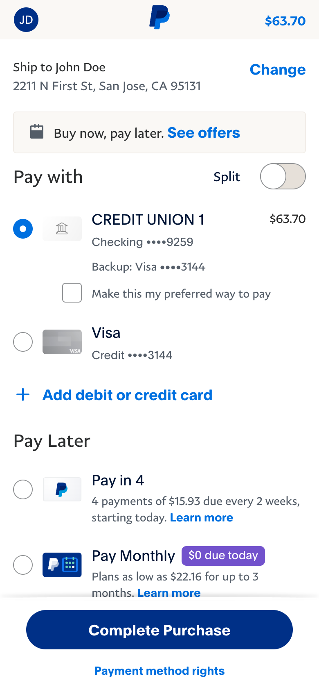
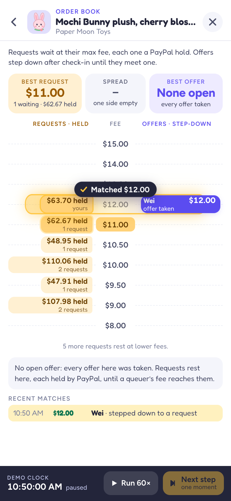
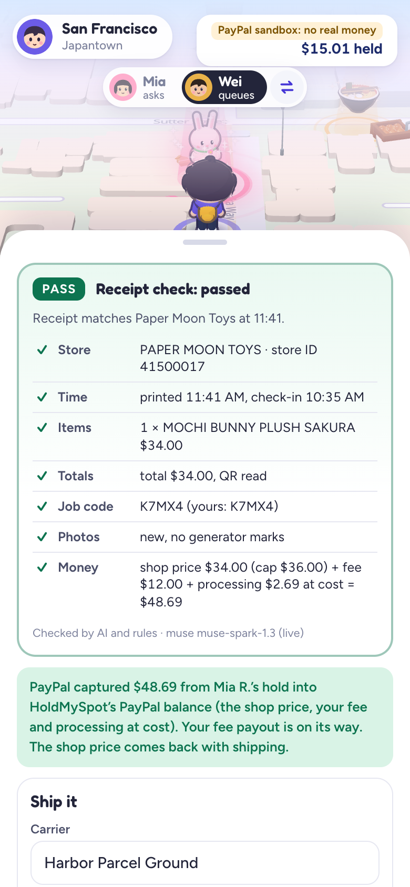
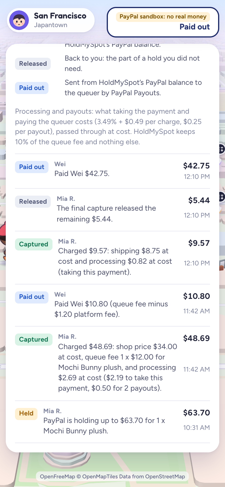
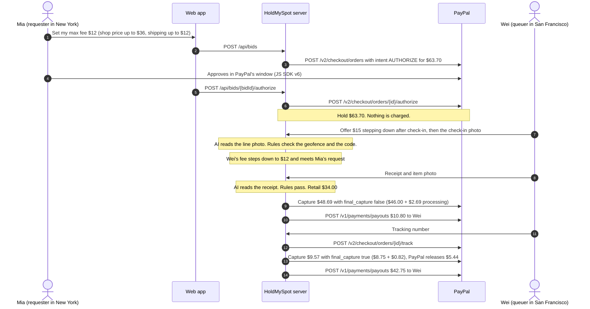
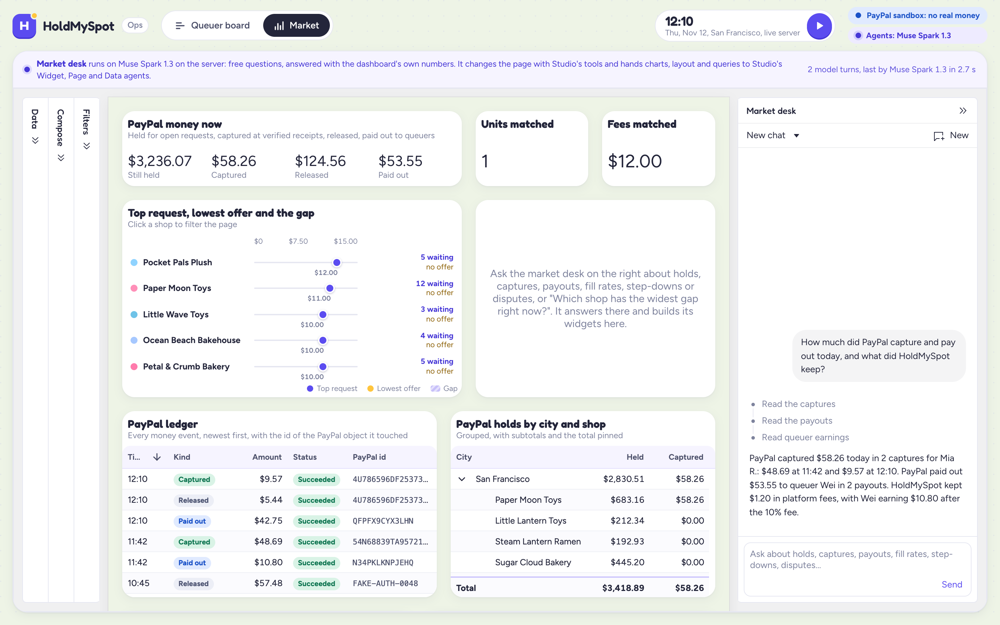
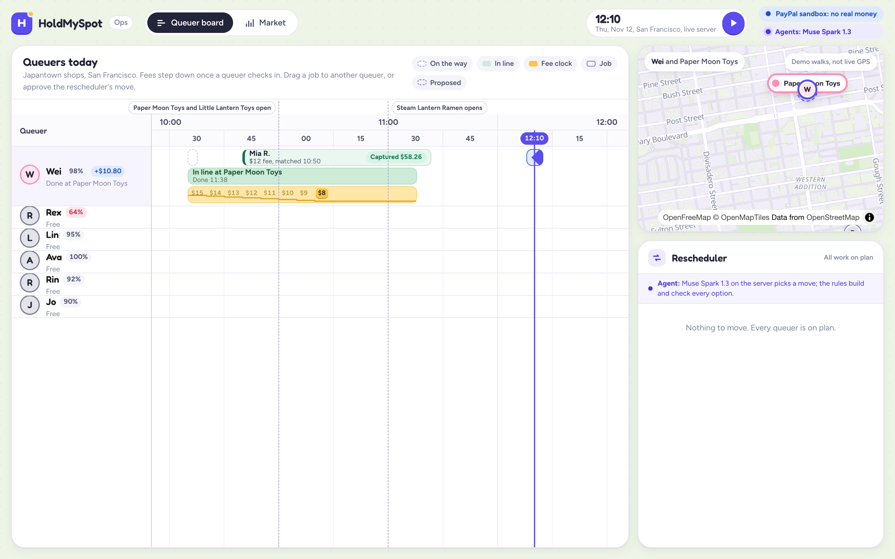
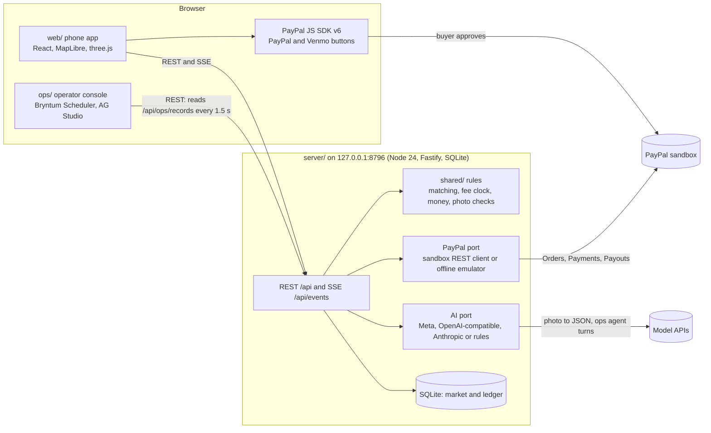

# HoldMySpot: technical details

Everything behind the short [README](../README.md), on one page: the full story and call sequence, the sandbox proof with every PayPal id, the attack table, each PayPal call, each AI job, the sponsor integrations, the sandbox setup, the tests and the architecture. Every number here comes from a log or a fixture ([claims.md](../claims.md)).

**Pay someone near the shop to stand in line for you. PayPal holds the most it could cost. No charge until AI reads the receipt and the rules pass it, or a person approves it.**

|  |  |  |  |
|:---:|:---:|:---:|:---:|
| **1. Hold.** Mia approves \$63.70 in PayPal's own window. Nothing is charged yet. | **2. Match.** Wei's fee steps down until it meets her \$12. | **3. Proof.** AI and rules pass his receipt; PayPal captures \$48.69. | **4. Settle.** The shipping Wei declares is captured, up to Mia's budget; \$5.44 is released, and Payouts pays Wei. |

**The problem.** Some things are sold only in person, in long lines: a bakery's limited cake, a one-per-customer plush drop, a famous bowl of ramen. Someone who cannot be there (out of town, or at work) can pay a stranger to queue, and that fails on trust both ways: the requester fears paying for nothing, and the queuer fears spending his own money at the counter and never being paid back. Paid line-sitting is already a business: a New York line-sitting company charges \$25 to \$37.50 an hour ([Fortune, 2025](https://www.fortune.com/2025/05/18/gen-x-entrepreneur-line-sitting-business-nyc-diddy-trial-sample-sale)), and TaskRabbit lists [waiting in line](https://www.taskrabbit.com/services/shopping-delivery/waiting-in-line) as a service.

**Who it is for.** Requesters anywhere in the US who want one item from an in-person-only sale, and queuers near the shop with an hour to spare, paid by PayPal Payouts with no merchant onboarding.

**How it works.** A requester's request is a PayPal authorization for her whole limit. Queuers nearby offer a fee that can step down on a clock, but only after a passed check-in at the shop (the phone inside the shop's geofence and an AI-read line photo with the visit's code). The queuer buys the item and uploads the receipt; AI reads it, the rules check it, and only then does PayPal capture the shop price read from the receipt plus the fee. The rest of the hold is released, and Payouts pays the queuer. The same hold-then-capture pattern works for a shipped item ([the 30-second story](#the-30-second-story)) and for a local pickup with one capture at the handover ([a local errand](#a-local-errand-one-capture-at-the-handover)).

**Proof.** The hero errand ran on the real PayPal sandbox through the web app with a live AI model, and a local pickup errand ran there through the server's API with its one capture at the handover code; each time PayPal's own records matched the server's ledger to the cent ([every id and the read-back log](#proof-on-the-real-paypal-sandbox)). `npm run attack` tries 22 ways to cheat it ([the table](#try-to-break-it)), and [claims.md](../claims.md) maps every claim here to its test or log.

**Run it** with Node 24, no keys and no accounts: `npm run setup && npm run demo`, then [what to click first](#quick-start-with-zero-keys).

| For judges | Where |
|---|---|
| PayPal | [How HoldMySpot uses PayPal](#how-holdmyspot-uses-paypal): each PayPal API and SDK feature, what it does here, its sandbox proof and its code. |
| AI | [How HoldMySpot uses AI](#how-holdmyspot-uses-ai): what the model reads, and what code decides instead. |
| Sponsors | [AG Studio](#ag-studio-ag-grid-the-market-dashboard) (the market dashboard and its agent) and [Bryntum Scheduler](#bryntum-scheduler-the-queuer-board) (the queuer board and its rescheduler); [where to click](#sponsor-technology-ag-studio-and-bryntum). |
| Evidence | [Sandbox proof](#proof-on-the-real-paypal-sandbox), [try to break it](#try-to-break-it), [evidence](#evidence) ([claims.md](../claims.md), [prior-art.md](../prior-art.md)), [tests](#tests), [production path](#production-path) |
| More | [Architecture](#architecture), [AI coding agents](../AGENTS.md), [troubleshooting](#troubleshooting), [other tools](#other-tools), [MIT licence](../LICENSE) |

**What is different.** HoldMySpot prices only the queuer's time, in an order book whose fee steps down only after a passed check-in at the shop, and pays the item back at the price on a receipt that AI read and the rules checked ([prior-art.md](../prior-art.md) sets it beside the nearest work).

## The 30-second story

The demo day is a plush drop in San Francisco's Japantown on 2026-11-12 (market time). Every number below is checked by the tests and shown by `npm run demo`, and PayPal's sandbox charged the same to the cent ([Proof](#proof-on-the-real-paypal-sandbox)).

1. **10:30.** Paper Moon Toys sells the Mochi Bunny plush for \$34.00, one per customer, in person only. Twelve requests already glow over the shop; the top fee is \$11.
2. **10:31.** Mia lives in New York. She asks for one plush shipped to her: shop price up to \$36, queue fee up to \$12, shipping up to \$12, and up to \$3.70 for processing and payouts at cost. PayPal authorizes a **\$63.70 hold**. Nothing is charged.
3. **10:35.** Wei, a short walk away, offers to queue at \$15. His fee steps down \$1 every 5 minutes once he checks in, never below \$8.
4. **10:50.** Wei checks in: he is inside the shop's geofence, and the AI reads the one-time code in his line photo. His fee starts stepping down.
5. **11:05.** His fee reaches \$12 and meets Mia's request.
6. **11:16.** Rex, who took Priya's \$11 request, uploads a fake receipt. The AI reads it and the rules fail four checks (shop, printed time, totals, recycled photo). **\$0 moves**, and Priya's request goes back on the map, where Lin takes it at \$10.
7. **About 11:40.** Wei buys the plush and uploads the receipt and an item photo. PayPal captures **\$48.69** (the \$34.00 shop price, the \$12.00 fee and \$2.69 processing: PayPal's \$2.19 fee on this capture and \$0.25 for each of the two payouts), and Payouts sends Wei **\$10.80** (the fee minus HoldMySpot's 10%).
8. **14:00.** Wei ships the parcel. The tracking number goes onto Mia's PayPal order, a final capture of **\$9.57** (the \$8.75 shipping Wei reports, under her \$12 budget, and PayPal's \$0.82 fee on it) releases the remaining **\$5.44**, and Payouts sends Wei **\$42.75** (the shop price and the shipping he reported).

<!-- numbers:hero-totals:start -->
Mia: held \$63.70, charged \$58.26 (\$34.00 shop price, \$12.00 fee, \$8.75 shipping, \$3.51 processing), \$5.44 released. Wei: received \$53.55 (\$42.75 back for the plush and the postage he declared, \$10.80 for his time). PayPal: \$3.51 (\$2.19 and \$0.82 on the two captures, \$0.25 on each payout), exactly the processing line. HoldMySpot: \$1.20, 10% of the queue fee. Rex's receipt that failed four checks: \$0.
<!-- numbers:hero-totals:end -->

Mia pays the shop price printed on the receipt, with no markup from HoldMySpot; the fee pays Wei for his time. Every purchase is for one named requester, within the shop's per-person limit. Mia's \$24.26 on top of the plush is the cost of getting it across the country: \$12.00 for Wei's time (HoldMySpot keeps \$1.20 of it), \$8.75 of shipping and \$3.51 of PayPal's processing.

### A local errand: one capture at the handover

The same hold works without shipping. In the zero-key demo's `local-errand` script, Jun in New York asks for a shortcake at Petal & Crumb Bakery (\$38.00, sold in person only). The PayPal order is a `PICKUP_FROM_PERSON` order (sandbox gate G9) and PayPal holds **\$51.54**. Dana, nearby, takes it at a \$9 fee, checks in, buys it and brings it to Jun. Nothing is captured at the receipt: when Jun gives Dana his handover code, PayPal makes **one capture of \$49.47** (\$38.00 shop price, \$9.00 fee, \$2.47 processing), releases \$2.07, and Payouts sends Dana **\$46.10**; HoldMySpot keeps \$0.90. A wrong code captures nothing, and ten wrong codes lock it ([Try to break it](#try-to-break-it), row 18). Run it with `curl -s -X POST http://127.0.0.1:8796/api/demo/start -H 'content-type: application/json' -d '{"scriptId":"local-errand"}'` on a running `npm run demo` (it resets that market); `server/test/processing.test.ts` checks every amount. In San Francisco, `?as=sam` opens the phone as a local requester for the cake and ramen errands.

The same kind of errand ran end to end on PayPal's real sandbox on 2026-11-08 (run `20261108-1357`, `npm run gates -- lifecycle --local`): Sam in San Francisco held \$50.50 for the plush on a `PICKUP_FROM_PERSON` order and Wei bought it with the hero's receipt: nothing at the receipt, one capture of \$48.43 at Sam's handover code, \$2.07 released, \$44.80 paid to Wei. PayPal's own records matched the server's ledger to the cent, its fees included ([Proof](#proof-on-the-real-paypal-sandbox)).

### The same errand, call by call

Sandbox mode; the zero-key demo sends the same requests to the emulator.



## Paid line-sitting, made fair

Paying someone to stand in line is already an ordinary paid service in the US (the sources are at the top). HoldMySpot keeps what makes it fair and adds what it lacks:

- **The requester pays the receipt's price.** The checked receipt sets the price, up to the requester's cap, and HoldMySpot adds no markup to it.
- **One item for one named requester**, within the shop's own limits. Nobody holds stock.
- **Only the queuer's time has a price.** It is set by requests and a falling fee, and HoldMySpot keeps 10% of that fee.
- **Money moves only after the receipt is checked.** PayPal holds the most it could cost and captures the receipt's price, up to the cap.
- **It is not for** event tickets, medical or government queues, or perishable food bought to sell on. By policy, the catalog carries none of these.

The same pattern of holding the most a job could cost, then capturing only after a check, fits any one-item errand whose final price is unknown upfront. That runs from a bakery box or a bowl of ramen to a \$500 launch-day console (a receipt with other lines goes to a person). The demo shows two end to end, a shipped plush and a local shortcake, and both shapes, shipped and local pickup, ran end to end on PayPal's real sandbox with the same plush ([Proof](#proof-on-the-real-paypal-sandbox)). For PayPal it is a reusable pattern built only on Orders v2 `AUTHORIZE`, partial captures and Payouts: hold the most a job could cost, capture what a check passes, and pay the worker.

## Proof on the real PayPal sandbox

**Shot on the real PayPal sandbox**, one errand through the web app on 2026-11-07 with a live AI model: authorization `88232929HR885933A`, captures `54N68839TA957213Y` and `4U786596DF2537313`, payout batches `88H3RUEBP9L4W` and `32VC3V9YGQ78C`. Read back from PayPal, every amount and every PayPal fee matched the server's ledger to the cent ([log](evidence/sandbox-readback-20261107.txt)).

The hero errand ran twice on PayPal's sandbox on 2026-11-07: through the web app on two phones (the screenshots at the top) and through the server's HTTP API alone. After each run, its authorization, order, captures and payout batches were read back from PayPal: every amount, status and PayPal fee matched the server's ledger to the cent. PayPal's answers are kept: the server run's as fixtures that a test pins, and both runs' in a GET-only read-back log ([docs/evidence/sandbox-readback-20261107.txt](evidence/sandbox-readback-20261107.txt)); the web app run's own checks of the server's ledger are in [docs/evidence/web-run-20261107.txt](evidence/web-run-20261107.txt).

| | Web app run (the screenshots) | Server run `20261107-2047` |
|---|---|---|
| How it ran | Two phones in Playwright, played by `web/scripts/sandbox-walk.mjs`: a sandbox buyer approved Mia's hold in PayPal's own window, Wei's offer stepped down in the order book, Muse Spark read the photos live | `npm run gates -- lifecycle`: the server's HTTP API only, the buyer's approval in a headless browser, recorded AI answers |
| Order | `0LK56938DW451581H` | `6EG92708FG4945307` |
| Authorization for \$63.70, now `CAPTURED` | `88232929HR885933A` | `5XK23595W1944882C` |
| Receipt capture, \$48.69 (PayPal's fee \$2.19) | `54N68839TA957213Y` | `24U26127PB091713A` |
| Final shipping capture, \$9.57 (PayPal's fee \$0.82) | `4U786596DF2537313` | `01D83946MR897871E` |
| Released by the final capture | \$5.44 | \$5.44 |
| Tracking on the order, `SHIPPED` | `HPG-2611-57842795` | `HPG-2611-55706958` |
| Payout of Wei's fee, \$10.80 (PayPal's fee \$0.25), `SUCCESS` | batch `88H3RUEBP9L4W` | batch `5MVTE5WFTZD24` |
| Payout of the shop price and shipping, \$42.75 (PayPal's fee \$0.25), `SUCCESS` | batch `32VC3V9YGQ78C` | batch `GS8Q7QS46SBDS` |
| PayPal's fees, equal to Mia's processing line | \$3.51 | \$3.51 |
| Left with HoldMySpot: 10% of the \$12 fee | \$1.20 | \$1.20 |
| Kept in | [`proto-shots/v3/final/`](../proto-shots/v3/final/): 16 phone screenshots, 3 ops console screenshots and 3 clips (D-121, D-122); the walk's log ([web-run-20261107.txt](evidence/web-run-20261107.txt)) and PayPal's read-back ([sandbox-readback-20261107.txt](evidence/sandbox-readback-20261107.txt)) | [docs/SANDBOX-GATES.md](SANDBOX-GATES.md#full-job-through-the-server-sandbox), and PayPal's sanitized answers in [`server/test/paypal/fixtures/recorded/20261107-2047-lifecycle/`](../server/test/paypal/fixtures/recorded/20261107-2047-lifecycle/), pinned by `server/test/paypal/sandbox-parity.test.ts` (D-120) |

**Again on 2026-11-09, on the stamped-photo build** (the app-stamped photos), three more times, each read back from PayPal with GET calls only:

| Run on 2026-11-09 | Order | Authorization | Captures \$48.69 and \$9.57 | Payout batches \$10.80 and \$42.75 | Log |
|---|---|---|---|---|---|
| The web app on two phones (`web/scripts/sandbox-walk.mjs`); `npm run paypal:check` found PayPal matching the ledger to the cent | `7396788025685924T` | `9KJ11656GF995531R` | `6NA8650702616170F`, `352158903M329042E` | `ZL7YXUPNNUCF4`, `9RSCJELWW6AUS` | [web-run-20261109.txt](evidence/web-run-20261109.txt) |
| `npm run errand`, the own-keys path in README; `npm run paypal:check` found PayPal matching the ledger to the cent | `4CM94847JR152032T` | `9BE6416664373732P` | `0J260223X3204031D`, `4HE57002LK731594M` | `ZA8MV9ZXVMT54`, `8YYKP2XBJK5HS` | [errand-run-20261109.txt](evidence/errand-run-20261109.txt) |
| The hosted judge site's "Use the real PayPal sandbox" path (`npm run hosted` with the nine Render variables, [HOSTING.md](HOSTING.md)) | `5PY04562NA309360X` | `9L90810467378031Y` | `7XV76064UH101771A`, `5JP246025R969501C` | `HQ3VEF7CQ63C2`, `QDYCL78BL67YC` | [hosted-sandbox-run-20261109.txt](evidence/hosted-sandbox-run-20261109.txt) |

Each held \$63.70, captured \$48.69 and \$9.57, released \$5.44 and paid out \$10.80 and \$42.75.

**A local pickup errand on the sandbox too**, run `20261108-1357` on 2026-11-08 (`npm run gates -- lifecycle --local`, D-156: the server's HTTP API only, the buyer's approval in a headless browser, recorded AI answers). Sam in San Francisco asks for the same plush for local pickup, so there is no shipping budget and no ship-to address; Wei takes it at \$12, checks in, buys it with the hero's \$34.00 receipt, and nothing is charged until he enters the handover code Sam's phone shows. Read back from PayPal with GET calls only, every amount, status and PayPal fee matched the server's ledger to the cent: 11 of 11 checks on the [gates page](SANDBOX-GATES.md#local-errand-through-the-server-sandbox), and the amounts are the ones the shared money rules give for this errand.

| Local errand run `20261108-1357` | PayPal |
|---|---|
| Order (no ship-to, no tracker) | `15B12811F4599863Y` |
| Hold for \$50.50 on a `PICKUP_FROM_PERSON` order (\$36 shop price cap, \$12 fee, \$2.50 processing reserve), now `CAPTURED` | `2KG09036B9936292Y` |
| Captured when the receipt passed | nothing |
| One capture at the handover code, \$48.43 (PayPal's fee \$2.18): \$34.00 shop price, \$12.00 fee and \$2.43 processing, final | `5KN64357P0403214L` |
| Released by that capture | \$2.07 |
| Payout of the shop price and fee, \$44.80 (PayPal's fee \$0.25), `SUCCESS` | batch `EQVZVFXCLDEDU` |
| PayPal's fees, equal to Sam's processing line | \$2.43 |
| HoldMySpot's 10% of the \$12 fee | \$1.20 |
| Kept in | [docs/SANDBOX-GATES.md](SANDBOX-GATES.md#local-errand-through-the-server-sandbox), and PayPal's sanitized answers in [`server/test/paypal/fixtures/recorded/20261108-1357-lifecycle-local/`](../server/test/paypal/fixtures/recorded/20261108-1357-lifecycle-local/), pinned by `server/test/paypal/sandbox-parity.test.ts` |

- **Gates passed** ([docs/SANDBOX-GATES.md](SANDBOX-GATES.md), written by `scripts/sandbox-gates.mjs`, ids and statuses only): partial and final captures (G1, G2), void after a partial capture (G3), a Venmo-funded hold captured (G4), payout by email (G6), a refund and a buyer-opened dispute settled in the seller's favour through `adjudicate` (G7), tracking on an authorized order's capture (G8), orders with `payment_source` and `PICKUP_FROM_PERSON` (G9) and the app's scopes (G11). For Venmo, the web app's sandbox check approved a \$56.00 hold through PayPal's Venmo button (authorization `7RB884471X718305E`, signed in on the Venmo sandbox page with a PayPal sandbox account; [log](evidence/venmo-hold-20261107.txt)). PayPal's own order records `payment_source` `venmo`, and on 2026-11-08 the gate script (`npm run gates -- venmo`) captured \$10.00 of it with `final_capture` (capture `41C59314FX8286919`, PayPal's fee \$0.84, the same 3.49% + \$0.49 as PayPal-funded captures), so PayPal released the other \$46.00.
- **Both captures read as final.** Once an authorization is closed, PayPal reports `final_capture: true` on every one of its captures; the server sent `false` on the \$48.69 one ([PAYPAL-MAPPING](PAYPAL-MAPPING.md) section 2, step 5).
- **The first server run** (`20261107-1642`, before D-105) held \$60.00; PayPal's \$3.40 in fees on it set the schedule the processing line passes through at cost: 3.49% + \$0.49 per capture and \$0.25 per payout.
- **What PayPal answered at the edges**, which the emulator copies (the full table is on the gates page):

| Call | PayPal's answer |
|---|---|
| Capture \$11.51 of a \$10.00 authorization (115.1%) | Refused: `MAX_CAPTURE_AMOUNT_EXCEEDED` |
| A final capture that brings the total to exactly 115% | Accepted |
| The same capture again with the same `PayPal-Request-Id` | The first capture again, not a second one |
| A new capture that reuses a captured invoice id | Refused: `DUPLICATE_TRANSACTION` |
| Reauthorize on day 1 | Refused: `REAUTHORIZATION_TOO_SOON` |
| Reauthorize on day 4 (G10, 2026-11-10) | Renewed: `61G829070K748054P` and `1EV02891JM262190X`; a second renewal of the same hold answered `REAUTHORIZATION_TOO_SOON`, so the server renews each hold once |
| Void after the final capture | Refused: `PREVIOUSLY_CAPTURED` |
| Refund \$12.01 of a \$12.00 capture | Refused: `REFUND_AMOUNT_EXCEEDED` |

## Quick start with zero keys

You need Node 24 or newer (the repo has an `.nvmrc`; `nvm install 24 && nvm use`), npm, and a browser with WebGL. Every package installs from the public npm registry, AG Studio and Bryntum included, so no account or login is needed. Checked on macOS with Node 24.22 and npm 11.19 ([Evidence](#evidence)).

```sh
git clone https://github.com/eric2612115/HoldMySpot.git
cd HoldMySpot
npm run setup     # npm ci in shared/, server/, web/ and ops/
npm run demo      # starts the server, the web app and the ops console; Ctrl-C stops all three
```

`npm run demo` also installs missing packages on its own. When everything answers it prints (trimmed):

```text
HoldMySpot is running (ready in N s)
  PayPal: simulated PayPal (fake mode): no network, no keys, same rules as the sandbox
  AI:     recorded answers of a real model for the demo photos (replay; no network), rules for any other photo

  Web app      http://127.0.0.1:5190/?demo=1   the market map (a phone layout)
  Ops console  http://127.0.0.1:5197/   queuer board; market dashboard at http://127.0.0.1:5197/#/market
  API          http://127.0.0.1:8796/api/health   (also /api/config, /api/books)
```

**What to click first**

1. **Web app**, http://127.0.0.1:5190/?demo=1 (a phone layout; it also works in a desktop window), on the fresh market every start gives you: tap **Mochi Bunny plush**, then **Set my max fee** (\$12) and **Hold \$63.70 with PayPal**. A sheet labelled **Simulated PayPal** asks you to approve; the money chip (top right) then shows "\$63.70 held". The **Mia asks / Wei queues** switch at the top shows the queuer's phone, where the chip shows Wei's own money instead, and **Map** (bottom right) opens the overview with a list sorted by \$/hour.
2. **Ops console**, http://127.0.0.1:5197/ : press the round **Play** button next to the clock (top right). The story above runs at 60 times speed with your request as Mia's (the script places one for her when you skipped step 1) and stops at 14:01, about 90 seconds to two minutes later (it jumps from 11:53 to 13:58, while the parcel waits to be shipped). Watch the queuer board while it runs: Wei's fee clock steps from \$15 down to \$12 and stops at the match, Rex's job turns red ("Receipt failed, \$0 moved"), and Mia's job goes from Held to Captured. Back in the web app, Mia's sheet says "Paid \$58.26 with PayPal" and her money chip "Charged \$58.26"; the plush is one per customer, so she cannot ask for a second one. Then open **Market** (top left) for the AG Studio dashboard and ask the market desk in its panel (an agent on AG Studio's Agent Framework: its offline planner without a model key, a model on the server with `--ai live` and a key) "Holds and captures", "Captures by shop" (it builds a table of the PayPal captures with the count, total and average per shop) or "Step-downs". By 14:01 every line has closed, so "Widest gap" finds no gap there; the replay in step 4 shows it building its widget.
3. **A queuer's errand by hand**, after Play: on **Wei queues**, tap **Mochi Bunny plush**, then **Take this task**, add a photo and **Check in with this photo** (Wei is still at the shop after the day; elsewhere, **Walk there** first); then **Bought**, two photos and **Send for checking**. No AI model reads your own photos in this mode, so each card asks how to read them (**Read my photo as**: line and code, no code or no line; genuine, fake receipt, totals off or no job code). Pick **Fake receipt** to see the rules fail it and "Receipt rejected: \$0 moved", or **Genuine** (with photos not used before) to see it pass and the money move on. The check card says "Simulated reading, no AI".
4. **Replay**, http://127.0.0.1:5197/?backend=mock : the ops console's in-browser replay of the demo day. Its moment buttons (Clock opens, Two problems, Wei on the way, Lines moving, Parcels shipped) jump to 10:52, 11:21, 12:05, 12:40 and 14:10. At **Two problems** the rescheduler proposes two moves; at **Wei on the way**, "Widest gap" on the **Market** page builds the spotlight widget. The server's demo day has no late queuer, so those two problems show here; approvals and drags also work on the live server (`POST /api/ops/moves`).

Place your own request before Play: the scripted day then runs with it as Mia's, and anything else you place joins the same market. To start over, press Ctrl-C and run `npm run demo` again; every start is a fresh market.

**What is simulated in this mode.** PayPal: the server's real sandbox REST client talks to an in-process emulator with PayPal's rules (ids look like `FAKE-AUTH-0065`); every screen says "Simulated PayPal". AI: the 21 demo photos in `server/fixtures/proofs` replay a real model's recorded answers. Any other photo, your own included, gets the simulated reading you pick on the queuer's phone (step 3), the same rules decide, and its check card says "Simulated reading, no AI" ("QR simulated" instead of "QR read"); an upload over the API with no reading chosen (`?fixture=`) goes to ops review instead of passing. To see a rejection by hand, pick **Fake receipt**: \$0 moves. The queuers' walks on the map are part of the simulated day. In this mode the server calls neither PayPal nor a model: the PayPal client talks to the in-process emulator, and photos are read from recordings or simulated readings (`server/test/no-network.test.ts` plays the hero day with every network call refused). The browser loads map tiles from OpenFreeMap.

**Useful switches**

| URL | What it does |
|---|---|
| `http://127.0.0.1:5190/?demo=1&phone=queuer` | Opens on the queuer's phone (Wei) |
| `http://127.0.0.1:5190/?demo=1&as=sam` | A San Francisco requester, for the local cake and ramen errands (Mia is in New York) |
| `http://127.0.0.1:5190/?demo=1&city=nyc` | The New York map |
| `http://127.0.0.1:5190/?demo=1&as=mia&book=plush-paper-moon` | Opens on the Mochi Bunny plush's order book ([below](#the-order-book-step-by-step)) |
| `curl -X POST http://127.0.0.1:8796/api/demo/start -H 'content-type: application/json' -d '{"scriptId":"fee-agent","speed":60}'`, with `http://127.0.0.1:5190/?demo=1` open on **Mochi Bunny plush** | The fee agent on Mia's held card with no key (about 15 s): \$10, \$11, \$12, then one attempt at \$14 that the server refuses, "Refused: above what PayPal holds". Every step reads "Scripted demo step, no AI"; the \$63.70 hold does not move and nothing is charged |
| `http://127.0.0.1:5197/#/market` | The AG Studio market dashboard |
| `http://127.0.0.1:5197/?backend=mock` | The ops console on its in-browser replay of the demo day, with moment buttons, the rescheduler's proposals and drag-to-move |
| `http://127.0.0.1:5197/?backend=mock&at=11:21` | The replay at 11:21: two rescheduler proposals wait for approval |
| `http://127.0.0.1:5197/?backend=mock&at=11:21#/people` | The console's third page, one receipt, one refund and one dispute for a person ([how it works, and the live-server script](NEEDS-A-PERSON.md)) |
| `http://127.0.0.1:5197/?backend=mock&at=12:05#/market` | The dashboard's replay at 12:05, where "Widest gap" builds the spotlight widget |

Ports taken? `npm run demo -- --port-offset 10` moves all three (8806, 5200, 5207). `npm run doctor` checks Node, packages, ports and keys (names only); when PayPal keys are saved it also makes one sandbox OAuth call. Where keys come from: PayPal and AG keys from this repo's `.secrets/` (written by `npm run keys`) or the folder `HMS_SECRETS_DIR` names, or from variables you set; AI keys from variables you set, `.secrets/ai.env` (or the same file in `HMS_SECRETS_DIR`), and the dotenv files `HMS_AI_KEY_FILES` lists, in the environment or in the git-ignored `server/.env.local`. Nothing else outside the repo is read. Without `--ai live` the demo never calls a model, and `npm run ai:eval` (without `--live`) and `npm run attack` read no key at all.

### The order book, step by step

Every shop item is a book. Tap the round badge on a map label, the **Order book** strip in a shop sheet or a queuer's task card, or open the link above. Requests rest on the left at their max fee, with what PayPal holds at each level; offers sit on the right at their fee now, each with its step-down path to its floor and a countdown to the next drop; the spread is in the middle and the latest matches below. In the zero-key demo the book's clock bar has **Run 60×** and **Next step**: after **Start the demo day** (or the ops console's Play), each Next step jumps the market clock to the next scripted moment or fee drop (Mia's request at 10:31, Rex taking Priya's request at 10:33, Wei's offer at 10:35, his check-in at 10:50), then from \$15 to \$14 to \$13 until his fee meets Mia's \$12 request at 11:05 and both leave the book with a "Matched" flash. `web/scripts/book-shots.mjs` takes the same walk for screenshots and a short video. Decisions D-110 to D-114.

## Try to break it

One command, no keys, under a minute ([runs.json](evidence/runs.json) keeps the recorded time and the machine's load):

```sh
npm run attack
```

It starts its own zero-key server (simulated PayPal, the recorded AI answers, an empty secrets folder), tries to cheat it in the ways below, prints one table and stops the server. Each fake receipt is a rendered demo photo from `server/fixtures/proofs` on a fresh demo market: Rex takes a request, checks in with his line photo and sends the fake. The money tricks run on a market where Wei does Mia's errand honestly, and the handover-code guess on one where he does Sam's local errand. On one more market Wei sends Mia's real receipt reprinted at her cap (a rendered reprint whose QR was regenerated to match, `server/fixtures/proofs/_reprint-at-cap`, read by the rules-only reader from its truth sidecar). Rows 19 to 21 skip HoldMySpot and go straight to the PayPal emulator, which gives the answers PayPal's sandbox gave ([what PayPal answered at the edges](#proof-on-the-real-paypal-sandbox)).

<!-- attack-table:start -->
```text
 #  Attempt                                                    Stopped by        Answer                             Moved
 1  Genuine receipt and item photo (control: should pass)      -                 passed                             $48.69 charged, $10.80 paid out (intended)
 2  Item photo recycled from Lin's job on 11-11                rules             duplicate_photo                    $0.00
 3  Receipt whose QR carries another store's ID                rules             shop_match                         $0.00
 4  Receipt printed at 10:31, before the check-in              AI + rules        time_window                        $0.00
 5  Receipt whose line does not add up to its total            AI + rules        totals_add_up                      $0.00
 6  Item photo showing another job's code                      AI + rules        code_visible                       $0.00
 7  Receipt file made by an image generator                    sent to a person  generator_metadata (to a person)   $0.00
 8  Raise the max fee to $40.00 after PayPal held $63.70       rules             OVER_LIMIT                         $0.00
 9  Buy and send a receipt without checking in                 state machine     INVALID_TRANSITION                 $0.00
10  Check in from home, 3.1 km from the shop                   rules             OUTSIDE_GEOFENCE                   $0.00
11  Take a request whose hold was released                     state machine     CONFLICT                           $0.00
12  Claim $500.00 shipping on a $12.00 budget                  rules             capped at the $12.00 budget        $12.94 charged, $46.00 paid out (capped)
13  Replay that tracking call (same Idempotency-Key)           state machine     first answer replayed              $0.00
14  Add tracking again to capture after the final one          state machine     INVALID_TRANSITION                 $0.00
15  Send the receipt again for a second fee payout             state machine     INVALID_TRANSITION                 $0.00
16  Approve a hold after the item sold out                     state machine     SOLD_OUT                           $0.00
17  Report the plush sold out alone, to void every hold on it  rules             only his own job ended; book open  $0.00
18  Guess the 4-digit handover code for two hours, then right  rules             locked after 10 wrong codes        $0.00
19  Capture $73.26 of a $63.70 hold, straight at PayPal        PayPal emulator   MAX_CAPTURE_AMOUNT_EXCEEDED        $0.00
20  Capture again after the final capture, straight at PayPal  PayPal emulator   AUTHORIZATION_ALREADY_CAPTURED     $0.00
21  Send the same payout batch again, straight at PayPal       PayPal emulator   USER_BUSINESS_ERROR                $0.00
22  Reprint the $34.00 receipt at the $36.00 cap, QR to match  sent to a person  listed_price (to a person)         $0.00
```
<!-- attack-table:end -->

**Stopped by** follows from each answer, not from a label next to the attempt: a receipt's failed checks, labelled as the [ablation](ABLATION.md) labels them (`server/src/ai/basis.ts`), or the refusal code (`LAYER_OF_CODE` in `server/src/demo/attack.ts`). *rules*: code alone decided (a photo hash, the receipt QR's store ID read from its pixels, the position the phone reports, the money caps in `shared/src/money.ts`, the lock on handover codes: 5 wrong in an hour, 10 in all). *AI + rules*: a rule rejected what the model read (a printed time, a total, a code); the model never decides. *sent to a person*: a soft check failed, so the receipt waits for review and nothing moves unless a person passes it. *state machine*: the request, the job or the call's idempotency key allows nothing more at that point. *PayPal emulator*: the in-process copy of PayPal's sandbox answers. Row 17's report is accepted, and the rule that one report ends only the reporter's own job (D-152) is what stops it, so it reads *rules*.

What moves: row 1 moves exactly what the shared money rules say for a genuine receipt. Row 12 pays shipping as declared by the queuer, capped by the budget: \$500.00 claimed, \$12.00 charged plus PayPal's fee on it. Row 22, a receipt reprinted at the requester's cap with a QR to match, agrees with itself, and the listed-price check still catches it: its price is above the plush's listed \$34.00, so it waits for a person and nothing is captured (D-151). Every other row moves \$0.00.

It exits 1 if any attempt moves anything but what the shared money rules say, or an attempt that must be refused is not. `npm test` runs it in CI mode (`server/test/attack.test.ts`): it checks every row, the layer each answer gives and this table against a fresh run, then runs the money part against a server that pays the queuer \$1.20 too much, where it must exit 1. To watch it in the ops console, attack the running demo instead: `npm run attack -- --reuse` (with the same port flags as `npm run demo`; it resets that market before each part, and the last part stays). `--json <file>` writes the report, `--verbose` prints every answer in full. Decisions D-137 to D-139, D-147 to D-149, D-151 and D-152.

## Evidence

Every row is written by `npm run numbers` (`scripts/readme-numbers.mjs`) from the log or fixture it names, not typed.

<!-- numbers:evidence:start -->
| Claim | Result | Run it | Log or fixture |
|---|---|---|---|
| The tests pass with no keys, calling neither PayPal nor a model | 763 tests in 6 steps: 763 passed, 0 failed (shared 104, server 491, web 141, ops 27); on macOS (arm64), Node 24.22.2, npm 11.19.1, 2026-11-10 | `npm test` | [tests.json](evidence/tests.json) |
| The money and market rules hold on generated cases (P1 to P8) | 19 property tests, 31,680 generated cases in every `npm test` (fixed seed; each test's name gives its runs): 29,500 cases of the shared rules, 2,000 rescheduler mornings on the ops console's replay model, and 180 generated market days on the server with the PayPal emulator (P5 plays each of its 60 days twice, with and without PayPal failures). The 120 days of P1-P4 P6 P7 reached 220 passed check-ins, 214 matches (37 below the opening fee), 32 completed jobs, 25 receipts failing a hard check, 21 PayPal failures injected, 118 server restarts and 6 reassignments | `npm test` | [tests.json](evidence/tests.json) |
| PayPal's sandbox charged what the rules say | Run `20261107-2047`: held \$63.70, captured \$48.69 + \$9.57, released \$5.44, paid out \$10.80 + \$42.75; PayPal's fees \$2.19 + \$0.82 + 2 x \$0.25 = \$3.51, the processing line; HoldMySpot kept \$1.20; 10 of 10 read-back checks match; the same amounts as the worked example in `shared/src/money.ts` | `npm run gates -- lifecycle` (your sandbox keys) | [SANDBOX-GATES.md](SANDBOX-GATES.md#full-job-through-the-server-sandbox), [PayPal's answers](../server/test/paypal/fixtures/recorded/20261107-2047-lifecycle/) |
| The web app run on PayPal's sandbox read back the same | PayPal on 2026-11-07 13:33 UTC: authorization `88232929HR885933A` \$63.70 CAPTURED; captures \$48.69 + \$9.57 COMPLETED (PayPal's fees \$2.19 + \$0.82); released \$5.44; payouts \$10.80 + \$42.75 SUCCESS; tracking SHIPPED; HoldMySpot kept \$1.20. The walk's own checks of the server's ledger: 9/9, the same ids and amounts | `web/scripts/sandbox-walk.mjs` (your sandbox keys, a second sandbox buyer) | [web-run-20261107.txt](evidence/web-run-20261107.txt), [sandbox-readback-20261107.txt](evidence/sandbox-readback-20261107.txt) |
| A local pickup errand on PayPal's sandbox charged what the rules say | Run `20261108-1357` (Sam's plush, a `PICKUP_FROM_PERSON` order): held \$50.50, nothing captured at the receipt, one capture of \$48.43 at the handover code, released \$2.07, paid out \$44.80 in one payout; PayPal's fees \$2.18 + \$0.25 = \$2.43, the processing line; HoldMySpot kept \$1.20; 11 of 11 read-back checks match; the same amounts as the shared rules give for this local errand | `npm run gates -- lifecycle --local` (your sandbox keys) | [SANDBOX-GATES.md](SANDBOX-GATES.md#local-errand-through-the-server-sandbox), [PayPal's answers](../server/test/paypal/fixtures/recorded/20261108-1357-lifecycle-local/) |
| Gates passed on PayPal's sandbox | G0, G1, G2, G3, G4, G6, G7, G8, G9, G10 and G11 | `npm run gates -- status` (your sandbox keys) | [SANDBOX-GATES.md](SANDBOX-GATES.md) |
| The model reads, the rules decide (21 demo photos, recorded muse/muse-spark-1.3 answers) | 0 model calls: 21/21 verdicts, 21/21 exact failed-check sets, 8/8 money, 161/164 fields, 10/10 bad proofs caught, 0/7 genuine proofs failed | `npm run ai:eval` | [ai-eval.json](evidence/ai-eval.json) |
| Which layer stops which fake | Fakes stopped: Rules + AI 10/10; the rules on the true reading (each photo's truth.json, not a reader) 10/10; the model without the job, not asked for a verdict, 3/10; code alone 4/10, a rule on the model's reading for the other 6; genuine proofs passed 7/7 in each | `npm run ablation` | [ABLATION.md](ABLATION.md), [ablation.json](evidence/ablation.json) |
| What the cheating attempts move | 22 attempts: 18 refused with \$0.00 moved (rules 6, AI + rules 3, state machine 6, PayPal emulator 3); rows 7 and 22 sent to a person, \$0.00 until they decide; row 1 moved exactly the genuine receipt's amount; row 12 paid shipping as declared, capped by the budget; across 9 markets and 11 jobs, no hold captured more than it held and no job paid out more than it charged | `npm run attack` | [attack.json](evidence/attack.json) |
| A fresh start answers with no keys | server, web, ops answered, ready in 3.1 s. PayPal: simulated PayPal (fake mode): no network, no keys, same rules as the sandbox. AI: recorded answers of a real model for the demo photos (replay; no network), rules for any other photo | `npm run demo -- --smoke` | [smoke.json](evidence/smoke.json) |
<!-- numbers:evidence:end -->

`npm run numbers` derives [docs/evidence/numbers.json](evidence/numbers.json) from those files and rewrites the rows above, the story's totals, the AI eval summary and the test count; it also checks the numbers this page states in its own words: both sandbox runs' ids and amounts against PayPal's recorded answers and read-back, the AI scores against the recorded answers, the gates and PayPal's edge answers against the gates page, the attack's duration, and the Node and npm versions. `npm run numbers -- --record` runs the zero-key commands again first and keeps their reports; each report records the commit and the git tree of each code folder it ran on (claims.md lists them). So this page cannot drift from the committed logs: `npm test` fails when it disagrees with them (`server/test/readme-numbers.test.ts`), and it also runs the AI eval, the attack and the ablation again and compares them with their logs. Decisions D-143 to D-146 and D-149.

- Evidence index: [claims.md](../claims.md), every claim on this page and in the Devpost text, with the test or script that proves it and its log or fixture.
- Nearest prior work: [prior-art.md](../prior-art.md), the nearest existing services and hackathon entries, what each does, and where this repo tests HoldMySpot's difference.

## Real PayPal sandbox with your own app

Sandbox mode sends real calls to `api-m.sandbox.paypal.com` (no real money). The server refuses any other PayPal host, and keys never enter the repo.

1. **App.** Sign in at https://developer.paypal.com, open **Apps & Credentials**, switch to **Sandbox**, and open the Default Application or **Create App** (Merchant). Copy the **Client ID** and **Secret key 1**.
2. **Features.** On the same app page, under Features, tick **Accept payments** (authorize, capture and refunds) and **Payouts**; tick **Customer disputes** and shipment tracking if they are listed. Save. `npm run keys` reports which ones the app has.
3. **Accounts.** Under **Testing Tools > Sandbox Accounts**, pick one **Personal** account as the buyer (you sign in to PayPal's window with it; View/Edit shows its password) and a second Personal account to receive queuer payouts (create one if there is only one). The app's own Business account is the merchant; `npm run keys` finds its email and ID.
4. **Save the keys.** Run `npm run keys`. It asks for the client ID, the buyer email, the payout email and the secret (hidden input), checks them with one sandbox OAuth call, lists the app's features, and finds the merchant account from one \$1.00 sandbox order that is never approved. Everything goes to `.secrets/` (git-ignored, folder 700, files 600); the payout receiver is saved as `PAYPAL_PAYOUT_EMAIL`. Non-interactive: export `PAYPAL_CLIENT_ID`, `PAYPAL_CLIENT_SECRET`, `PAYPAL_BUYER_EMAIL` and `PAYPAL_PAYOUT_EMAIL`, then run `npm run keys -- --from-env`.
5. **Check.** `npm run doctor` ends with "PayPal sandbox mode is ready too: npm run dev:sandbox."
6. **Start.** `npm run dev:sandbox`. Every screen now says "PayPal sandbox: no real money", and the launcher's "What to click" lists the sandbox steps below. With an AI key saved too, photo checks call the model live.
7. **Approve a hold.** On the fresh market `npm run dev:sandbox` starts, in the web app tap **Mochi Bunny plush**, then **Set my max fee** (or **Book now** when a queuer has offered). PayPal's own buttons appear: PayPal, and Venmo when PayPal reports it eligible. Click one; PayPal's window opens (when pop-ups are blocked, PayPal shows the same sign-in as an overlay on the page). Sign in as the sandbox buyer and approve. The app shows the hold, for example "\$63.70 held".
8. **Finish the errand, no password stored.** `npm run errand` (add the same port flags as the server) plays Wei over the server's HTTP API for that held request: a claim at your max fee, the check-in with the rendered line photo, "bought", the receipt and item photos, both PayPal Payouts and the tracking number. PayPal captures the receipt, then the shipping, releases the rest and pays Wei; the command prints the request's ledger with every PayPal id. It needs Mia's Mochi Bunny plush request on a fresh market (the clock at or before 10:40, before Play), because the rendered photos carry the codes that market gives Wei's first visit. It takes a few minutes while the model reads the photos and PayPal settles the payouts; in the zero-key demo it takes a second.
9. **Confirm on PayPal.** `npm run paypal:check -- --bid <request id>` (the id `npm run errand` prints; add the port flags) gets one OAuth token, then only GETs the order, the authorization, each capture and each payout batch from PayPal, and prints PayPal's amounts and fees next to the server's ledger, ending "PayPal matches the server to the cent." when they agree. Before approval it shows the order (`PAYER_ACTION_REQUIRED`) and its amount; `-- --order <id>` reads one order without the server. The server's ledger itself: `curl -s -H 'X-HMS-User: mia' 'http://127.0.0.1:<server port>/api/ledger?mine=1'` (8796 by default; it lists money lines once the hold is authorized, and `GET /api/bids/<id>` shows a request still waiting for approval). Or sign in at https://www.sandbox.paypal.com with the app's business account and open its activity. **Cancel and release the hold** in the app voids the authorization.
10. **The whole money cycle on your sandbox, scripted.** `npm run gates -- lifecycle --by-hand --out .run/gates.md --no-record` plays Mia and Wei over the server's HTTP API on its own port (8798; `--port` to change), prints PayPal's approval link for you to approve as your sandbox buyer in your own browser (`--open` opens it, `--wait 15` minutes), then reads the authorization, the captures and the payouts back from PayPal and compares them with the server's ledger to the cent. Without `--by-hand` it approves in a headless browser with the buyer's sandbox login saved in `.secrets/sandbox-buyers.json` (`{"buyers":[{"label":"buyer","email":"...","password":"..."}]}`, git-ignored) and Playwright's Chromium (`npx playwright@1.56.1 install chromium`). `--out` and `--no-record` keep the committed evidence page and fixtures as they are. If PayPal shows a challenge (a CAPTCHA or a code), the script stops without answering it and names a screenshot of the page; holds you approve by hand (step 7) are not affected. Add `--local` for the local pickup errand instead: Sam's `PICKUP_FROM_PERSON` hold in San Francisco, nothing captured at the receipt, one capture when Wei enters Sam's handover code, one payout, read back and compared the same way.
11. **The same errand through the web app, scripted.** `web/scripts/sandbox-walk.mjs` plays Mia's and Wei's phones in Playwright against a sandbox server with a live AI model, approves in PayPal's own window as a second sandbox personal account (`APPROVER`, never the payout receiver), checks the ledger and saves the screenshots and clips shown at the top of this page. It moves the market clock with the order book's Next step and never starts the scripted day. Its header lists what it needs: the server and web app commands, the keys saved by `npm run keys` (or `HMS_SECRETS_DIR`), and ffmpeg for the clips.

Notes:
- The seeded crowd requests that fill the map stay on simulated PayPal in sandbox mode; every request you place is a real sandbox order. The Play button's scripted day is for the zero-key mode: in sandbox mode its first request waits for a PayPal approval that no screen offers, so place your own requests instead; the order book's **Next step** moves the market clock for them (D-123). Captures and payouts on your own sandbox come from `npm run errand` (step 8) or the scripted runs in steps 10 and 11.
- The app's buttons are PayPal and Venmo, with Pay Later switched off; PayPal's own window still shows PayPal's own Pay Later offers.
- Venmo (gate G4): approve a hold with the Venmo button (step 7), then `npm run gates -- venmo --order <PayPal order id>` checks with PayPal that the order is paid with Venmo and still uncaptured, captures \$10.00 of it with `final_capture` (`--amount` in cents), reads it back with GET calls and records the gate; add `--out .run/gates.md --no-record` to keep the committed page and fixtures.
- `npm run gates -- run --fake` runs the gate checks against the emulator with no keys (its page goes to a temporary file).

## How HoldMySpot uses PayPal

- **A request opens only on money PayPal holds.** The server reads the status and amount of every authorization PayPal returns: `CREATED` for exactly the hold's amount opens the request; `PENDING` (PayPal reviewing the payment) keeps it waiting, with no queuer matched, until a status read says otherwise; `DENIED` or another amount ends it, and a wrong amount is voided at once (D-150, `server/test/adversarial.test.ts`).
- One Orders v2 order with intent `AUTHORIZE` per request. The hold is the requester's own limit: quantity x (shop price cap + max fee) + shipping budget + the most processing the request can cost.
- Processing and payouts at cost: a service line for moving the money, on every payment whichever button pays (the app offers no other way to pay). Each capture adds what PayPal charges HoldMySpot to take it (3.49% + \$0.49) plus \$0.25 for each payout it funds, grossed up to the cent, and the server reads PayPal's own fee back from every capture and payout. So neither the queuer's pay nor HoldMySpot's 10% of the queue fee absorbs PayPal's fees ([docs/DECISIONS.md](DECISIONS.md) D-105).
- Partial captures with `final_capture`: the receipt (the shop price read from it, up to the cap, + the fee), then the shipping the queuer reports, up to the shipping budget, after tracking is added to the order. The final capture releases the rest. Captures never exceed the hold, although PayPal accepts up to 115%.
- Void when a request can capture nothing more (sold out, expired, cancelled, or done without a final capture). Reauthorize untouched holds from day 4, after PayPal's 3-day honor period.
- PayPal Payouts to the queuer, only after a `COMPLETED` capture. Refunds from the ops side.
- PayPal's own JS SDK v6 buttons (PayPal, and Venmo when eligible) in sandbox mode.
- Every money call carries a `PayPal-Request-Id` from the ledger, so a resent capture, void or refund returns PayPal's first answer instead of acting twice; a payout is never resent (PayPal refuses a batch sent again), so a payout whose answer was lost stays pending for ops to reconcile and is never paid twice. Orders and captures carry an `HMS-` invoice id; a payout batch's `sender_batch_id` is its ledger key.
- Run against the real PayPal sandbox on 2026-11-07: the hero errand through the web app and through the server's API alone, each read back from PayPal and matched to the cent, plus PayPal's answers to edge cases; on 2026-11-08 a local pickup errand through the server's API, read back and matched the same way ([Proof](#proof-on-the-real-paypal-sandbox)). The zero-key demo runs the same REST client against an offline emulator that copies those answers.

**Who holds the money.** HoldMySpot is the merchant on every order and pays queuers with Payouts, because a queuer is a person running one errand, not a seller. So the money does pass through HoldMySpot: PayPal holds the requester's money in the authorization, each capture lands in HoldMySpot's PayPal balance, and Payouts sends the queuer's share on: the fee minutes after the receipt capture, the shop price and shipping of a shipped item once tracking is added, a local errand's payout minutes after the handover. PayPal's multiparty or marketplace onboarding, which pays queuers directly as PayPal sellers in the same payment, is the [production path](#production-path).

**Every call**, with what the real sandbox proved on 2026-11-07 and 2026-11-08 (gate ids from [docs/SANDBOX-GATES.md](SANDBOX-GATES.md); "both runs" are the two hero errands and "the local run" is the local pickup errand under [Proof](#proof-on-the-real-paypal-sandbox)). The hero errand's calls in order are in [the sequence diagram above](#the-same-errand-call-by-call).

| PayPal feature | Call | What HoldMySpot does with it | Sandbox proof | Code |
|---|---|---|---|---|
| OAuth 2.0 | `POST /v1/oauth2/token` | Client credentials for every server call, cached until 60 s before they expire. `npm run keys` and `npm run doctor` use the same call to check the app's scopes. | G0, G11 | `server/src/paypal/http.ts`, `scripts/common.mjs` |
| JS SDK v6 | `createInstance`, `findEligibleMethods`, `createPayPalOneTimePaymentSession`, `createVenmoOneTimePaymentSession`, `<paypal-button>`, `<venmo-button>` | The requester approves the hold in PayPal's own window. The client ID comes from `GET /api/config`; the secret stays on the server. Fake mode shows a "Simulated PayPal" sheet instead. | The web app run: Mia's \$63.70 hold `88232929HR885933A`, approved in PayPal's own window (picture 1 at the top); a hold approved through the Venmo button, `7RB884471X718305E` ([log](evidence/venmo-hold-20261107.txt)), which PayPal records as Venmo-funded and G4 captured in part | `web/src/services/payments/paypalV6.ts`, `web/src/services/payments/approval.ts`, `web/src/ui/PayPalButton.tsx` |
| Orders v2, intent `AUTHORIZE` | `POST /v2/checkout/orders` | One order per request for its limit, with item lines, an `HMS-` invoice id, our id in `custom_id`, the soft descriptor `HOLDMYSPOT`, and `GET_FROM_FILE` shipping or `PICKUP_FROM_PERSON` for local errands. | G1 to G3, G9; both runs (orders `0LK56938DW451581H`, `6EG92708FG4945307`); the local run's `PICKUP_FROM_PERSON` order `15B12811F4599863Y` | `server/src/app/bids.ts`, `server/src/paypal/wire.ts` |
| Authorize | `POST /v2/checkout/orders/{id}/authorize` | Creates the hold (valid 29 days, 3-day honor period). | Both runs: \$63.70 (`88232929HR885933A`, `5XK23595W1944882C`); the local run: \$50.50 (`2KG09036B9936292Y`) | `server/src/app/money.ts` |
| Partial capture | `POST /v2/payments/authorizations/{id}/capture` with `final_capture` | Receipt capture (the shop price read from the receipt, up to the cap, + matched fee + processing at cost), then the shipping capture (the shipping the queuer reports, up to the budget, + its own PayPal fee), final when it is the last one; a local errand gets one capture at the handover code. PayPal's fee comes back in `seller_receivable_breakdown.paypal_fee` and is stored on the ledger. Our code refuses any capture past 100% of the hold. | G1, G2; G4 (\$10.00 of the Venmo-funded hold, final, fee \$0.84); both runs: \$48.69 (PayPal's fee \$2.19), then \$9.57 final (fee \$0.82); the local run: one final capture of \$48.43 at the handover code (fee \$2.18) | `server/src/app/money.ts`, `shared/src/money.ts` |
| Void | `POST /v2/payments/authorizations/{id}/void` | Releases a hold that can capture nothing more: a sold-out line, an expired or cancelled request, or one whose jobs are done without a final capture (also after partial captures). After a fake receipt the request first goes back on the map. | G3 (after a partial capture) | `server/src/app/money.ts` |
| Reauthorize | `POST /v2/payments/authorizations/{id}/reauthorize` | Renews an untouched hold of an open request once, from day 4 (G10 on the sandbox, 2026-11-10); otherwise asks the requester to approve again. | PayPal's sandbox enforces the same window: a day-1 reauthorization answered `REAUTHORIZATION_TOO_SOON` | `server/src/app/money.ts`, `server/src/app/scheduler.ts` |
| Add tracking | `POST /v2/checkout/orders/{id}/track` | The queuer's tracking number goes onto the requester's order before the shipping capture. | G8; both runs | `server/src/app/jobs.ts` |
| Payouts | `POST /v1/payments/payouts`, `GET /v1/payments/payouts/{batch_id}` | Pays the queuer after a `COMPLETED` capture: the fee minus 10% after the receipt, the shop price and shipping after the final capture; on a local errand, the shop price and the fee minus 10% in one payout after the handover. One item per batch; `sender_batch_id` is the ledger key. | G6; both runs: \$10.80 and \$42.75, each `SUCCESS` with PayPal's \$0.25 fee; the local run: \$44.80 `SUCCESS` (fee \$0.25) | `server/src/app/money.ts`, `server/src/app/sync.ts` |
| Refunds | `POST /v2/payments/captures/{id}/refund` | Full or partial refund from the ops side (`POST /api/ops/jobs/:jobId/refund`). | G7 (refund `COMPLETED`) | `server/src/app/money.ts` |
| Status sync | `GET` captures and payout batches | A poller settles pending captures and payouts (default every 20 s). | Both runs (payout batches read back) | `server/src/app/sync.ts` |
| Webhooks | `POST /v1/notifications/verify-webhook-signature` | The client verifies each event's signature with PayPal before trusting it; the status sync settles every capture and payout, and webhooks on a public URL are the [production path](#production-path). | Unit tests (`server/test/paypal/status-webhook.test.ts`) | `server/src/paypal/webhook.ts` |
| Disputes | list, get, `provide-evidence`, `accept-claim`, `adjudicate` (sandbox) | The status sync lists disputes on our `HMS-` invoices; the ops console's [Needs a person](NEEDS-A-PERSON.md) page answers them through the server's evidence, accept and adjudicate routes. | G7: a buyer-opened dispute settled in the seller's favour through `adjudicate`; the server's status sync listed a buyer's dispute on the sandbox and drafted its note | `server/src/paypal/client.ts`, `server/src/app/disputes.ts`, `scripts/sandbox-gates.mjs` |

How the money stays safe:

- **Never above the user's limit.** PayPal accepts captures up to 115% of an authorization; HoldMySpot's code stops at 100% (`OVER_LIMIT`), and the request form says so. The hold already includes the most processing the request can cost, so passing processing through never needs more than the hold.
- **PayPal's fees are paid at cost, never out of the queuer's pay.** The requester's "Processing and payouts" line is PayPal's fee on each capture plus \$0.25 per payout, to the cent; the server records PayPal's own fee from each capture and payout and the ops console shows any difference.
- **The ledger is the outbox.** Each money call first writes a `pending` ledger line with a deterministic key, sends that key as `PayPal-Request-Id`, then marks the line `succeeded` or `failed`. After a crash the server resends pending lines with the same keys, so nothing is charged twice. A payout whose answer was lost stays `pending` for ops to reconcile and is never sent twice (PayPal refuses the same batch again).
- **The emulator copies the sandbox.** Fake mode is the sandbox REST client answered by `server/src/paypal/emulator.ts`, which follows the answers recorded from the real sandbox on 2026-11-07: 115% capture limit, `final_capture` closing the authorization, void after a partial capture, reauthorization only from day 4, payout batches `PENDING` first, PayPal's fees, idempotent replays. The recorded answers are test fixtures (`server/test/paypal/fixtures/recorded/`).
- **Unspent money never leaves the requester.** It stays in the PayPal authorization until a final capture, a void or PayPal's own expiry on day 29 releases it. Captured money waits in HoldMySpot's PayPal balance only until its payout: the fee goes to the queuer right after the receipt capture, and the shop price and the shipping wait for the final capture after tracking. If no tracking arrives within 5 days of the verified receipt, the job fails and the server refunds the receipt capture.

More: [docs/PAYPAL-MAPPING.md](PAYPAL-MAPPING.md) (every call, order and payout bodies, errors) and [docs/DOMAIN.md](DOMAIN.md) section 7 (money rules with the worked example).

## How HoldMySpot uses AI

Models read and explain; code decides. The model reads the prices; code checks them (the lines add up to the total, the receipt QR's total matches the print, the price is at or under the requester's cap, and a price above the item's listed shop price goes to a person) and computes every capture from them. A provider error never passes a proof (it goes to ops review), and every AI result is stamped on screen with provider, model and mode.

| Job | When | What the model does | What decides | Code |
|---|---|---|---|---|
| Line photo check | Check-in | Reads whether a line is visible, how many people are ahead, the one-time code in the app's stamp, the storefront text | Geofence on the position the phone reports (80 m), code matches, photo not recycled (hard); line visible (soft). | `server/src/ai/proof.ts`, `shared/src/proofs.ts` |
| Receipt and item photo check | After buying | Reads the shop name, store ID, receipt number, printed time, lines and total, the job code in the app's stamp on the item photo, and the units visible | 7 hard checks (code, shop, receipt QR against the print, time window, totals, recycled photo, quantity) and 4 soft ones (item lines, shop price cap, the item's listed price, image-generator metadata). Hard failure: \$0 moves. Soft failure: ops review. Code computes the capture from the price the model read, up to the cap. | `server/src/ai/proof.ts`, `server/src/ai/qr.ts`, `server/src/ai/phash.ts`, `shared/src/proofs.ts` |
| Fee and wait estimate | Request and offer forms, map | Counts people in the latest line photo and writes the one-line reason | The formula (wait minutes x 24 cents, rounded) | `server/src/ai/estimates.ts`, `shared/src/estimates.ts` |
| Shipping estimate | Request form (shipped items) | Writes the explanation | A rate table and the item's weight | `server/src/ai/estimates.ts`, `shared/src/estimates.ts` |
| Bidding agent (optional, on the phone) | A request whose "Let AI adjust my fee" toggle is on | Proposes raise, keep, reduce or cancel | The server enforces a ceiling inside the hold: a raise that PayPal does not hold is refused (`OVER_LIMIT`, `server/test/agent.test.ts`), and the agent never touches PayPal. The held card shows the fee it set, a log with reasons, and who decided each step (provider, model and mode, "Written rules, no AI" or "Scripted demo step, no AI"); without a key it follows a formula. The toggle is off by default. Live with Muse Spark 1.3 on 11-09: eight decisions over 163 minutes of market time, every row stamped `muse/muse-spark-1.3/live` and every reason in dollars, the fee held at \$12.00 while it waited for an offer ([log](evidence/bidding-agent-live-20261109.json)). | `server/src/ai/agent.ts`, `server/src/app/agent.ts` |

The two agents on the ops console think on the same AI port when the server runs a live model (`POST /api/ops/agents/turn`; never recorded or replayed): the market desk, a custom agent that works with AG Studio's built-in agents ([AG Studio](#ag-studio-ag-grid-the-market-dashboard)), and the queuer board's rescheduler, which picks among the moves the rules allow ([Bryntum](#bryntum-scheduler-the-queuer-board)). Without one they run offline, a planner with fixed topics and the rules' pick, and the console says so.

**Models and services.** One provider answers every AI job above (`HMS_AI_PROVIDER`; `auto` picks Anthropic, then Meta, then OpenAI, by which key is present):

| Model or service | What it does here | Key | Status |
|---|---|---|---|
| Meta **Muse Spark** (`muse`): `muse-spark-1.3` at `https://api.meta.ai/v1/chat/completions` | The jobs above: reads line photos and receipts into JSON for the rules, writes the estimates' reasons, and thinks for both ops agents when the server runs it live. The zero-key demo replays its recorded answers. | `MODEL_API_KEY` | Its readings of all 21 demo photos, recorded live on 2026-11-08 (one recording each, median 8.3 s per photo), give 21/21 verdicts, 161/164 fields, 10/10 bad proofs caught and 0/7 genuine ones failed; they are the demo's recorded answers. Also live in the web app's sandbox run: the line photo, the receipt (picture 3 at the top) and the market desk. |
| **Any OpenAI-compatible** Chat Completions endpoint (`openai`, `HMS_AI_BASE_URL`): `gpt-6.1-sol` (`HMS_AI_MODEL`) at api.openai.com by default | The same jobs | `OPENAI_API_KEY` | Ran live through Meta's endpoint on the same code path (one photo, 4/4 fields, [log](evidence/openai-path-live-20261107.txt)). |
| Anthropic **Claude** (`anthropic`): `claude-opus-5-5` (`HMS_ANTHROPIC_MODEL`) through the official TypeScript SDK | The same jobs | `ANTHROPIC_API_KEY` | Wired through the official SDK; `server/test/ai/providers.test.ts` pins its requests. The same port and rules. |
| **Rules only** (`fake`): `rules-v1` | No model: a simulated reading for a photo without a recorded answer, so the rules still decide | none | Used by the tests and when no key is present. |
| **AG Studio's built-in agents**: Widget, Page and Data | Add and configure dashboard widgets, lay out the page and query the dashboard's data when the market desk delegates to them; they think on the server's model through our adapter | The server's model key (no AG key needed) | Live with Muse Spark on 11-07: the Widget agent configured a bar chart ([AG Studio](#ag-studio-ag-grid-the-market-dashboard), [screenshot](evidence/ag-studio-desk-live-20261107.png)). |

**Without a key** (`npm run demo`): the 21 rendered demo photos in `server/fixtures/proofs/` (5 line photos, 16 receipt sets, each with a `truth.json`) replay Muse Spark's recorded answers from `server/fixtures/ai/`, stamped `muse / muse-spark-1.3 / replay`, and the rules decide exactly as in a live run. Other photos (the script's placeholders, your own uploads) get a simulated reading stamped `fake / rules-v1`. Estimates use the formulas. Nothing touches the network.

**With a key**: `npm run keys` (AI section) or `OPENAI_API_KEY=... npm run keys -- --from-env`, then `npm run demo -- --ai live` (sandbox mode uses a saved key on its own). For any other OpenAI-compatible endpoint, name it too: `OPENAI_API_KEY=... HMS_AI_PROVIDER=openai HMS_AI_BASE_URL=https://<host>/v1 HMS_AI_MODEL=<model> npm run keys -- --from-env` (a base URL ending in `/v1`; `/chat/completions` is added). Saving a key makes one tiny live check call. Photos you upload on the queuer's phone and the estimate explanations then go to the model. The scripted day's staged photos keep their recorded readings, so the demo's numbers never change; to send the 21 demo photos to your model, run `npm run ai:eval -- --live` (21 model calls; it prints the accuracy table below). `npm run doctor -- --live-ai` makes one tiny call to check the key.

`npm run ai:eval` with no key replays the recorded answers offline in seconds: one line per photo, each ending with the stamp of the answer it replayed (`muse/muse-spark-1.3/replay`), then a summary:

<!-- numbers:ai-eval:start -->
```text
Cases: 21 (16 purchase proofs, 5 line photos)
Answers: 21 replayed from recorded muse/muse-spark-1.3 answers. No model was called in this run.
Verdict accuracy:         21/21 = 100.0%
Exact failed-check sets:  21/21 = 100.0%
Money (retail, capture):  8/8 = 100.0%
Fields read correctly:    161/164 = 98.2%
Bad proofs caught:        10/10; genuine proofs wrongly failed: 0/7
```
<!-- numbers:ai-eval:end -->

The "Answers" line counts where each answer came from, by its stamp: replayed recordings (no model call), live answers (`--live` or `--record`), or the rules-only reader for a photo without a recording. The money line checks the full capture, processing at cost included. The 21 cases are 10 bad proofs (expected `failed`), 7 genuine ones (`passed`) and 4 that belong in ops review (`needs_review`: a line photo with no line visible, a price over the requester's cap, an extra line on the receipt, and image-generator metadata). The photos are rendered by `server/scripts/render-receipts.ts`, each with its truth.

More: [docs/AI-SERVICES.md](AI-SERVICES.md).

## Sponsor technology: AG Studio and Bryntum

Both live in the ops console (`ops/`), http://127.0.0.1:5197/ after `npm run demo`. Neither needs a key, and both install from the public npm registry. Each runs on the live server and on the console's in-browser replay (`?backend=mock`). Where to click (with other ports, the launcher prints both links with its own ops port):

- **AG Studio:** http://127.0.0.1:5197/?backend=mock&at=12:05#/market, then **Widest gap** in the market desk panel on the right. Without a model the desk is its offline planner (the panel says so): it reads the market with our `read_market` tool and calls Studio's own `remove_widget`, `add_widget` and `configure_widget`; the panel lists each step and a spotlight widget appears. With a live model on the server (`npm run demo -- --ai live` and a key), open http://127.0.0.1:5197/#/market and ask anything: the desk hands charts to Studio's own Widget agent.
- **Bryntum Scheduler:** http://127.0.0.1:5197/?backend=mock&at=11:21, then read the two **Rescheduler** cards (hover an option to see it on the board) and click **Approve: Move to Ava at \$8.00** on Jo's, or instead drag Leo's job from Jo's row onto Ava's. Either way the move is checked with the shared matching rules and the job runs at Ava's \$8.00, inside Leo's PayPal hold.

### AG Studio (AG Grid): the market dashboard



*The sandbox server at 12:10, after the web app run. Asked "How much did PayPal capture and pay out today, and what did HoldMySpot keep?", the market desk (Muse Spark, two model turns) read the captures, the payouts and the queuer earnings with `read_market` and answered from them: \$58.26 captured in two captures, \$53.55 paid out to Wei, \$1.20 kept. The PayPal ledger grid lists the sandbox ids; the seeded crowd's requests stay on simulated PayPal (`FAKE-` ids).*

**Where:** ops console > **Market** (`#/market`), on the live server and on the zero-key replay, for example at 12:05: http://127.0.0.1:5197/?backend=mock&at=12:05#/market.

| What AG Studio offers | How the dashboard uses it | Code |
|---|---|---|
| **Custom widgets** | Three widget types registered with Studio, each with field roles that Studio's panels and AI tools can map: the gap board (top request, lowest offer and the gap per shop), the depth ladder, and the gap spotlight the agent builds. Studio's Compose panel lists them under "HoldMySpot". | `ops/src/market/widgets/` |
| **Theming** | `studioTheme.withParams` with the app's palette, rounded widgets, Fredoka titles and a pale green canvas, and Studio's grid params for the grids (lilac header, soft rows, a pinned total row). Field names replace Studio's "(sum)" labels (`localeText`). | `ops/src/market/theme.ts`, `ops/src/market/MarketView.tsx` |
| **AG Grid inside Studio** | The first screen holds the **PayPal ledger** (Studio's grid widget: time, kind and status pills, amount, PayPal id) and the **holds by city and shop** (the pivot table widget: grouped rows, subtotals, a pinned total); a payouts grid with a pinned total sits below. The pills and PayPal ids are React cell renderers passed through the grid widgets' `createCellRenderer` option. | `ops/src/market/studioState.ts`, `ops/src/market/widgets/cells.tsx` |
| **Layout tools** | Studio runs in edit mode with its Data, Compose and Filters panels: an operator can add, move, resize, duplicate and delete widgets and drag fields onto them, and Studio keeps the layout while the market data refreshes. Every dataset joins a shops table, so a click on a shop filters the page. | `ops/src/market/MarketView.tsx`, `ops/src/market/studioState.ts` |
| **Studio Agent Framework** | Our own harness (`createAiHarness`, Studio's `ai` prop) whose primary agent is the market desk, a custom agent that **delegates to three of Studio's built-in agents** (Widget, Page, Data) with `delegate_to`. All four run as `directLlmRunner`s on our `AgLlmAdapter`, whose LLM is the HoldMySpot server's AI port (`POST /api/ops/agents/turn`; the key stays on the server). The desk reads the market with our `read_market` tool and acts with Studio's `add_widget`, `remove_widget`, `position_widget` and `view_page`, plus two tools of ours that run Studio's own (`add_gap_spotlight`, `filter_shop`); Studio runs every call and lists each step and delegation in its AI panel. | `ops/src/market/agent/` |

- **Ask it anything about the market.** With a live model on the server (for example `npm run demo -- --ai live` with Meta's key, `HMS_AI_KEY_FILES=<file>#MODEL_API_KEY`), the desk takes free questions about holds, captures, payouts, fill rates, step-downs and disputes. Its figures come from code: `read_market` (the snapshot the console draws), our `add_breakdown` tool, which builds a table or bar chart of captures, releases, payouts, holds or queue fees by shop, city, queuer or requester from exact fields and filters and returns the figures it shows, or Studio's Data agent when the desk delegates a query. After Studio's Widget agent configures a widget, our `check_widget` tool reads it back and computes what it shows, so the desk says when a widget differs from `read_market` (a count drawn in dollars, an average over requests instead of captures). The panel lists each step in plain words with the tool's name at the end of the row. Each delegate is capped (Widget 8 turns, Page 6, Data 6, 30 s per turn), so a question that brings in all three stays bounded. The chips finish fast: "Widest gap", "Captures by shop", "Payouts by queuer", "Step-downs", "Only Paper Moon". Live with Muse Spark 1.3 on 11-07, on the replay: "Chart the money PayPal captured, by shop, and tell me which capture was the largest" added a bar chart, handed it to Studio's Widget agent, which configured it, and named the largest capture with its PayPal id (9 model turns, [screenshot](evidence/ag-studio-desk-live-20261107.png)). Live on 11-08, on the replay at 12:05 with `?agents=model`: asked "Add a bar chart of captured dollars by shop to this page.", the desk called `read_market` and `add_breakdown` on Muse Spark 1.3 (3 model turns) and added the chart with the figures it computed ([screenshot](evidence/ag-studio-chart-live-20261108.png)). On the sandbox server after the web app run, the question in the picture above took two model turns (28 s, [log](evidence/web-run-20261107.txt)).
- **Without a model** the desk is an **offline planner**, and the AI panel title, the strip above Studio and the top bar say so: it maps a question by keywords to the same topics ("Widest gap", "Holds and captures", "Captures by shop", "Fill rates", "Step-downs", "Disputes", "Top earner"), builds the gap spotlight, the depth ladder or the captures table through the same Studio tools, and filters the page for "only <shop>". A question that spans two topics gets the first one's answer and a line naming the other to ask on its own. On the replay (`?backend=mock`) the desk stays offline unless the URL adds `?agents=model`, so the scripted checks never call a model.
- **Data:** the eight datasets the server's API serves (fills, bids, asks, jobs, holds, ledger, payouts, books) at `GET /api/ops/datasets/:name`, built once in `shared/src/opsviews.ts`, plus the shops table. The page holds a PayPal money tile, two value tiles, the gap board, the PayPal ledger and holds pivot, three AG charts (matches over time, queuer earnings, holds versus captures), the depth ladder and the payouts grid. Code: `ops/src/market/studioData.ts`, `ops/src/market/studioState.ts`.
- **Keys:** none needed. AG's trial mode unlocks every feature, the AI panel included; AG Studio then prints "License Key Not Found" in the browser console, and on hosts other than `localhost` and `127.0.0.1` it shows a "For Trial Use Only" watermark. An **AG Studio Pro with AI** trial key from AG Grid removes both: `npm run keys` (AG section, saved as `.secrets/agstudio-license.txt`), or `AG_STUDIO_LICENSE_KEY=... npm run keys -- --from-env`, or `VITE_AG_STUDIO_LICENSE_KEY` in `ops/.env.local`, or with no copy in the repo `HMS_AG_STUDIO_LICENSE_FILE=/path/to/agstudio-license.txt npm run demo`. Keys are read only from those places (and the folder `HMS_SECRETS_DIR` names), when the ops dev server or build starts, and never printed; the launcher's banner and `npm run demo -- --dry-run` name the source it found, and `npm run demo -- --no-ag-licence` forces the trial mode on a machine that has a key. An AG Grid and AG Charts Enterprise key is optional, since every grid and chart here is drawn inside AG Studio. With the ops dev server running, `npm run licence:check` in `ops/` reports what AG makes of the keys, and that AG Studio drew the grids and the three charts and the agent answered ([Tests](#tests)). To see the watermark, start the console under a test host name and check it there: `OPS_ALLOWED_HOSTS=ops.holdmyspot.test npm run demo -- --no-ag-licence`, then in `ops/` `HOST_ALIAS=ops.holdmyspot.test npm run licence:check` ("Watermarks: AG Studio ..."). Details: [ops/README.md](../ops/README.md#licences).

### Bryntum Scheduler: the queuer board



*The sandbox server at 12:10, after the web app run: Wei's row holds his walk, his time in line, his fee clock from \$15 and Mia's job (matched at \$12 at 10:50, captured \$58.26); the map follows him to Paper Moon Toys; the rescheduler runs on Muse Spark and has nothing to move. Its two proposals are on the replay at 11:21 (`?backend=mock&at=11:21`).*

- **Where:** ops console > **Queuer board** (the default page), on the live server and on the replay, http://127.0.0.1:5197/?backend=mock&at=11:21. Approvals and drags reach the server through `POST /api/ops/moves`, which checks every move again with its own rules (D-102).
- **Two problems at 11:21.** Jo is 2.7 km from Little Lantern Toys and will miss his check-in window at 11:25, so the rescheduler proposes moving Leo's plush to Ava, already in line, at \$8.00, under Leo's \$10.00 max fee. Noor's hold, funded with Venmo, is past its honor period and needs a new approval (a Venmo-funded hold renews with a fresh approval from the requester), while Rin waits in line for Noor's two cakes; the rescheduler proposes giving the cakes to Sam and Leo, whose holds can still capture, at \$8.50 each. Each card lists every option the rules allow (for Jo: move to Ava, give Jo 9 more minutes, release Jo now); hovering one draws its dry run on the board, and **Approve** applies the selected one at once. Without approval, Jo's claim lapses at 11:25 and the rules give the plush to Ava then; Rin buys Noor's cakes at noon and the capture fails.
- **Payment-aware moves.** A proposal or a drag is checked with the shared matching rules: the same item at the same shop, room left in a compatible offer, and that queuer's current fee at or under the request's max fee. The job then runs at that fee, so the requester's PayPal hold still covers it and never has to grow. A refused drop says why, in the drag tooltip and in a toast after the bar snaps back.
- **The rescheduler is an agent that drives the schedule** (D-101). Rules find a queuer who cannot reach the shop before the window closes, or whose ETA passed without a check-in, and jobs on a hold that can no longer capture; they build every move they allow (**reassign**, **shift the window**, **release**, **free the units** of an unpayable hold) and dry-run each for the ghost bars. A model on the server's AI port then picks one option per problem and writes the reason the card shows ("Agent pick"); it can only choose among the rules' options, never set an amount. Checked live on 11-07 ([screenshot](evidence/rescheduler-live-20261107.png)): Muse Spark 1.3 picked "move to Ava at \$8.00" for Jo ("Jo is 2.7 km out and has not moved, so waiting fails") and "give them to Sam and Leo" at \$8.50 for Noor's cakes. Without a model the rules' pick shows ("Rules pick", and "Rules only" on the panel).
- **What the board draws:** one row per San Francisco queuer. Bars show the walk to the shop (arrival window), the time in line, the fee clock drawn as a staircase with the price at each step (it stops at the match that takes the offer's last unit: "Matched at \$12"), and one job per requester with its money state (Held, Captured, or failed with the reason). A market-clock line runs across; shop openings have their own lane. The MapLibre map beside it follows the selected queuer and shop, with the walk and the geofence.
- **Bryntum features used:** the React wrapper (`BryntumScheduler`), a minute-and-hour view preset with 15-minute ticks, stacked events in our own lane order, an `eventRenderer` for every bar (the fee-clock staircase included), a column renderer per queuer (reliability, earnings, status), event tooltips that list each fee step, drag with a `validatorFn` that runs the shared rules and an asynchronous drop finalize, `scrollToDate` to keep the market clock in view, and row and bar clicks synced to the map.
- **Code:** `ops/src/board/QueuerBoard.tsx` (the `BryntumScheduler` React component), `ops/src/board/boardModel.ts`, `ops/src/board/MapPanel.tsx`, `ops/src/board/ReschedulerPanel.tsx`.
- **Package and key:** `@bryntum/scheduler-community` and `@bryntum/scheduler-react-community` 8.0.0, MIT licensed, from the public npm registry, so a judge's clone needs no Bryntum account or trial key and shows no trial badge. The market-clock line and the shop-opening labels are an overlay placed with the scheduler's `getCoordinateFromDate`.

## Other tools

| Tool | What it does here |
|---|---|
| Node.js 24 and TypeScript 5.9 | The server runs its TypeScript directly (`node src/main.ts`); `npm test` type-checks all four packages. |
| Fastify 5, Zod 4 and `node:sqlite` | The server's REST and server-sent-events API, request validation, and the market and ledger in one SQLite file. |
| React 19 and Vite 8 (with Zustand and React Router in the web app) | The phone web app and the ops console. |
| MapLibre GL JS with OpenFreeMap tiles | The maps in the web app and beside the Bryntum board. |
| three.js | The 3D scene over the map: KayKit City Builder and Restaurant Bits props (CC0), our own cast as small skinned models (`web/public/models/cast/`, one draw call each), items drawn in code. |
| jsQR, jpeg-js and qrcode | Reading a receipt's QR code against its print, decoding JPEG photos, and drawing the QR codes on the rendered demo receipts. |
| Playwright with Chromium | Approving sandbox orders as the test buyer in the gate script, rendering the 21 demo photos, and the screenshots, clips and sponsor checks. |
| ffmpeg | Joins the sandbox walk's frames into its three clips. |
| node:test and Vitest | The test suites: node:test for shared, server and ops; Vitest for the web app. |
| Fontsource: Figtree and Fredoka | The fonts. |

## Tests

<!-- numbers:tests:start -->
```sh
npm test              # shared, server, web and ops: type checks and 763 tests, ends with "All green: 6 steps"
npm test -- --quick   # the same without the generated server days and the attack, for a short check
npm test -- --build   # also the web and ops production builds
```
<!-- numbers:tests:end -->

The suites run without keys and call neither PayPal nor a model (the runner removes `HMS_*`, `PAYPAL_*` and AI key variables, and `server/test/no-network.test.ts` plays the hero day with every network call refused). A full run takes a few minutes ([runs.json](evidence/runs.json) keeps the recorded seconds and the machine's load), allow 10 on a busy machine; `npm test -- --quick` leaves out the two slowest suites (the generated server days and the attack), and CI runs the full one. They cover the worked money example; the matcher and the fee clock; the hero day end to end over HTTP with the real PayPal client on the emulator (held \$63.70, captures \$48.69 and \$9.57, \$5.44 released, payouts \$10.80 and \$42.75, PayPal's fees equal to the processing line, Rex \$0); HoldMySpot's margin on every job type (`server/test/processing.test.ts`); sandbox mode refusing to start without its settings (`server/test/config.test.ts`); the same day on the recorded model answers; the photo rules on every demo photo; every route; the recorded sandbox answers mapped by the client (`server/test/paypal/recorded.test.ts`); the emulator pinned to them (`server/test/paypal/sandbox-parity.test.ts`); the ops agents' model turns (a stand-in model) and moves applied on the server (`server/test/opsAgents.test.ts`); and, in `ops/`, the rescheduler's options and dry runs at 11:21, what happens without approval or with a shifted window, the desk's facts, and the widest gap at 12:05 (Steam Lantern Ramen, \$2.00).

**Sponsor screens in a headless browser.** With `npm run demo` running and Playwright's Chromium installed (`npx playwright@1.56.1 install chromium`), from `ops/`:

```sh
OUT_DIR=../.run/ops-shots npm run shots   # exit 0, three "saved" lines: the Bryntum board with its job bars and the map
                                          # (11:21), the AG Studio dashboard after the agent's spotlight (12:05), and the
                                          # board after both approvals; the PNGs go to .run/ops-shots (git-ignored)
npm run licence:check                     # exit 0: "Drawn by AG Studio: 3 grid(s), 3 chart(s); market desk agent answered"
```

Both open the console's replay, so the server's state does not matter. Without an AG key the second ends "Verdict: AG trial mode, every feature works; an AG Studio Pro with AI key removes the trial notices." The last run's output, on 127.0.0.1 and on a test host name where AG draws its trial watermark: [docs/evidence/sponsor-check-20261109.txt](evidence/sponsor-check-20261109.txt). With other ports, export the ops URL once so both commands get it: `(cd ops && export BASE_URL=http://127.0.0.1:<ops port> && OUT_DIR=../.run/ops-shots npm run shots && npm run licence:check)`.

## Architecture



Every command runs in one SQLite transaction and appends its events to an outbox; after the commit they reach the web app over server-sent events, and the ops console reads every record every 1.5 seconds. The market clock belongs to the server (the demo runs it at 60 times speed). In code the market is a walking order book: bids (requests) and asks (offers) matched by price-time priority, with the fee clock on the asks. The apps share one typed contract, `shared/src/contract.ts`.

| Path | What is there |
|---|---|
| `shared/src/` | The contract (REST and SSE types) and the pure rules: `money.ts` (limits, captures, payouts, renewals), `matching.ts` (price-time priority), `stepdown.ts` (the fee clock), `proofs.ts` (photo checks), `seed.ts` (fictional shops, items and people), `opsviews.ts` (dashboard datasets). TypeScript source, no build step. |
| `server/src/app/` | Commands and queries: bids, asks, jobs, money (the ledger outbox), the scheduler, the PayPal poller and the ops agents' moves (`opsAgents.ts`). |
| `server/src/paypal/` | The REST client (`client.ts`), the sandbox adapter (`sandbox.ts`) and the emulator (`emulator.ts`). |
| `server/src/ai/` | Providers (Meta, OpenAI-compatible, Anthropic, rules), the photo pipeline, estimates, the bidding agent, the ops agents' model turns (`opsTurn.ts`). |
| `server/src/demo/` | The demo director and its scripts (the hero day, a local errand, a renewal). |
| `server/fixtures/` | `proofs/`: the 21 rendered demo photos with their truth; `ai/`: the recorded model answers. |
| `server/test/` | node:test suites; `paypal/fixtures/recorded/`: sanitized answers from the real sandbox. |
| `web/src/` | The phone app: map and 3D scene (`map/`, `three/`), the requester's sheets, the queuer's phone (`ui/queuer/`), PayPal (`services/payments/`). |
| `ops/src/` | The ops console: `board/` (Bryntum), `market/` (AG Studio), `data/` (live server or in-browser replay). |
| `scripts/` | The root commands: `setup.mjs`, `dev.mjs` (the launcher), `doctor.mjs`, `setup-keys.mjs`, `test-all.mjs`, `sandbox-gates.mjs`. |
| `docs/` | [ARCHITECTURE](ARCHITECTURE.md), [DOMAIN](DOMAIN.md), [PAYPAL-MAPPING](PAYPAL-MAPPING.md), [AI-SERVICES](AI-SERVICES.md), [API](API.md), [SANDBOX-GATES](SANDBOX-GATES.md), [WEB-INTEGRATION](WEB-INTEGRATION.md), [DECISIONS](DECISIONS.md). |

Root commands: `setup`, `demo` (alias `start`), `dev:sandbox`, `keys`, `doctor`, `test`, `gates`, `ai:eval`, `ablation`, `attack`, `numbers`. Each takes `-- --help`.

## For AI coding agents

Everything runs without keys or prompts. [AGENTS.md](../AGENTS.md) lists the checks in order with the output each one ends with (`npm run setup`, `doctor`, `npm test`, `ai:eval`, `attack`, `demo -- --smoke`, `numbers -- --check`), how to drive the scripted day over the API and read the ledger, the ports and port flags, and the rules for changing the code.

## The hosted judge site

`npm run hosted` (and Render, [docs/HOSTING.md](HOSTING.md)) serves the phone app, the ops console under `/ops/` and `/api/*` from one process on one port (D-163). The landing page shows Mia's phone on the left and Wei's on the right, on one market, with three one-click steps; **More scenes** plays the local pickup (one capture at the handover code) or a sell-out (two checked-in queuers report the plush sold out, every hold on it is released, \$0 charged) in the same market, and Wei's check-in card offers the demo line photo, which passes on its recorded answer ([HOSTING.md](HOSTING.md#what-a-judge-can-run-on-the-page)). A signed cookie, or the `X-HMS-Market` token from `POST /api/demo/session`, maps each visitor to a whole server of their own with SQLite in memory: nothing is shared, so one visitor's reset cannot touch another, and there is no database to back up. A market is built on the first API call that needs one and removed after an hour idle, after four hours, or longest-idle-first at a cap of 40. The ops console needs no key in the browser: its token is the only way into a market, and admin routes are open only inside it. Demo photos replay recordings; with a server-side key, a visitor's own photo gets a real model read and the two ops agents and the requester's bidding agent think live, under caps per market and per day. With no key, or past a cap, the labelled simulated behaviour returns and says so. `server/test/hosted.test.ts` proves the isolation, eviction, caps and the admin boundary; `web/scripts/hosted-walk.mjs` drives it in a browser.

## Production path

- **Queuers paid as PayPal sellers:** PayPal's multiparty or marketplace onboarding, so each queuer is paid at their own PayPal account in the same payment; today Payouts sends the queuer's share on from HoldMySpot's balance ([who holds the money](#how-holdmyspot-uses-paypal)).
- **Webhooks on a public URL:** the client already verifies PayPal's signatures (`server/src/paypal/webhook.ts`), and the status sync keeps settling captures and payouts beside them.
- **Live approvals:** PayPal's approval as a marketplace and Payouts approval for live use, with Venmo payouts for US queuers ([docs/PAYPAL-MAPPING.md](PAYPAL-MAPPING.md) section 11).
- **Accounts:** sign-in for requesters and queuers in place of the demo's persona switch.

## Troubleshooting

| Problem | Fix |
|---|---|
| "Node X is too old" | Install Node 24 or newer: `nvm install 24 && nvm use` (the repo has `.nvmrc`). The server runs TypeScript directly and uses `node:sqlite`. |
| "a port is taken" | Another program holds 8796, 5190 or 5197. Use `npm run demo -- --port-offset 10`. If an earlier launcher is still running, `npm run demo -- --stop` (with the same port flags) stops what it started. |
| `npm ci` fails | Check the network and the Node version (`npm run doctor`), then run `npm run setup` again. |
| `npm run dev:sandbox` refuses to start | It names the missing settings. Run `npm run keys` (the payout receiver is `PAYPAL_PAYOUT_EMAIL` there), then `npm run doctor`. |
| `--ai live` refuses to start | No AI key was found. Add one with `npm run keys` (AI section), or leave out `--ai live`. |
| PayPal's window does not open | With pop-ups blocked, PayPal shows its sign-in as an overlay on the page instead; or allow pop-ups for `127.0.0.1` and click the button again. |
| The map stays blank | The browser needs WebGL and internet access for the OpenFreeMap tiles. |
| "License Key Not Found" in the browser console, or a watermark | AG Studio's trial mode; everything still works. Add an AG Studio key (see Sponsor technology) to remove it. |
| The board looks empty after the Play run | The board follows the clock, which stops at 14:01. Scroll the board sideways back to 10:30 to see the whole day, open **Market**, or open the replay (`?backend=mock`), whose moment buttons jump to set times. |
| "Widest gap" finds no gap | After the Play run every line has closed. Ask "Top earner", "Captures by shop" or "Held versus captured", or open the replay at 12:05 (`?backend=mock&at=12:05#/market`). |
| Start over | Ctrl-C, then `npm run demo` again (a fresh market each start), or `POST /api/demo/reset` with `{"scriptId":"hero"}`. |
| My own photo was "checked" with no AI key | In the zero-key demo your photos get the simulated reading you pick on the card ("Simulated reading, no AI"); pick **Fake receipt** to see \$0 move. With an AI key and `--ai live`, they go to the model. |
| `npm run errand` refuses | It needs Mia's held Mochi Bunny plush request on a fresh market (clock at or before 10:40, before Play). Restart the server, place and approve the request, then run it with the same port flags. |

## Licence and attribution

HoldMySpot is released under the [MIT Licence](../LICENSE).

- **3D props:** KayKit City Builder Bits and Restaurant Bits by Kay Lousberg (www.kaylousberg.com), CC0, in `web/public/models/` with their licence files. The characters in `web/public/models/cast/` (models, faces and portraits) are our own, made for HoldMySpot, under the same MIT Licence; the item models are drawn in code.
- **Map:** tiles and the "liberty" style from OpenFreeMap, data from OpenStreetMap contributors through OpenMapTiles; the attribution is shown on every map. Rendered with MapLibre GL JS (BSD-3-Clause).
- **Fonts:** Figtree and Fredoka (SIL Open Font License 1.1), bundled through Fontsource.
- **Sponsor libraries:** AG Studio, AG Grid Enterprise and AG Charts Enterprise (commercial; they run in AG's trial mode without a key, or with your own trial key); Bryntum Scheduler Community (MIT).
- **Libraries:** React, three.js, Vite, Vitest, Zustand, React Router, Fastify, Zod, qrcode (MIT); TypeScript, jsQR, the Anthropic TypeScript SDK and Playwright (Apache-2.0); jpeg-js (BSD-3-Clause). PayPal's JS SDK is loaded from PayPal at run time.
- **Fictional content:** every shop, item, person, store ID and receipt in the demo is fictional. The demo photos are rendered by `server/scripts/render-receipts.ts`.
